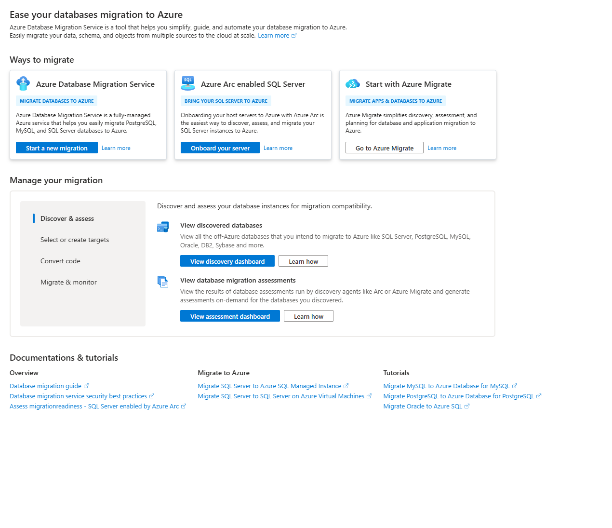
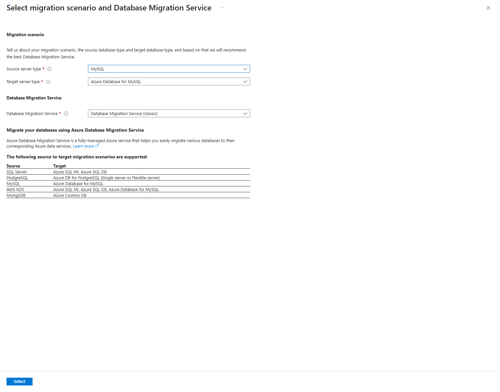
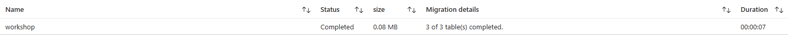
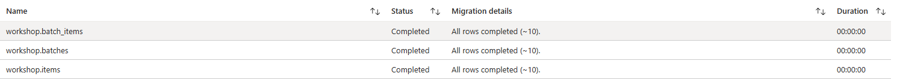

# MySQL — 현재 DMS 경험에서 작업·데이터 결과 읽기

[English](./README.md) | 한국어


## 1. 학습 목표·모듈 경계


- 대상: RDS/Aurora MySQL 또는 일반 MySQL의 Azure 이전을 검토하는 엔지니어.
- 목표: **현재 MySQL용 DMS source/target·schema/data 작업·진행/오류·결과와 offline/online 차이**를 이해합니다.
- 기본은 Portal/native DMS이며 `mysqldump`는 선택 비교입니다. SQL Server용 DMS Portal 화면·PostgreSQL 전용 서비스와 같은 경험이라고 설명하지 않습니다.
- 예상: 읽기 30분, 선택 합성 source/target·service 준비 45~60분, migration/확인/정리 45~60분 + 준비/job 대기. 실제 시간은 기록합니다.

| 모드 | 최소 입력 | 범위 |
|---|---|---|
| A: 개념/walkthrough | 공식 문헌·source SQL·합성 사례 | Azure/AWS 로그인·DB·job 생성 없이 읽기 |
| B: DMS 합성 실습 | 승인된 private MySQL source·빈 private Flexible Server target·DMS/권한/network/비용 | native connection/input 검사 → 별도 승인한 offline schema/data activity → 독립 비교 |
| C: 선택 비교 | 별도 승인된 local source/target·현재 MySQL utility | 작은 dump/restore 비교. DMS 성공으로 보고하지 않음 |

PostgreSQL·SQL Server·컴퓨트·Terraform·공통 앱을 완료할 필요 없습니다. 실제 AWS는 만들지 않습니다. B의 준비된 source는 **현재 DMS가 지원하고 연결할 수 있는 합성 MySQL DB**이며 local Docker만 있다고 service reachability가 준비된 것이 아닙니다.


## 2. 서비스·도구 소개와 선택


### 2.1 DMS 개념과 엔진별 선택을 실제 Portal에서 읽기



*실제 Portal 소개 콘텐츠만 캡처했습니다. 계정·다른 리소스/비밀을 제외했습니다. 사용할 version/target/mode의 지원은 공식 문헌에서 확인하고 native assessment 결과를 별도로 읽습니다.*

**Start a new migration**을 눌러 source/target을 고르는 폼을 열고 **MySQL**로 변경했습니다. 실제 화면은 **Azure Database for MySQL + Database Migration Service (classic)**를 추천했습니다.



1. Source의 engine·version·TLS/table engine을 확인합니다. AWS RDS에 도달할 수 없으면 실제 source 이전을 실행하지 않습니다.
2. Target/mode·service tier·private 연결·권한·비용을 정한 뒤 native service를 준비합니다. 이 화면의 legacy 지원 표만으로 다른 engine/Single Server까지 current 지원으로 확정하지 않습니다.
3. 관리형 DMS의 validation/task/table error와 SQL schema/data 검증을 연결합니다. `/items` 앱 재배포나 SQL dump만으로 DMS job 성공이라고 하지 않습니다.

| 서비스/도구 | 소개 링크 | 이 모듈에서 볼 내용 |
|---|---|---|
| Azure DMS | [DMS 개요](https://learn.microsoft.com/en-us/azure/dms/dms-overview), [엔진별 지원](https://learn.microsoft.com/en-us/azure/dms/resource-scenario-status) | 선택 source/target·migration 기능과 지원 |
| MySQL migration 경험 | [현재 MySQL offline tutorial](https://learn.microsoft.com/en-us/azure/dms/tutorial-mysql-azure-mysql-offline-portal) | MySQL용 instance/project/activity·offline 결과 |
| MySQL Flexible Server | [Target 서비스 개요](https://learn.microsoft.com/en-us/azure/mysql/flexible-server/overview) | 관리형 DB·version·network·운영 책임 |
| VNet | [VNet 개요](https://learn.microsoft.com/en-us/azure/virtual-network/virtual-networks-overview) | DMS/source/target의 실제 연결 |
| Azure RBAC | [RBAC 개요](https://learn.microsoft.com/en-us/azure/role-based-access-control/overview) | 관리 권한과 DB privilege의 구분 |

이전 `tutorial-mysql-azure-mysql-online` URL은 현재 위 offline-portal 문서로 이동합니다. URL 이름을 지원 방식의 근거로 쓰지 않습니다. 현재 문헌은 MySQL 5.7/8.0/8.4 target과 lower→higher version을 설명하지만, 실제 support·권한·SQL mode·앱 호환성은 따로 확인합니다.

현재 참고 MySQL offline 문헌은 **Premium pricing tier**를 요구합니다. 기본 자료 읽기에는 resource가 필요 없으며 B는 실제 지원/SKU·가격·예산을 승인한 경우에만 후보로 둡니다. 저렴한 tier에서 같은 동작을 보장하거나 CLI wrapper로 대체하지 않습니다.


## 3. 사전 준비·권한·비용


- A는 문서/SQL만 읽습니다. B 제어 환경은 **Azure portal**, SQL은 승인된 MySQL client/Workbench 등을 사용합니다.
- 기본 합성 source는 MySQL 8.0 계열 후보이며 CHECK enforcement를 위해 승인된 **8.0.16 이상**을 검토합니다. target은 current Flexible Server·DMS 지원 version/patch를 별도 확인합니다.
- 이 source는 VM에 DB engine을 추가하지 않고 작은 private MySQL Flexible Server를 사용했습니다. source 8.0.46·target 8.4.9이며 관리 API의 source version 식별자 `8.0.21`과 실제 `SELECT VERSION()` 값은 구분합니다. 기존 private VM은 승인된 client만 제공하며 PostgreSQL source를 변경하지 않았습니다.
- source와 새 target DB는 `workshop`, tables는 InnoDB입니다. 실제 RDS/Aurora 특성·table engine·collation/charset·SQL mode·권한은 추가 assessment 대상입니다.
- 새 DMS instance/project·target 관리 권한과 engine user/DDL/data privilege를 나눠 준비합니다. source에는 선택 schema를 읽을 권한, target에는 현재 native 동작에 필요한 schema/data 권한이 필요합니다.
- views/triggers/routines/events가 있는 실제 source는 별도 privilege·지원 검토가 필요합니다. 기본 sample에 없다고 customer source에도 없다고 하지 않습니다.
- source/target credentials는 native service의 승인된 경로에만 입력하고 argv·SQL·Git·Copilot에 넣지 않습니다. 현재 인증 방식이 engine credential이면 선택 native 도구의 실제 인증 방식과 지원을 확인합니다.
- [connection.example.json](./lab/connection.example.json)은 placeholder이며 source/target별 실제 connection JSON은 owner 전용 private 파일로 준비합니다. 관리·join 권한은 새 모듈 그룹/subnet에만 제한합니다. Native task의 `input`에는 보호/암호화된 credential 필드도 있으므로 전체 응답을 공유하지 않습니다.
- DMS network에서 source/target의 MySQL 3306·DNS·TLS와 필요한 outbound/service endpoint를 검토합니다. DB를 모든 IP에 공개하거나 TLS/인증서를 끄지 않습니다.
- source/target private subnet·DNS·public Disabled와 DMS subnet의 필요한 endpoint/outbound를 확인합니다. native TLS encryptConnection과 SQL client VERIFY_IDENTITY/CA를 구분하고 지원되지 않는 generic SQL trustServerCertificate 필드를 MySQL connection에 넣지 않습니다.
- source가 private이면 승인된 연결을 먼저 준비합니다. 기본을 위해 VPN/ExpressRoute·고가 network를 자동 추가하지 않으며 조건이 없으면 A/강사 자료로 제한합니다.
- 비용은 DMS의 해당 실제 tier·Flexible Server/storage/backup·필요 synthetic source/network입니다. [가격 계산기](https://azure.microsoft.com/en-us/pricing/calculator/)와 현재 지원을 승인합니다. PostgreSQL의 서비스 비용 모델을 그대로 적용하지 않습니다.
- 이 소량 구성은 source B1ms 1 vCore, target D2ads_v5 2 vCore·각 32 GiB/HA 없음, Premium_4vCores DMS입니다. 주요 추가 compute는 약 USD 0.596/시간, 두 DB storage 합계 약 USD 8.38/월이며 기존 비용/backup 등은 별도입니다. 큰 workload 권장 compute와 작은 실습 선택을 구분하고 무료 credit을 가정하지 않습니다.
- source와 target·service는 새 교육 전용 범위입니다. 기존 운영 server를 read-only·truncate·parameter 변경 대상으로 가져오지 않습니다.


## 4. 순서별 instruction — B는 선택 범위 승인 후 실행


### 4.1 MySQL 사례와 source 조건 읽기


[계획](../planning/README-ko.md)의 `mysql-sample`을 선택합니다. [공통 DB sample](../../../shared/database-sample/README-ko.md)은 PostgreSQL과 **같은 의미의 합성 3 tables·30 rows**를 제공하지만 한 엔진만 수강해도 됩니다.

source version·table engine·charset/collation·SQL mode·쓰기 활동·native support·network·credentials/privilege의 known/unknown을 나눕니다. Aurora/RDS source가 없으면 실제 AWS 이전은 별도 source가 필요한 범위로 구분하고 준비된 일반 MySQL source와 혼동하지 않습니다.


### 4.2 새 합성 source만 준비


1. 교사/DB 관리자가 새 synthetic source DB `workshop`를 준비합니다. source owner·server/session과 DB를 대조합니다.
2. [MySQL schema](./lab/schema.sql)를 source에 한 번 실행합니다. InnoDB·PK/FK/CHECK/unique를 읽습니다.
3. [seed.sql](../../../shared/database-sample/seed.sql)을 **source에만 한 번** 실행합니다.
4. 읽기 전용 [verify.sql](../../../shared/database-sample/verify.sql)의 baseline을 기록합니다.
5. 기대값은 table별 10, total 30, join 10, quantity sum 55와 정렬된 10행입니다.

MySQL client를 쓰면 정확한 `--database=workshop`·TLS/CA·password prompt·오류 중단을 적용하고 `--force`로 SQL 실패를 무시하지 않습니다. DDL은 implicit commit이므로 중간 실패 후 일부 table이 남을 수 있습니다. 자동 DROP/TRUNCATE/reseed를 하지 않습니다.

target에 seed하면 data가 이전된 결과인지 알 수 없으므로 **seed는 source-only**입니다. schema/data SQL은 MySQL 8.0.46 local에서 확인했고 재현 범위는 [공통 SQL 검증](../../../shared/database-sample/README-ko.md)을 따릅니다. 이 결과는 DMS job이나 RDS/Aurora 검증이 아닙니다.


### 4.3 Portal — 새 target·현재 MySQL DMS 경험 준비

1. 승인된 tenant/subscription/region에 작은 새 MySQL Flexible Server target과 전용 group `rg-amw-mysql-<lab-id>`를 준비합니다.
2. target version/patch·network/TLS·storage/backup·price·DDL/data privilege를 source와 비교합니다. HA/read replica·큰 data를 기본 추가하지 않습니다.
3. 현재 MySQL DMS 문헌/Portal이 제공하는 instance·tier·network 경로를 대조합니다. 승인된 경우에만 새 service를 준비합니다.
4. 고유 migration project를 만들고 **source MySQL → target Azure Database for MySQL**의 현재 선택을 확인합니다. SQL Server target·현재 SQL용 DMS 화면과 이름만 치환하지 않습니다.
5. 아직 입력/승인이 안 됐으면 **Create project only**와 실제 activity 실행을 구분합니다.
6. Portal이 해당 경로를 제공하지 않거나 지원/가격을 확정하지 못하면 중단하고 기록합니다. 자료 문헌을 현재 service 실행 성공으로 쓰지 않습니다.

**관찰할 결과:** 새 service/project·실제 source/target·network·지원과 비용의 준비 상태입니다. 아직 migration job은 시작하지 않습니다.


### 4.4 Source·target·schema/table 선택과 위험 읽기


1. native 경험에서 source/target 접속·credential·TLS·선택 DB를 입력/확인합니다.
2. source/target DB mapping은 `workshop` 한 개만, 나머지 DB는 제외합니다. 이름이 같다고 자동 선택된 target을 그대로 승인하지 않습니다.
3. 현재 경험의 schema migration 지원을 확인합니다. data-only 경로라면 교사가 승인한 **빈 schema-only 준비**를 구분하고 target에 seed하지 않습니다. 필요한 DDL도 실제 새 target와 지원을 대조한 뒤 별도 승인합니다.
4. 선택 table 3개·FK/constraint·target 빈 상태·실제 action을 검토합니다.
5. 문헌의 **Make Source Server Read Only**는 특정 DB가 아니라 **server 전체**에 영향을 줄 수 있습니다. 기본으로 선택하지 않고 source owner와 다른 DB 영향을 확인합니다. 이 synthetic DB의 source writes만 통제하는 방법을 정합니다.
6. 문헌의 기존 target table 선택은 migration 전에 **truncate**할 수 있습니다. **기존 data가 있는 target은 이 기본 실습 조건이 아니므로 중단**합니다. 클릭해서 덮거나 재실행하지 않습니다.
7. 현재 precheck/validation/error·connection·privilege·support 결과를 읽고 미해결 항목이 있으면 migration을 시작하지 않습니다.

**관찰할 결과:** 어떤 DB/table·DDL/data action과 source 범위의 변경을 승인하는지 설명합니다. 위험 checkbox와 이전 결과를 구분합니다.


### 4.5 승인된 offline activity와 native 상태 읽기


1. source writes가 통제됐고 baseline/backup·복구·target 빈 상태가 확인됐는지 대조합니다.
2. activity 이름·source/target/table·mode·영향·비용을 Summary에서 확인합니다.
3. 승인을 받은 뒤 **Start migration** 또는 현재 해당 action을 수행합니다.
4. initializing/running·DB/table별 완료/실패·row 진행·error를 읽습니다. 반영/처리 대기를 success-shaped 기본값으로 바꾸지 않습니다.
5. native activity가 완료되면 4.6의 data/schema 비교를 합니다. source는 보존합니다.

online은 별도 확장입니다. binlog/replication·source privilege·PK/제약·retention/change rate·lag·cutover/source 영향과 현재 도구 지원을 먼저 확인합니다. server의 global parameter를 자동 변경하거나 무중단을 약속하지 않습니다.

이미 실행한 activity의 결과는 **Azure Database Migration Service (classic) → 승인된 owned service/project → 선택 Offline activity → Database results → workshop**에서 읽습니다. DB 상태·table 완료 진행·표시 용량·activity 시간을 확인하며 결과 조회를 위해 migration을 다시 시작하지 않습니다.



*작은 예시 결과는 Completed·3 of 3 tables·0.08 MB·00:00:07입니다. 표시 용량·시간은 service 진행 요약이지 정확한 byte 비교나 source/runtime 준비·validation·교육·정리까지 포함한 회차 시간이 아닙니다.*

`workshop`의 **Migration activities / table results**에서 매핑한 `workshop.batch_items`·`workshop.batches`·`workshop.items`를 모두 읽습니다.



*각 table은 Completed / All rows completed와 근사 행 수(~10)·반올림 시간 00:00:00을 보여줍니다. 근사 count와 표시상 0초는 정확한 행 일치나 순간적인 이전을 증명하지 않습니다. 다음의 독립 schema·전체 정렬 행·TLS 검증까지 진행합니다.*


### 4.6 동일한 읽기 query로 source/target 비교

독립 비교로 **workload table별 정확히 10행·전체 정렬 30행**, schema 일치·source baseline 불변과 검증된 SQL TLS connection을 확인합니다. Portal의 근사 진행값으로 해당 결과를 대신하지 않습니다.


선택 DB `workshop`와 source 동결 상태를 확인합니다. [verify.sql](../../../shared/database-sample/verify.sql)을 source와 target 각각 읽기 실행합니다.

| 확인 | 기대 기준 |
|---|---|
| Schema/engine | 매핑한 workload InnoDB 3 tables, column/type/charset/collation·PK/FK/CHECK/unique의 실제 지원. 추가 service artifact는 별도 조사/기록 |
| Counts | 각 10, total 30 |
| Representative query | join 10, quantity sum 55 |
| 정렬된 결과 | id/label/name/quantity의 10행이 source/target에 일치 |
| Service evidence | 실제 activity·단계별 warning/error·schema/data action·미확인 범위 |

같은 count/sum만으로 전체 source 호환성·정합성을 인증하지 않습니다. 실패하면 mapping·source 변경·native skip/error·schema/constraints·engine 차이를 확인합니다.

**공통 앱은 아직 memory API이며 DB adapter가 없습니다.** 앱 연결은 선택 확장으로 별도 작성·검증하고 이 단계에서 구현/연결 성공을 표시하지 않습니다.

[compare-native.py](./verify/compare-native.py)는 workload 3개의 engine/column/keys/CHECK/data를 엄격히 비교합니다. 추가 객체는 이름·빈 행·조사한 metadata column shape가 일치하는 이 하나만 별도 serviceArtifacts로 기록합니다. 다른 extra table은 실패이며 이 처리를 모든 source/DMS artifact에 적용하는 범용 규칙으로 설명하지 않습니다.


### 4.7 공식 native CLI/task 대안


관리 CLI에는 `az dms`가 classic으로 표시됩니다. 이름만으로 MySQL 지원 종료나 SQL DMS와 동일한 경험이라고 결론내리지 않습니다. 현재 provider/SKU·runtime의 supportedTaskTypes와 공식 MySQL 문헌을 대조해 다음 native 사전 검사와 실제 migration을 구분합니다.

- source `ConnectToSource.MySql`, target `ConnectToTarget.AzureDbForMySql` task: Succeeded, expanded output의 validationErrors 없음.
- `GetUserTablesMySql`: workshop의 정확한 3개 InnoDB table/hasRows를 실제 service가 확인.
- `ValidateMigrationInput.MySql.AzureDbForMySql`: 실제 agent가 지원하며 Succeeded·errors 없음. PostgreSQL의 Validate option이나 SQL-only CLI validation flags를 그대로 넣지 않습니다.
- `Migrate.MySql.AzureDbForMySql`: 사전 검사 이후 별도 승인을 받은 실제 offline schema/data activity.

다음은 **필요한 관리 권한을 가진 private Linux/VM Bash** 예입니다. Source/target protected connection 파일과 [database-options.example.json](./lab/database-options.example.json)을 실제 승인된 입력으로 준비합니다. 이 명령은 복사를 시작할 수 있으므로 사전 검사·빈 target·writer 중단·별도 시작 승인 전에는 실행하지 않습니다.

```bash
: "${DMS_GROUP:?Set the approved new group}"
: "${DMS_SERVICE:?Set the approved Premium service}"
: "${DMS_PROJECT:?Set the approved MySQL project}"
: "${DMS_ACTIVITY:?Set a unique approved activity name}"
: "${SOURCE_CONNECTION_FILE:?Set the owner-private source file}"
: "${TARGET_CONNECTION_FILE:?Set the owner-private target file}"
: "${DATABASE_OPTIONS_FILE:?Set the approved workshop-only options file}"
: "${AZURE_SUBSCRIPTION_ID:?Set the approved subscription}"
az dms project task create --name "$DMS_ACTIVITY" --project-name "$DMS_PROJECT" \
  --service-name "$DMS_SERVICE" --resource-group "$DMS_GROUP" --task-type OfflineMigration \
  --source-connection-json "$SOURCE_CONNECTION_FILE" \
  --target-connection-json "$TARGET_CONNECTION_FILE" \
  --database-options-json "$DATABASE_OPTIONS_FILE" --subscription "$AZURE_SUBSCRIPTION_ID" \
  --query '{name:name,state:properties.state,type:properties.taskType}'
az dms project task show --name "$DMS_ACTIVITY" --project-name "$DMS_PROJECT" \
  --service-name "$DMS_SERVICE" --resource-group "$DMS_GROUP" --expand output \
  --subscription "$AZURE_SUBSCRIPTION_ID" \
  --query '{state:properties.state,type:properties.taskType,errors:properties.errors,output:properties.output}'
```

Task show에서 output=null이 나오면 expanded output을 조회합니다. `--expand output`으로 실제 server/database/table·validationErrors를 읽습니다. 일부 newer task subtype은 설치된 SDK가 output을 표현하지 못할 수 있으므로 supported runtime/native API와 shape를 확인하고 필요한 metadata만 출력합니다. Windows az.cmd에 `&`가 있는 REST URL을 직접 넘기면 뒤의 expand/query가 분리될 수 있으니 공식 CLI의 expand option 또는 같은 설치 CLI의 안전한 호출을 사용합니다. 암호화된 secure input도 공개하지 않습니다.

읽기 비교 프로그램은 승인된 private client에 전달한 뒤 **그 파일이 있는 VM/Linux Bash 폴더**에서 실행합니다. owner-private `credentials.json`과 source/target `-client.cnf`, 원본 `verify.sql`/baseline이 작업 폴더에 필요합니다. 예제 DB/user는 workshop/workshopadmin이며 실제 고객의 범용 비교 도구가 아닙니다.

```bash
python3 compare-native.py "$MYSQL_PROTECTED_DIRECTORY" "$AZURE_SUBSCRIPTION_ID" \
  "$DMS_GROUP" "$DMS_SERVICE" "$DMS_PROJECT" "$DMS_ACTIVITY"
```

이 프로그램의 성공은 매핑한 workload·native result와 별도로 명시한 service artifact 기준입니다. 전체 target이 source와 물리적으로 동일하다거나 login/system object·앱 호환성까지 검증한 것은 아닙니다. Run Command 외부 성공만 확인하지 말고 guest 실패와 `AMW_MYSQL_NATIVE_COMPARE_PASS`의 실제 수치도 확인합니다.


### 4.8 Utility 비교와 cutover/rollback


[컷오버·롤백](../cutover/README-ko.md)의 카드/runbook을 사용할 수 있습니다. server 전체 readonly 옵션이나 기존 target 변경은 그 read-only client 연습에 자동 포함하지 않습니다.

`mysqldump`/MySQL client 복원의 logical backup·schema/data·권한·client version·routines/events 등 목적을 선택 비교합니다. synthetic source/target 외의 data를 dump하지 않습니다. credential은 argv·공유/추적 파일에 넣지 않고 승인된 owner-private option 파일 등 현재 도구의 안전한 입력 방법을 사용합니다.

dump/restore 완료는 DMS activity 성공이 아닙니다. 실제 cutover는 [계획](../planning/README-ko.md)의 쓰기 정지·최종 확인·승인·connection/DNS·관찰/rollback을 따릅니다. target 새 writes 뒤 source로 접속만 되돌리는 것은 data rollback이 아닙니다.


## 5. 대표 실패


| 실패 | 확인할 것 |
|---|---|
| 예상 MySQL project/tier/메뉴 없음 | current 문헌·engine/target/region·실제 경험·지원. SQL DMS/old URL로 성공을 가정하지 않음 |
| native connection/403/privilege 오류 | 관리 역할과 DB user·DNS/network/TLS·필요 source/target privilege를 분리 |
| table engine/version/CHECK 차이 | InnoDB·current source/target version·constraint enforcement/SQL mode 확인 |
| source load 중 일부 table만 생김 | MySQL DDL implicit commit·client 오류 중단 확인. 자동삭제/reseed로 숨기지 않음 |
| target에 기존 data/readonly 영향 | 작업을 중단하고 선택 target/source 범위·owner·backup을 다시 검토 |
| activity 완료·query 불일치 | schema/table mapping·FK/charset·source 변화·failed/skipped·native 처리 범위 확인 |


## 6. 정리 — service/job·source/target·비용은 분리


A는 Azure 삭제 대상이 없습니다. B/C를 실제 실행했다면 owner·보존/rollback·source 영향과 actual resource 목록을 대조합니다.

1. 실행 중 activity/sync·source server readonly 변경 등 실제 설정 상태를 확인합니다. 만들지 않은 기존 설정을 임의로 되돌리지 않습니다.
2. DMS project/activity 삭제와 instance·network·target DB/server 삭제가 다른 작업임을 확인합니다.
3. 새 target/service 그룹의 lab 식별·resource·관련 역할/credential·backup을 확인하고 승인 후 자신이 만든 것만 정리합니다.
4. 외부 강사 source·network·다른 DB·다른 migration project는 변경/삭제하지 않습니다. 자기 synthetic source도 보존/backup·owner 승인 뒤 정리합니다.
5. 실제 resource·data·role/network·요금과 남은 사용을 확인합니다. Premium instance를 잊고 activity만 지우지 않습니다.
6. 임시 dump는 해당 정확한 파일만 정리하고 입력 SQL·전체 작업 폴더를 일괄 삭제하지 않습니다.

일반 customer table의 DROP/TRUNCATE·server 전체 readonly·폭넓은 source 삭제 명령은 자동 준비/정리 단계에 넣지 않습니다.


## 7. 실제 이전에서 추가로 고려할 사항


- RDS/Aurora 기능·MySQL version·InnoDB·charset/collation·SQL mode·definer·trigger/routine/event.
- source/target user·TLS·backup·binlog/retention·data 변화량·일관성·cutover/rollback.
- service tier/region·연결·egress·quota·target 성능·관측·운영 인계.
- 작은 offline sample은 실제 AWS/production 이전·online 운영 지원을 인증하지 않습니다.


## 8. 출처


- InnoDB schema·공통 data/읽기 query·instruction은 직접 작성했고 customer DB·서비스 결과·외부 dataset을 복사하지 않았습니다.
