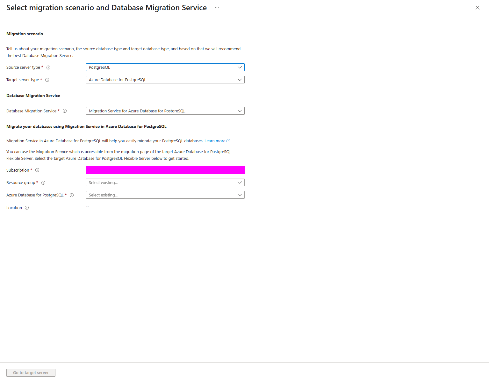
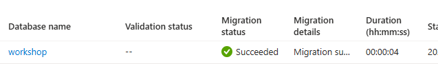

# PostgreSQL — read validation and migration results in the dedicated service

English | [한국어](./README-ko.md)

Use Migration Service for Azure Database for PostgreSQL, not a generic DMS Classic task or custom CDC engine. Learn native validation, offline copy and independent schema/data evidence.

## 1. Learning objectives and module boundaries

For RDS/Aurora/general PostgreSQL users. Choose reading (30 minutes), approved reachable synthetic source/empty target with native Validate/offline migration (45–60 minutes preparation plus 45–60 minutes exercise), or a separate utility comparison. No MySQL/SQL Server/compute/IaC/shared-app completion is needed. No real AWS environment was constructed; a synthetic Azure source/target teaches the workflow without proving RDS/Aurora readiness. Teacher-provided source inputs do not imply a required compute course.

## 2. Service introductions and selection

Open the Microsoft Learn introductions below before choosing a deployment or migration tool. Compare responsibilities, identity, network boundaries and lifecycle rather than treating AWS and Azure product names as one-to-one equivalents. A service resource, a running job and a verified application or dataset are separate outcomes.

### 2.1. Compare DMS introduction with PostgreSQL's dedicated service

Read the common DMS introduction and select PostgreSQL in Start a new migration. The recommended target is Azure Database for PostgreSQL with its dedicated Migration Service, typically entered from the target Flexible Server's Migration page. DMS as a broad label does not mean MySQL/SQL/PostgreSQL share a task/API. Inspect the screenshot as a service-selection example, not a native job or target connection result.



*Portal illustration: observe the selected service and fields. Visible defaults are not approved deployment inputs; confirm the current interface and your own scope.*

**Resources for this step**

- [Database mysql](../database-mysql/README.md#21-introduce-dms-and-compare-engine-selection-in-the-portal)
- [Overview migration service postgresql](https://learn.microsoft.com/en-us/azure/postgresql/migrate/migration-service/overview-migration-service-postgresql)
- [Overview](https://learn.microsoft.com/en-us/azure/postgresql/flexible-server/overview)
- [How to network setup migration service](https://learn.microsoft.com/en-us/azure/postgresql/migrate/migration-service/how-to-network-setup-migration-service)
- [Overview](https://learn.microsoft.com/en-us/azure/role-based-access-control/overview)

## 3. Prerequisites, permissions and cost

Use the Portal for native setup and an approved SQL client for source-only load and comparison, or the explicit official CLI alternative. Approve engine/source/target versions, extensions, region, target/runtime costs and management roles separately from DB privileges. Use protected service properties/credential files, not argv/SQL/Git/prompts/full secretParameters output. Check real service DNS/TLS/5432/pg_hba connectivity; local Docker is not Azure reachability. A private VM source with a VNet-integrated target differs from a Private Endpoint-only target that may need a migration runtime server for outbound source access. Check native-worker SSL/CA/hostname requirements separately from the SQL client's verify-full settings. Do not infer unlimited quota from a failed quota query. Use only an approved sandbox, synthetic data and the selected module's minimum inputs. Do not place credentials, account identifiers, real customer inventory or sensitive output in Git, prompts or shared screenshots. Confirm tenant, subscription, region, quota, cost and the resource owner; do not change the participant's default subscription or broaden access to make an error disappear.

**Resources for this step**

- [Migration.example.json](./lab/migration.example.json)
- [Concepts migration service runtime server](https://learn.microsoft.com/en-us/azure/postgresql/migrate/migration-service/concepts-migration-service-runtime-server)
- [Concepts known issues migration service](https://learn.microsoft.com/en-us/azure/postgresql/migrate/migration-service/concepts-known-issues-migration-service)
- [Calculator](https://azure.microsoft.com/en-us/pricing/calculator/)

## 4. Step-by-step lab

Choose only the mode that matches your objective and available inputs. Read the full step, its execution environment and expected observation before running its commands. Use approved synthetic sandbox inputs. Obtain approval for resource creation, role assignments, writes and destructive actions separately.

### 4.1. Choose source, target and owner

Use the PostgreSQL synthetic planning case and common three-table/thirty-row dataset. Specify source owner, fresh rg-amw-pg-<lab-id>/target, optional runtime, network/role/cost and retention. Do not reuse an existing populated target. Deliver actual credentials only through the approved service/private path.

**Resources for this step**

- [Planning](../planning/README.md)
- [Database sample](../../../shared/database-sample/README.md)

### 4.2. Seed only the fresh synthetic source

A DB administrator prepares new workshop/public and confirms the actual server/session/owner. Use SET search_path = public for the selected comparison scope. Run the engine schema, common seed once and read-only verify.sql baseline only on source. psql requires ON_ERROR_STOP=1 and approved TLS settings. Reject existing objects/data, and do not DROP/TRUNCATE/reseed to hide failure. Verify three workload tables, ten rows in each and thirty total. The representative join returns ten ordered rows and quantity sum 55. Compare actual columns, types, nullability, PK/FK/CHECK/unique constraints and all small ordered results, not only counts or sums. Seed the source once; do not seed the migration target. The shared memory API has no DB adapter, so SQL client success is not application DB connectivity.

**Resources for this step**

- [Source schema](./lab/schema.sql)
- [Source-only synthetic seed](../../../shared/database-sample/seed.sql)
- [Read-only verification queries](../../../shared/database-sample/verify.sql)
- [Database sample](../../../shared/database-sample/README.md)

### 4.3. Prepare a new Flexible Server and native task

Approve a small supported target with appropriate storage/backup/network/TLS and current source compatibility. Open Migration → Create, select the actual synthetic source type and workshop only. Begin with Validate, not Validate and migrate, which can start real copy on successful checks. Choose Offline, review connection/TLS/runtime and empty target, then inspect connection failures before continuing. Accepted asynchronous creation is not Ready; use the official show/wait path rather than duplicate creation or interpreting provisioning-null fields as final network settings.

### 4.4. Read native validation before authorizing copy

Approve validation scope and read server/DB checks, warnings and errors for version/extensions/parameters/roles/connections/schema. Unresolved failures stop migration; a connection test or validation success does not certify app performance or changing source compatibility. In the official CLI explicitly set migration-option Validate; the default ValidateAndMigrate may copy. Keep overwriteDbsInTarget False and independently confirm an empty target. The properties schema uses supported True/False string enums for fields such as startDataMigration/overwrite; do not substitute guessed booleans/defaults. Filter public output and protect full credential-bearing responses.

```bash
: "${PG_GROUP:?Set the approved new PostgreSQL group}"
: "${PG_TARGET:?Set the approved private target}"
: "${PG_VALIDATE_NAME:?Set a unique validation name}"
: "${PG_PROPERTIES_FILE:?Set the owner-private properties file path}"
: "${AZURE_SUBSCRIPTION_ID:?Set the approved subscription}"
az postgres flexible-server migration create \
  --resource-group "$PG_GROUP" --server-name "$PG_TARGET" --name "$PG_VALIDATE_NAME" \
  --properties "$PG_PROPERTIES_FILE" --migration-mode offline --migration-option Validate \
  --subscription "$AZURE_SUBSCRIPTION_ID" \
  --query '{name:name,option:migrationOption,mode:migrationMode,status:currentStatus}'
az postgres flexible-server migration show \
  --resource-group "$PG_GROUP" --server-name "$PG_TARGET" --name "$PG_VALIDATE_NAME" \
  --subscription "$AZURE_SUBSCRIPTION_ID" \
  --query '{name:name,option:migrationOption,mode:migrationMode,status:currentStatus}'
```

**Resources for this step**

- [Migrations](https://learn.microsoft.com/en-us/azure/templates/microsoft.dbforpostgresql/2024-08-01/flexibleservers/migrations)

### 4.5. Start only the approved offline migration

Confirm controlled source writers, baseline, backup/recovery and owner. After validation and separate copy approval, use actual native migration inputs, Migrate/Offline with startDataMigration True, overwrite False and deliberate role-migration policy. Observe overall/DB stages, table progress and errors. Native failures call for supported diagnosis, not a new retry/CDC platform. A read-only session default can be overridden by its owner and is not a replacement for operational writer shutdown. Online is a separate extension requiring replication/PK/privilege/change-rate/cutover review.

### 4.6. Compare source and target with identical read-only queries

Open the approved **target Flexible Server → Migration → selected offline migration → database details**. Read the row for **`workshop`**, including Migration Succeeded and the migration message.



*The illustrated DB row shows Migration Succeeded / Migration successful with a displayed database duration of 00:00:04. Database-stage duration and overall job duration cover different work. Read service completion together with the independent schema, complete-row, TLS and source-baseline checks below.*

For the supplied synthetic schema, compare **8 columns, 7 PK/FK/CHECK/unique constraints and all 30 rows**. Require the native offline job's three completed tables and no table errors, an unchanged original source baseline, and independently verified source/target SQL connections using `verify-full`. Keep NOT NULL column attributes distinct from version-dependent constraint-catalog entries.

Verify three workload tables, ten rows in each and thirty total. The representative join returns ten ordered rows and quantity sum 55. Compare actual columns, types, nullability, PK/FK/CHECK/unique constraints and all small ordered results, not only counts or sums. Seed the source once; do not seed the migration target. The shared memory API has no DB adapter, so SQL client success is not application DB connectivity. The linked compare-native.py additionally reads actual native status/table counts, columns and keys. Execute only on the approved private Linux client after safely providing the script and protected credentials.json/source CA/original verify SQL/baseline. Use verify-full for each SQL connection according to its trust chain. NOT NULL is compared as a column property; PostgreSQL versions may represent it differently in pg_constraint, so raw catalog counts are not equivalent. Require AMW_PG_NATIVE_COMPARE_PASS with actual values and reject guest failures. Send large source as a script payload, not a long base64 Windows az.cmd parameter.

```bash
python3 compare-native.py \
  "$PG_SOURCE_HOST" "$PG_TARGET_HOST" "$PG_PROTECTED_DIRECTORY" \
  "$AZURE_SUBSCRIPTION_ID" "$PG_GROUP" "$PG_TARGET" "$PG_MIGRATION_NAME"
```

**Resources for this step**

- [Read-only verification queries](../../../shared/database-sample/verify.sql)
- [Native result and database comparison](./verify/compare-native.py)

### 4.7. Optional utility comparison and cutover planning

Read pg_dump/pg_restore as logical-backup alternatives with client-version, role/globals, downtime and privilege boundaries. Execute only on separately approved synthetic inputs; a restore is not native service job success. Use the cutover cards for final sync/write freeze/go-no-go/client switch/observation and target-write recovery. Do not claim app DB connectivity without an adapter or call a connection reversal data rollback.

**Resources for this step**

- [Cutover](../cutover/README.md)
- [Planning](../planning/README.md)

## 5. Verification and common failures

Check actual service reachability/DNS/TLS/5432/runtime and DB authentication separately from Azure management rights. Inspect support/extensions/parameters/roles on validation errors and actual mapping/source changes/constraints/warnings on data differences. Avoid broad public access, TLS disablement and automatic reseeding. Require native status plus small full schema/data results; other source/version/topology, online behavior and application compatibility need distinct assessment.

## 6. Cleanup and ownership

List native tasks, target, optional runtime, synthetic source, backups/files/new roles and networks with their owners. Inspect cancellation/deletion effects and active sync. Delete only the new approved target/runtime assets; preserve teacher-provided source/network/credentials and source recovery inputs until retention approval. Job deletion alone does not stop DB cost. Remove only exact temporary dump/credential artifacts, not input SQL or all lab-output, and verify remaining resources/grants/charges.

## 7. Additional considerations for a real migration

Review RDS/Aurora features, major-version compatibility, extensions/collation/encoding/sequences/large objects/partitions/triggers, roles/parameters/superuser limits, connection pools and performance. Plan backups/RPO/RTO/change rate, consistency, cutover/rollback, networking/egress and operating ownership. Small offline learning results do not certify production support.

## 8. Sources and reuse

The workshop instructions and synthetic inputs were written for learning. Consult the official introductions and procedures linked here for the current support matrix, versions and regional availability. Documentation and illustrative screenshots are not a compatibility guarantee for a different source, target or topology. Keep third-party dependency licenses and notices intact.

**Resources for this step**

- [Tutorial migration service iaas offline](https://learn.microsoft.com/en-us/azure/postgresql/migrate/migration-service/tutorial-migration-service-iaas-offline)
