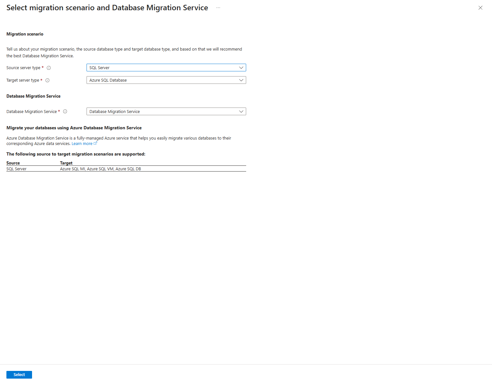
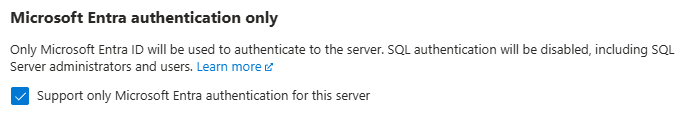

# SQL Server — 타깃부터 고르고 공식 이전 도구의 결과 읽기

[English](./README.md) | 한국어

**샘플 설정:** 제공 Blob 예제는 private endpoint/DNS·public Disabled·Entra data 인증·Shared Key/익명 금지·bypass None·resource-instance 예외 없음으로 구성합니다. 선택 lab의 승인 identity/network 입력과 관리자에게 적용 정책을 확인합니다. 제공 설정/TLS 검사는 유지하며 대안은 별도 지원 시나리오·승인을 따릅니다. 인증과 network는 다른 통제입니다.


## 1. 학습 목표·모듈 경계


- 대상: RDS SQL Server 또는 SQL Server의 Azure 타깃을 검토하는 엔지니어.
- 목표: **SQL Database·Managed Instance·SQL VM의 기능/운영 차이와 target별 DMS 경로**를 읽고, migration job과 실제 DB 결과를 구분합니다.
- 기본은 Portal/native service입니다. 자체 backup replay·CDC·scheduler나 CLI wrapper를 만들지 않습니다.
- 예상: 타깃·사례 읽기 30~45분, 선택 작은 DB/도구 준비 45~60분, migration/확인/정리 45~60분 + runtime/target 준비 별도. 실제 시간은 기록합니다.

| 모드 | 범위 | 요구하지 않는 것 |
|---|---|---|
| A: 기능/도구 선택·guided walkthrough | 합성 source 요구·문헌·지원/backup/runtime/cutover 흐름 | Azure/AWS 로그인·DB/backup/job 생성 |
| B: 작은 data-only offline 실습 | 승인된 SQL Server source·새 SQL Database target·current DMS/SHIR/권한 | SQL Agent·cross-database 기능의 보존 성공 주장 |
| B2: Entra-only SqlPackage offline 실습 | 승인된 SQL Server source·BACPAC·빈 Azure SQL Database·private client/MI·공식 Export/Import | DMS/SHIR·Blob upload·SQL 타깃 비밀번호·instance 기능 보존 |
| C: 준비된 MI/SQL VM 데모 | 보존 요구에 맞는 지원 source/backup·target·native 경로·승인 | 새 고가 MI/VM을 자동 생성하거나 참가자 production을 변경 |

PostgreSQL/MySQL·다른 컴퓨트·Terraform·공통 앱 완료가 필요 없습니다. **AWS SQL Server source는 RDS이며 Aurora가 아닙니다.** 현재 실제 AWS가 없어 B/C는 준비된 source·강사 데모만 후보이며 B2에서는 Azure 합성 source의 schema와 data를 옮깁니다.

`sqlserver-sample`의 SQL Agent·cross-database 요구를 값싼 SQL Database demo로 만족했다고 하지 않습니다. B는 그런 기능이 **없는 별도의 축소 데이터 실습**이고 원래 보존 요구의 정답/이전 검증이 아닙니다.


## 2. 서비스 소개와 타깃 선택


### 2.1 SqlPackage 실습에도 DMS/타깃 선택 소개를 포함한다



*서비스/시나리오 선택 화면만 캡처했습니다. Select 이후 배포·SHIR·source credential·job 실행은 하지 않았습니다. 타깃을 선택한 뒤 도구의 Entra 인증 지원과 source SQL Agent/cross-DB 기능의 보존 조건을 확인합니다.*

**소개와 실행을 분리합니다.** DMS의 관리형 runtime/task/진행·오류와 target 기능/인증·정책을 먼저 이해합니다. SQL 인증 도구와 강제 Entra-only 정책이 맞지 않으면 지원을 재검토하고 별도 승인한 B2 또는 walkthrough를 선택합니다. SqlPackage 결과를 DMS 성공으로 표현하지 않습니다.

| 타깃/도구 | Microsoft Learn 소개 | 핵심 비교 |
|---|---|---|
| Azure SQL Database | [SQL Database 개요](https://learn.microsoft.com/en-us/azure/azure-sql/database/sql-database-paas-overview) | DB 중심 PaaS·기능 제한·앱 변경 필요성 |
| SQL Managed Instance | [Managed Instance 개요](https://learn.microsoft.com/en-us/azure/azure-sql/managed-instance/sql-managed-instance-paas-overview) | instance/cross-database 호환성·운영/비용 |
| SQL Server on Azure VM | [SQL VM 개요](https://learn.microsoft.com/en-us/azure/azure-sql/virtual-machines/windows/sql-server-on-azure-vm-iaas-what-is-overview) | OS·SQL Server instance 제어·패치/backup 책임 |
| Azure DMS | [DMS 개요](https://learn.microsoft.com/en-us/azure/dms/dms-overview), [지원 매트릭스](https://learn.microsoft.com/en-us/azure/dms/resource-scenario-status) | native migration·지원 mode·job/status |
| Assessment | [SQL Server 이전 개요](https://learn.microsoft.com/en-us/data-migration/sql-server/overview) | source 호환성·기능/target 평가와 실행의 구분 |
| SqlPackage / DacFx | [SqlPackage 소개](https://learn.microsoft.com/en-us/sql/tools/sqlpackage/sqlpackage?view=sql-server-ver17) | 공식 schema/data portability·BACPAC Export/Import. DMS job·CDC·instance 전체 backup과 다름 |
| Entra-only | [Entra-only 인증 소개](https://learn.microsoft.com/en-us/azure/azure-sql/database/authentication-azure-ad-only-authentication?view=azuresql) | SQL login/user 연결을 허용하지 않음. client MI 인증과 DB 권한·private network를 따로 준비 |

| DMS 타깃 | Offline | Online | 선택에 중요한 것 |
|---|---|---|---|
| SQL Database | 문헌 지원 | 해당 경로 미지원 | SQL Agent/cross-database 요구를 이름만 바꿔 유지한다고 하지 않음 |
| Managed Instance | 문헌 지원 | 문헌 지원 | collocated DB·instance 기능·network/비용·login/job 등의 별도 이전 |
| SQL VM | 문헌 지원 | 문헌 지원 | OS/SQL 운영 책임·backup/restore·instance 설정·license |

Online도 최종 sync/cutover 중단이 생길 수 있습니다. 지원 매트릭스의 `Yes`는 내 source가 준비됐거나 해당 기능·암호화·login이 자동 이전된다는 뜻이 아닙니다.


B2 샘플은 Entra-only target·Managed Identity client를 사용합니다. 실행 전 선택 도구가 target의 구성된 인증·적용 정책을 지원하는지 확인합니다.

## 3. 사전 준비·권한·비용


- A는 문서/T-SQL 읽기만 합니다. B/C는 **Azure portal + 승인된 현재 SQL Server client/SSMS/sqlcmd**를 사용합니다. 폐기된 도구/extension 화면을 그대로 따라가거나 일반 .bak restore를 모든 target에 적용하지 않습니다.
- 기본 synthetic source는 SQL Server 2019 후보의 새 `workshop` DB입니다. source/target version·compatibility level·collation·client/driver와 서비스 지원을 확인합니다.
- Azure resource 관리, DB data/schema privilege, backup storage read, runtime 등록은 다른 권한입니다. 광범위한 subscription Owner·SQL sysadmin을 참가자 기본값으로 자동 부여하지 않습니다.
- current SQL Database schema migration 문헌은 data-only보다 넓은 source/target 권한과 **SHIR 최소 버전**을 요구할 수 있습니다. 정확한 해당 mode의 역할·scope·비용/영향을 관리자와 승인합니다.
- credentials·SHIR registration key·SAS·backup URL의 secret은 native 필드·승인된 저장 경로만 사용합니다. 코드/SQL·Git·Copilot·공유 screenshot에 넣지 않습니다.
- source/target/runtime/backup 경로의 DNS·TLS·engine/port·storage/network·필요 443 outbound를 확인합니다. TCP 1433 전체 공개·인증서 검사 해제를 기본 준비로 하지 않습니다.
- SHIR은 현재 선택 경로가 필요로 하고 source/target/backup에 접근 가능한 machine에만 준비합니다. 강사의 승인된 runtime을 입력받는 것이 다른 컴퓨트 트랙 수강 완료를 뜻하지 않습니다.
- 비용은 target·DMS/SHIR 준비·backup/임시 Blob·source·network/egress입니다. MI·SQL VM의 최소 크기/생성 시간·license 비용이 크면 **A/준비된 강사 데모**로 제한합니다. [가격 계산기](https://azure.microsoft.com/en-us/pricing/calculator/)와 지원 조건을 승인합니다.
- source TDE/암호화된 backup의 이전 지원과 target의 기본 at-rest encryption은 별도입니다. 현재 DMS 기능 경계를 확인하며 암호화를 끄거나 key를 export하는 자동 명령을 만들지 않습니다.
- B2는 [공식 SqlPackage 배포본](https://learn.microsoft.com/en-us/sql/tools/sqlpackage/sqlpackage-download?view=sql-server-ver17)과 source Windows 인증/TLS·target MI/Entra-only·Private Endpoint/DNS·빈 DB·보호된 artifact 폴더가 입력입니다. 새 source VM/다른 컴퓨트 실습은 필수가 아닙니다. 실제 회차는 승인된 private Windows VM을 source/client로 함께 썼습니다.
- **B2 Import 권한:** source BACPAC과 target user/schema 충돌을 확인합니다. 임시 Entra 관리자 context가 필요하면 새 isolated logical server에서만 별도 승인하고 원래 관리자·MI의 workshop DB 권한으로 즉시 복구합니다. 기존 운영 서버에는 적용하지 않습니다.


## 4. 단계별 instruction — 타깃 하나와 모드 하나


### 4.1 Source 요구를 읽고 잘못된 target 배제


[계획](../planning/README-ko.md)의 `sqlserver-sample`은 cross-database query·SQL Agent가 필요합니다. 먼저 현재 기능/의존성을 평가해 **MI/SQL VM 후보**를 비교하고 SQL Database를 자동 확정하지 않습니다.

실제 source의 user/role·login·job/operator·linked server·CLR/TDE·backup·compatibility를 known/unknown으로 나눕니다. 작은 3-table dataset은 그 기능을 표현하지 않으므로 data 결과가 같아도 instance 전체가 이전됐다고 말할 수 없습니다.

네이티브 assessment/readiness·target SKU 검토는 migration 실행과 별도입니다. current DMS Portal이 모든 assessment/SKU recommendation을 자체 수행한다고 가정하지 않습니다.


### 4.2 B/C용 source-only 합성 data


교사/DB 관리자가 승인된 새 synthetic source DB `workshop`와 `dbo` schema·client/error 중단 설정을 준비합니다. 현재 접속 server/DB·owner가 맞는지 확인한 뒤 다음을 **source에만 한 번** 실행합니다.

1. [schema.sql](./lab/schema.sql): 명시적 dbo의 `items`, `batches`, `batch_items`.
2. [seed.sql](./lab/seed.sql): PostgreSQL/MySQL과 같은 의미의 30 synthetic rows.
3. [verify.sql](./lab/verify.sql): 읽기 query로 baseline을 기록.

T-SQL은 `XACT_ABORT`·transaction·rollback/rethrow·DB 이름 guard를 사용합니다. 실행 전 server/owner를 대조해 새 합성 source인지 확인합니다.

client는 오류 중단을 적용하고 SQL 실패를 무시하지 않습니다. object/data가 있으면 중단하며 DROP/TRUNCATE/reseed로 덮지 않습니다. 공통 [PG/MySQL seed.sql](../../../shared/database-sample/seed.sql)은 dialect가 다르므로 SQL Server에 그대로 실행하지 않습니다.

target에 seed하거나 source login/role/job을 sample로 만들지 않습니다. SQL Agent/cross-database 기능 데모는 별도 source와 기준을 마련한 C에서만 합니다.


### 4.3 B — data-only SQL Database offline 후보 준비


SQL Agent/cross-database 요구와 별개인 축소 data-only 실습임을 먼저 선택합니다. source/target/mode·현재 도구 인증·SHIR·권한·network·비용·조직 정책이 맞을 때만 진행합니다.

SQL Database의 Entra 지원과 해당 DMS 연결의 Entra-only 지원은 다릅니다. SQL 인증이 조직 정책과 충돌하면 중단하고 지원되는 B2 또는 walkthrough를 선택합니다. 정책 예외 tag·Entra-only 해제·다른 subscription 탐색으로 우회하지 않습니다.

MySQL Premium DMS와 SQL migration service는 다른 resource/경험입니다. current SHIR version·기기 권장 조건·source와 runtime 분리·license·VM/disk/DB/backup/network 비용을 승인합니다. data-only CLI는 빈 target table이 필요할 수 있으며 Portal Migrate Missing Schema와 별도 schema 준비는 같은 단계가 아닙니다. target에는 seed하지 않습니다.

1. 전용 `rg-amw-sql-<lab-id>`·고유 target·빈 target DB `workshop`·DMS를 준비합니다. 운영/공유 target은 가져오지 않습니다.
2. 현재 [SQL Database offline Portal 절차](https://learn.microsoft.com/en-us/data-migration/sql-server/database/database-migration-service)를 읽고 source SQL Server→target Azure SQL Database·**offline**을 선택합니다.
3. 필요한 SHIR·version·연결·등록·권한을 준비합니다. 원격 machine 권한·registration key와 service/source 권한은 구분합니다.
4. source/target FQDN·TLS·engine credential·선택 DB·schema/data action을 확인합니다.
5. 빈 target에서 schema를 이전하려면 현재의 **Migrate Missing Schema**와 지원 object·권한을 검토합니다. 기존 schema/data를 자동 덮거나 seed하지 않습니다.
6. source DB 하나·3개 table·target mapping·migration 이름과 영향을 Summary에서 대조합니다.
7. source writes 통제·baseline/복구·시작 승인 후 native migration을 실행합니다.

현재 SQL Database 문헌은 일부 schema object의 오류가 발생해도 table object 문제가 아니면 data migration이 진행될 수 있다고 설명합니다. **전체 status만 보지 말고 schema/object별 결과와 data 결과를 함께 확인**합니다. 전체 상태와 개별 object 오류를 각각 확인합니다.


### 4.3.1 B2 — SqlPackage로 Entra-only 타깃에 schema/data 이전


이 경로는 Microsoft 공식 [Export](https://learn.microsoft.com/en-us/sql/tools/sqlpackage/sqlpackage-export?view=sql-server-ver17)와 [Import](https://learn.microsoft.com/en-us/sql/tools/sqlpackage/sqlpackage-import?view=sql-server-ver17)를 사용합니다. DMS 실행 지원을 확인한 것이 아니며 BACPAC은 instance backup·replication/CDC가 아닙니다. **B2는 축소 workload의 schema와 table data를 옮기는 offline 실습**입니다.


#### 입력과 권한 준비


1. 승인된 source `workshop`와 Windows 인증으로 접속하는 SQL client·일치하는 TLS hostname/신뢰 체인을 준비합니다. [schema.sql](./lab/schema.sql)·[seed.sql](./lab/seed.sql)은 새 source에만, [verify.sql](./lab/verify.sql)은 source baseline 기록에 사용합니다. 이 회차의 source는 새 Azure Windows SQL Server 2019 Developer이며 실제 RDS source가 아닙니다.
2. Portal/native resource 설정에서 새 Azure SQL logical server의 **Entra-only=true, public network Disabled**·현재 사용자 Entra 관리자·빈 Basic DB `workshop`·Private Endpoint/DNS를 준비합니다. private 실행 위치에서 canonical `<server>.database.windows.net`이 private IP로 해석되는지 확인합니다. Proxy/TCP1433과 Redirect는 필요한 network 조건이 다르므로 선택한 policy를 확인합니다.
3. Source/client의 승인된 MI와 import 권한·원래 관리자 복구 방법을 준비합니다. 승인된 VM system-assigned MI를 입력받을 수 있습니다. Import가 기존 MI user와 충돌하면 새 isolated logical server에서만 관리자가 별도 승인한 **임시 MI Entra 관리자·정확한 새 user 정리·원래 관리자 복구**를 준비합니다. target에는 workload schema/seed를 미리 넣지 않습니다. 임시 관리자는 master/다른 DB에도 영향을 줄 수 있으므로 다른 DB가 있는 서버를 가져오지 않고 새 sandbox에만 별도 승인합니다.
4. 공식 SqlPackage의 self-contained Windows zip을 승인된 source/client에 설치합니다. 예제 tool 기준은 **170.4.83.3**입니다. 승인된 배포본을 사용하고 불필요한 cloud package 설치를 추가하지 않습니다. `.bacpac`은 압축되어 있지만 **암호화된 파일이 아니므로** 소유자만 접근하는 폴더에서 보존합니다. 직접 Import에는 Blob·storage key·SAS가 필요 없습니다.

OS 관리 권한과 SQL 권한은 다릅니다. 새 fixture의 관리자 복구·임시 sysadmin·TLS 준비는 [강사 가이드](../../../guides/instructor-guide-ko.md)를 따릅니다. 기존 서버에 자동 적용하지 않습니다.


#### source 동결과 공식 Export


DB 관리자가 합성 source의 다른 writer가 없고 baseline을 저장했음을 확인합니다. source 전용 SQL session에서 `ALTER DATABASE workshop SET READ_ONLY WITH NO_WAIT;`로 동결합니다. `WITH NO_WAIT` 실패는 조사하며 다른 session/transaction을 강제 종료하지 않습니다. owner는 readonly를 다시 바꿀 수 있으므로 이 설정을 운영 writer 권한의 영구 회수로 표현하지 않습니다.

아래는 **private Windows source/client의 PowerShell**입니다. Windows 통합 인증을 사용하므로 source SQL 비밀번호를 argv에 넣지 않습니다. Source TLS hostname과 승인된 보호 폴더·SqlPackage executable을 입력합니다.

```powershell
foreach ($name in @("WORKSHOP_SQL_SOURCE", "WORKSHOP_SQL_TARGET", "WORKSHOP_SQLPACKAGE", "WORKSHOP_SQL_ARTIFACT_DIR")) {
    if (-not [Environment]::GetEnvironmentVariable($name)) { throw "$name 입력이 필요합니다." }
}
$sourceServer = $env:WORKSHOP_SQL_SOURCE
$targetServer = $env:WORKSHOP_SQL_TARGET
$sqlpackage = $env:WORKSHOP_SQLPACKAGE
$artifactDir = $env:WORKSHOP_SQL_ARTIFACT_DIR
if (-not (Test-Path -LiteralPath $sqlpackage -PathType Leaf)) { throw "SqlPackage executable이 없습니다." }
if (-not (Test-Path -LiteralPath $artifactDir -PathType Container)) { throw "승인된 보호 폴더가 없습니다." }
$bacpac = Join-Path $artifactDir "workshop.bacpac"
if (Test-Path -LiteralPath $bacpac) { throw "기존 BACPAC은 덮어쓰지 않습니다." }
$sourceConnection = "Server=tcp:$sourceServer,1433;Initial Catalog=workshop;Integrated Security=True;Encrypt=True;TrustServerCertificate=False;Connection Timeout=60"
& $sqlpackage /Version
if ($LASTEXITCODE -ne 0) { throw "SqlPackage version 확인 실패" }
& $sqlpackage /Action:Export "/SourceConnectionString:$sourceConnection" "/TargetFile:$bacpac" /p:VerifyExtraction=True
if ($LASTEXITCODE -ne 0) { throw "SqlPackage Export 실패" }
Get-FileHash -LiteralPath $bacpac -Algorithm SHA256
```


#### MI Import와 즉시 권한 복구


Target가 **새 schema-empty DB**이고 source BACPAC hash가 그대로인지 확인합니다. Import의 connection identity가 임시 Entra 관리자이며 target에 그 identity의 기존 contained user가 남아 있지 않은지 확인한 뒤, 앞 단계와 같은 **private Windows PowerShell session**에서 실행합니다.

```powershell
if (-not (Test-Path -LiteralPath $bacpac -PathType Leaf)) { throw "승인된 source BACPAC이 없습니다." }
$targetConnection = "Server=tcp:$targetServer,1433;Initial Catalog=workshop;Authentication=Active Directory Managed Identity;Encrypt=True;TrustServerCertificate=False;Connection Timeout=60"
& $sqlpackage /Action:Import "/SourceFile:$bacpac" "/TargetConnectionString:$targetConnection" /p:DatabaseEdition=Basic /p:DatabaseServiceObjective=Basic
if ($LASTEXITCODE -ne 0) { throw "SqlPackage Import 실패. 재실행 전에 타깃 상태를 조사합니다." }
```

`Successfully imported database`는 tool의 결과입니다. 이어서 schema와 전체 data를 비교합니다. **성공/실패와 관계없이 원래 현재 사용자 Entra 관리자를 복구**하고 actual administrator SID·Entra-only/public 설정을 다시 확인합니다. 비밀 token을 command argv·로그에 넣지 않고 원래 관리자 복구가 실패하면 명시적으로 중단합니다.

```sql
IF DB_NAME() <> N'workshop' OR CONVERT(int, SERVERPROPERTY('EngineEdition')) <> 5
    THROW 50005, 'Use only the approved new Azure SQL Database target session.', 1;
SELECT DATABASEPROPERTYEX('workshop', 'Updateability') AS updateability;
ALTER DATABASE workshop SET READ_WRITE WITH NO_WAIT;
```

복구한 Entra 관리자 session에서 승인 MI contained user와 workshop db_owner를 준비합니다. Azure RBAC·DB role·Entra 관리자는 별도 권한입니다. Graph/Conditional Access 오류는 관리자와 지원 경로를 확인하고 정책을 해제하지 않습니다.


#### 독립 검증과 결과 해석

Portal의 승인 **SQL server Overview**에서 `workshop` DB **Online / Basic**을 읽습니다. **Settings → Microsoft Entra ID**에서는 샘플의 Entra-only 인증 설정을 변경 없이 확인합니다.




*Online은 DB 가용 상태이며 checked Entra-only는 이 샘플 server의 인증 구성입니다. 이에 맞는 client 인증/DB 권한을 선택하고 아래 schema/전체행/TLS/source baseline으로 SqlPackage import를 확인합니다.*


Source와 target의 정확한 `workshop`에서 [verify.sql](./lab/verify.sql)·[compare.sql](./verify/compare.sql)을 **읽기 실행**하고 출력 전체를 대조합니다. `compare.sql`은 tables3·columns8·key-column rows5·FK2·CHECK1·각 table 정렬10행을 반환합니다. key-column rows5는 compound unique의 2개 column 때문에 constraint 개수7과 다릅니다. constraint 이름·column/order·type/nullability·collation·referential actions·trust/disabled·CHECK definition과 전체30행이 같아야 합니다. 원본 baseline 불변과 source READ_ONLY, target READ_WRITE·MI db_owner·실제 encrypted connection·TLS 검증도 확인합니다.

| 확인 | 결과 |
|---|---|
| 공식 tool | SqlPackage 170.4.83.3, Export exit0/7.82초·BACPAC4620bytes, Import exit0/2분15.04초 |
| 권한/network | Entra-only=true/public Disabled·private DNS/TCP1433, target MI EXTERNAL_USER·db_owner=1·encrypted=TRUE·backend auth_scheme=FEDERATED |
| schema/data | 3 tables/8 columns/7 constraints·30 rows 전체 일치·join10/sum55·source baseline 불변 |
| 복구 | 정상 source 서비스·source sysadmin=0/READ_ONLY, 원래 사용자 Entra 관리자 복구·target READ_WRITE·MI DB 권한만 유지 |
| 제한 | actual AWS·SQL DMS/SHIR·

SqlPackage의 source-platform/target physical data/log file 경고를 읽고 실제 workload schema/data와 구분합니다. native tool clock만으로 source/TLS/network/권한 준비와 교육 시간을 추정하지 않습니다.

Azure SQL의 [managed identity Import/Export service](https://learn.microsoft.com/en-us/azure/azure-sql/database/database-import-export-managed-identity?view=azuresql)와 [service-managed Private Link](https://learn.microsoft.com/en-us/azure/azure-sql/database/database-import-export-private-link?view=azuresql)는 **preview 대안**입니다. UAMI/server admin·Blob 역할·추가 PE 승인 등이 필요하며 이 direct SqlPackage/VM 경로와 다른 서비스입니다. 현재 경로 성공으로 그 preview 조합도 검증됐다고 하지 않습니다.


### 4.4 C — MI/SQL VM의 경로·backup/cutover 읽기


AWS가 없고 준비된 C 환경도 없으면 이 단계는 설명만 합니다. [MI 이전 안내](https://learn.microsoft.com/en-us/data-migration/sql-server/managed-instance/guide)와 [SQL VM offline 절차](https://learn.microsoft.com/en-us/data-migration/sql-server/virtual-machines/database-migration-service-offline)를 읽습니다.

| 검토 항목 | MI/SQL VM 경로에서 볼 것 |
|---|---|
| Target choice | instance/cross-DB·OS 제어·관리/운영·license와 가격 |
| Mode | 해당 target의 current offline/online·backup/restore/동기화·cutover |
| Source evidence | 실제 engine/DB version·지원 backup·쓰기/변경량·권한 |
| Backup/runtime | Blob/share의 접근·순서·해당 마지막 backup·SHIR 필요 조건 |
| Instance 기능 | 같은 instance에 둘 DB, login·SQL Agent job/operator·credentials 등의 별도 계획 |
| 최종 확인 | native job·schema/data·실제 instance 기능/앱·connection·보존/rollback |

Azure SQL Database에 동일한 backup restore 명령을 적용하지 않습니다. RDS SQL Server의 backup·storage/permission 제한도 실제 AWS source가 있어야 확인할 수 있으며 현재 실습 제외입니다.

native Portal의 tracking resource/Arc 등록·추가 resource provider, MI link/LRS/native restore 같은 대안은 선택 source/target의 요구에 따라 설명합니다. 기본 실습에 모든 방법을 만들거나 지원되는 것처럼 조합하지 않습니다.


### 4.5 Native job과 동일 data 결과를 대조


실제로 B/C를 실행한 경우만 current service의 단계·DB/object/table 상태·failed/skipped·error·시간·미확인 기능을 기록합니다.

source 동결 상태에서 [verify.sql](./lab/verify.sql)을 source와 target의 정확한 `workshop` DB에 각각 읽기 실행합니다.

| 검토 | 작은 dataset의 기대값 |
|---|---|
| Schema | dbo의 3 tables, column/type·PK/FK/CHECK/unique |
| Rows | 각각 10·total 30 |
| Representative query | join 10·quantity sum 55 |
| 정렬 join 전체 | 10행의 id·label·name·quantity source/target 일치 |
| Instance 기능 | sample에는 없음. C에서 필요한 별도 실제 테스트/결과가 없으면 미확인 |

이는 실습 결과와 대조할 SQL에서 의도한 기준입니다. count/sum만으로 전체 SQL Server 기능·정합성을 보장하지 않습니다. DMS의 login/job/암호화/지원 경계도 별도로 확인합니다.

공통 앱은 memory API이며 SQL Server adapter도 아직 없습니다. 이 DB의 read-only data 비교를 앱 연결 검증이라고 표시하지 않습니다.


### 4.6 Cutover·rollback 계획


[컷오버·롤백](../cutover/README-ko.md)의 합성 카드/읽기 profile 연습은 필요한 target 하나만 사용합니다. schema/data 기준과 별도 instance 기능·새 business writes의 복귀 조건을 함께 확인합니다.

[이전 계획](../planning/README-ko.md)의 승인자·source 쓰기 정지·최종 sync/backup·native 상태·schema/data/기능 확인·connection/DNS 전환·관찰을 적용합니다.

SQL Database B에는 해당 DMS online 지원을 보장하지 않습니다. MI/SQL VM의 online이라도 cutover downtime·source 부하·data 일관성 검토가 필요합니다. target에 새 writes가 있다면 source로 connection만 복귀하는 것은 data rollback이 아닙니다.

로그인·user mapping·job·operator·instance 설정은 각 경로의 지원/수동 작업을 구분하고 migration 완료에 자동 포함됐다고 하지 않습니다.


**선택 마무리:** 선택한 native 도구의 결과와 T-SQL schema/data 비교를 마친 뒤, 승인된 Entra/TLS SQL client로 target `workshop`에 새 연결을 만듭니다. 해당 모듈의 읽기 검증 query로 실제 server/DB·총 30행·join 10행·sum 55를 확인하고 [target client 마무리](../cutover/README-ko.md#45a-이전-결과를-새-client에서-사용하는-마무리)에 기록합니다. 새 business write·SQL 인증 전환·source 삭제는 수행하지 않습니다. [실제 source 준비 과제](../planning/README-ko.md#48-합성-source를-실제-source로-바꿀-때의-준비-과제)에서 대상별 SQL Agent/cross-DB 기능·도구/인증 지원·backup·복구 조건을 정리합니다.

## 5. 대표 실패


| 실패 | 확인·대응 |
|---|---|
| SQL Database가 source 기능을 못 수용 | SQL Agent/cross-database/instance 요구를 재평가. 데이터 sample 성공으로 무시하지 않음 |
| SHIR/source/backup 연결 실패 | 현재 version·등록·권한·DNS/TLS·network·share/Blob을 확인. 보안 검사/암호화 해제 금지 |
| SQL target 생성이 Entra-only policy로 거부 | 사용자 SQL 인증 승인과 조직 정책은 별개. policy/target 인증·해당 도구의 공식 지원을 재검토하고 B는 차단/실습 제외으로 기록. 예외 tag·인증 해제·다른 구독으로 우회하지 않음 |
| B2 Import가 현재 MI user를 DROP하려다 실패 | 첫 회차 native 오류 SQL15151 확인. 새 isolated target에서만 승인된 임시 MI Entra administrator/context와 user 정리·원래 관리자 복구를 사용. 문서화되지 않은 user 보존 flag·BACPAC model 수정으로 우회하지 않음 |
| B2 Import 후 target이 readonly | source DB 옵션이 포함됐는지 확인. 새 target의 updateability만 승인 범위에서 READ_WRITE로 되돌리고 권한 준비. source 동결을 풀거나 target seed/reimport하지 않음 |
| schema object 실패·data는 진행 | object/table별 native 결과·지원/DDL·target 상태를 대조. 전체 Complete만으로 accept하지 않음 |
| source T-SQL 오류 | 새 source DB/dbo·version·client/error 중단·transaction 상태를 확인. 자동 DROP/reseed 금지 |
| target data/constraint 불일치 | mapping·source 변화·schema/error·native data 결과와 query를 대조 |
| logins/Agent jobs가 없음 | migration data와 instance/global object의 별도 범위를 확인 |
| 현재 Portal 경로/지원 없음 | source/target/mode/region·current 문헌을 재확인. deprecated 도구/CLI wrapper로 같은 성공을 만들지 않음 |


## 6. 정리 — DB/instance/backup/runtime의 소유권을 분리

1. 진행 중 job·동기화·backup upload/restore·source 쓰기 상태를 확인합니다.
2. DMS job/tracking resource/instance 삭제, SHIR 등록 해제, target DB/server/MI/VM·disk/network 삭제는 서로 다른 작업입니다.
3. 전용 group·lab 식별·관련 backup Blob/share·runtime·role·target의 owner를 확인하고 **자기 synthetic resource만** 정리합니다.
4. 외부 강사 source·기존 target/SHIR·customer backup·암호화 key·다른 project는 변경/삭제하지 않습니다.
5. source와 backup은 acceptance·retention·복구/rollback 승인 전에는 보존합니다. project만 지우고 전체 비용이 정리됐다고 하지 않습니다.
6. actual resource/data/role·잔여 비용을 확인하고 임시 파일은 정확한 대상만 제거합니다. 입력 SQL·전체 작업 폴더는 일괄 삭제하지 않습니다.

운영 DB DROP/TRUNCATE·암호화 해제·자동 source 정지/삭제 명령은 이 자료에 넣지 않았습니다.


## 7. 실제 이전에서 추가로 고려할 사항


- engine/compatibility·edition/license·collation·cross-database·Agent/linked server·CLR/TDE.
- source RDS backup/권한·data change·SHIR/share/Blob·backup 순서·대용량/대역폭.
- BACPAC은 암호화된 backup이나 CDC가 아닙니다. Export 중 writer 정지/consistent copy·source SQL Azure 호환성·파일 보호·용량/임시 공간·DB 옵션·기존 target user와 Import 권한을 별도로 검토합니다.
- login/user·job·target 성능·관측·HA/복구·go/no-go·cutover/rollback·운영 인계.
- 작은 data-only 결과는 source instance 전체·AWS migration·운영 설계의 완료가 아닙니다.


## 8. 출처


- T-SQL·합성 data·기대 query·instruction은 직접 작성했고 실제 backup/customer DB·native 결과를 복사하지 않았습니다.
