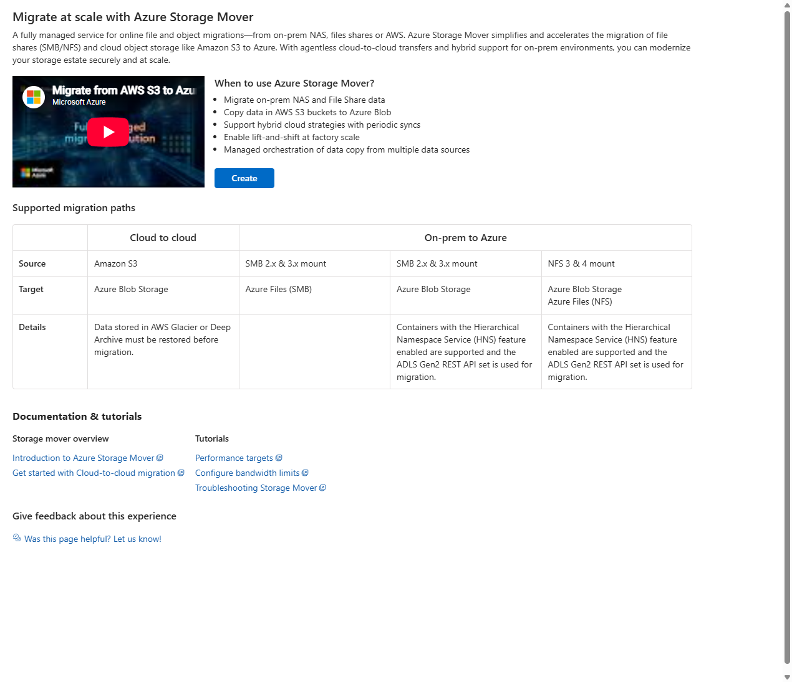
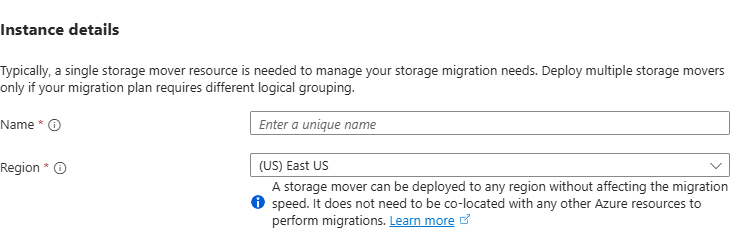
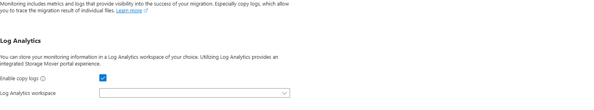

# 오브젝트 이전 — Storage Mover 소개와 AzCopy 실습

[English](./README.md) | 한국어

> **관리 geography:** Mover 관리 resource 가용성과 source/target storage 리전은 별도 입력이다. 소개 이후 도입에는 현재 공식 가용성·관리자 승인을 확인하고 Blob 리전을 그대로 재사용하지 않는다.


## 1. 학습 목표·모듈 경계

S3 사용자를 대상으로 서비스/도구 개념20분·승인 AzCopy 입력30분·utility30~45분과 대기·검증/정리20분을 계획한다. 소개 읽기 또는 승인 private Blob-to-Blob AzCopy를 선택한다. 앱/compute/IaC/DB 수강은 필요 없다. 실제 source는 작은 합성3개이고 계획 CSV의100개/10MiB는 가상 요구다.

**워크샵 제공 경계:** Storage Mover는 **서비스 소개만** 제공한다. 관리 기능·적합한 source/workload·리전/비용/권한/network와 공식 문헌을 배우고 endpoint/project/job definition 생성·실행 role·copy 시작/검증은 실습하지 않는다. 오브젝트 hands-on은 별도 공식 **private AzCopy**의 합성3개/109 bytes다. 이 선택은 Mover 전반의 미지원 결론이 아니다. 실제 고객 실행은 해당 지원 공식 시나리오와 고객 관리자 승인을 별도로 따른다.

실제 AWS 환경은 만들지 않았으며 합성 Azure 결과를 실제 S3 이전으로 표현하지 않는다.

- [Blob 기초](../../onboarding/storage/README-ko.md)
- [Private client 입력](../../../shared/storage-private-access/README-ko.md)
- [합성 workload 사례](../planning/lab/workloads.csv)

## 2. 서비스 소개와 선택 이유


### 2.1 AzCopy 실습 전 Storage Mover도 함께 소개한다

1. Portal 검색에 **Storage movers**를 입력하고 **Services** 결과를 선택한다. 이 화면은 **Storage center → Storage Mover → Get started**로 연결됐다.
2. **Migrate at scale with Azure Storage Mover / When to use / Supported migration paths**를 읽는다. Mover는 여러 source의 endpoint·job·진행/오류·반복 작업을 관리형 서비스로 다루는 선택이다. AzCopy는 참가자가 명시한 작은 복사 범위를 공식 utility로 실행하고 job 결과와 내용을 확인하는 선택이다.
3. 화면의 S3/SMB/NFS 경로를 source별로 읽는다. S3→Blob의 소개가 있다고 실제 AWS 접근 권한·copy가 준비된 것은 아니다. 표에 없는 Blob→Blob 경로는 [Blob→Blob 공식 절차](https://learn.microsoft.com/en-us/azure/storage-mover/azure-to-azure-migration)와 선택 topology를 따로 확인한다.



*Portal 소개/설정 예시. 보이는 기본값을 승인 입력으로 사용하지 않고 실제 job 결과와 구분한다.*

4. **Create Storage Mover**를 눌러 설정 폼의 **Basics / Monitoring / Tags / Review + create**를 확인한다. **Create/Review 제출은 하지 않는다.** Name/Region은 Mover 관리 리소스의 입력이고 실제 source/target 위치와 동일 설정이 아니다. 이 미입력 폼의 기본 표시 Region은 East US였으며 승인한 배포 리전이나 추천값이 아니다. 자동 선택된 기존 Resource Group은 사용하지 않는다.



*새 리소스 없이 Instance details 영역만 캡처했다. 기본값을 참가자의 승인 입력으로 해석하지 않는다.*

5. **Monitoring**에서 **Enable copy logs**와 Log Analytics workspace 입력을 읽는다. 수집·보존 비용을 설명하고 생성/활성화하지 않는다. 소개를 마치면 폼을 닫고 별도 AzCopy 실습으로 이동한다.



*설정 화면만 관찰했다. workspace·copy logs 설정이나 Mover를 저장/생성하지 않았다.*

| 서비스·도구 | Microsoft Learn 소개 | 맡기는 일·선택 이유 |
|---|---|---|
| Azure Storage Mover | [Storage Mover 개요](https://learn.microsoft.com/en-us/azure/storage-mover/service-overview), [Blob→Blob 흐름](https://learn.microsoft.com/en-us/azure/storage-mover/azure-to-azure-migration) | endpoint·project/job·진행·오류를 관리형 서비스에서 관찰 |
| AzCopy | [AzCopy 소개](https://learn.microsoft.com/en-us/azure/storage/common/storage-use-azcopy-v10), [Blob copy](https://learn.microsoft.com/en-us/azure/storage/common/storage-use-azcopy-blobs-copy) | 작은 copy를 공식 utility의 짧은 명령으로 이해 |
| Azure Blob Storage | [Blob 소개](https://learn.microsoft.com/en-us/azure/storage/blobs/storage-blobs-introduction) | 계정·container·blob·properties/metadata |
| Storage account | [Storage account 개요](https://learn.microsoft.com/en-us/azure/storage/common/storage-account-overview) | source와 target의 범위·replication·비용 |
| Microsoft Entra / Managed Identity | [Entra 소개](https://learn.microsoft.com/en-us/entra/fundamentals/what-is-entra), [Managed Identity 개요](https://learn.microsoft.com/en-us/entra/identity/managed-identities-azure-resources/overview) | 사람의 login과 service endpoint identity 구분 |
| Azure RBAC | [RBAC 개요](https://learn.microsoft.com/en-us/azure/role-based-access-control/overview) | 관리 권한과 object data 권한 분리 |
| Private Endpoint / Private DNS | [Storage private endpoints](https://learn.microsoft.com/en-us/azure/storage/common/storage-private-endpoints), [Private DNS 개요](https://learn.microsoft.com/en-us/azure/dns/private-dns-overview) | source/target의 private 실행 경로와 DNS |
| Azure Arc | [Azure Arc 소개](https://learn.microsoft.com/en-us/azure/azure-arc/overview) | 실제 Storage Mover S3 경로의 multicloud connector 설명에만 사용 |

| 선택 | 적합한 학습 목표 | 같은 것으로 보지 말 것 |
|---|---|---|
| Storage Mover | 지원되는 source/target·native job·진행/오류·운영 관리 | CLI 명령만 실행해 같은 service job을 관찰한 것으로 대체 |
| AzCopy | 작고 명확한 copy 범위·권한·utility 결과 | Portal의 job 관리나 모든 metadata/버전을 자동 보장 |
| 새 Blob의 업로드·읽기 | Azure data 권한·내용 검증 기초 | 이것만으로 S3 이전 완료 |

copy는 source를 없애는 이동 명령이 아니다. Storage Mover Blob→Blob도 source를 유지한다. source 쓰기·최종 delta·cutover·rollback은 별도 운영 조건이다.


## 3. 준비·권한·비용

서비스 소개에는 browser만 필요하고 Mover 등록/배포/role은 요구하지 않는다. AzCopy 실습에는 승인 owned source/target·빈 target container·공식 AzCopy v10·private PowerShell 또는 VM/MI client가 필요하다. 실제 tenant/계정/owner·DNS/route·source Storage Blob Data Reader/target Contributor를 확인한다. seed용 임시 source Contributor가 필요하면 정확한 새 grant만 추적해 준비 후 회수한다.

**샘플 설정:** 제공 Blob 예제는 private endpoint/DNS·public Disabled·Entra data 인증·Shared Key/익명 금지·bypass None·resource-instance 예외 없음으로 구성한다. 선택 lab의 승인 identity/network 입력과 관리자에게 적용 정책을 확인한다. 제공 설정/TLS 검사는 유지하며 대안은 별도 지원 시나리오·승인을 따른다. 인증과 network는 다른 통제다.

public network Disabled여도 기존 resource-instance/trusted-service 예외가 유지될 수 있으므로 [Storage network 제한](https://learn.microsoft.com/en-us/azure/storage/common/storage-network-security-limitations)을 읽는다. [Resource-instance rule](https://learn.microsoft.com/en-us/azure/storage/common/storage-network-security-resource-instances)은 **public endpoint network 접근**이며 data 권한이나 **Private Endpoint가 아니다.** 제공 샘플은 bypass None/resourceAccessRules 빈 설정을 사용한다. 예외 추가는 승인되지 않았고 private 준수 해결책으로 제안하지 않는다.

storage/request/transfer·선택 fixture 비용을 승인한다. 권한 확대/TLS 해제/secret 공개/다른 compute 추가로 오류를 해결하지 않는다. 미래 Mover 도입의 source별 지원·관리 geography/metadata residency·identity/network는 고객 관리자가 별도 검토하며 이 회차의 실행 준비가 아니다.

- [Private 입력 준비](../../../shared/storage-private-access/README-ko.md)
- [가격 계산기](https://azure.microsoft.com/en-us/pricing/calculator/)

### 3.1 Mover 관리 리전과 Storage 리전 입력 분리

공식 [Storage Mover 생성 안내](https://learn.microsoft.com/en-us/azure/storage-mover/storage-mover-create)를 읽는다. Portal Instance details는 Mover를 storage account와 반드시 같은 위치에 두지 않아도 된다고 설명한다. 이것이 관리 resource 가용성이나 실제 copy topology 검토를 생략한다는 뜻은 아니다.

| 입력·경계 | 승인 예시 / 별도 확인 |
|---|---|
| Mover 관리 resource 리전 | West US 3 (`westus3`) 위치 예시, 실제 도입에는 현재 가용성 확인 |
| Source storage account 리전 | Korea Central (`koreacentral`), 변경하지 않음 |
| Target storage account 리전 | Korea Central (`koreacentral`), 변경하지 않음 |
| Copy engine·data path | 선택 native source/target topology로 확인하며 관리 위치만으로 실제 전송 경로를 결정·인증하지 않음 |
| 관리 metadata residency | endpoint/project/job 구성·선택 log의 위치/처리를 조직 요구와 대조해 승인 |

관리 위치는 storage 가용성과 다를 수 있다. 별도 승인 배포에는 선택 구독의 현재 storageMovers 위치·필요 등록을 확인한다. 소개 읽기에 등록은 필요 없다. 화면의 West US 3은 예시이지 필수 실습 리전이나 Korea Central 이전 지원 판단의 근거가 아니다.

Blob 샘플 계정/private endpoint/DNS는 관리 위치 예시와 별개다. West US 3 관리를 선택했다고 **모든 copy data가 West US 3을 경유하거나 private network가 지원된다고 증명하지 않으며**, storage/DB/compute를 이동할 권한도 생기지 않는다. 하나의 Location 값을 재사용하지 않고 관리/스토리지 리전을 각각 기록한다.


*잘라낸 Essentials는 실제 Mover **관리 resource 위치**만 보여준다. 관리 위치 예시이지 copy 결과가 아니다. Source/target Korea Central 리전·private 설정은 이미지에 없으므로 독립 resource 조회로 확인한다. endpoint/role/job·copy data 경로·private copy 지원을 검증한 화면이 아니다.*

관리 위치만으로 data 경로/private topology를 증명하지 않는다. 미래 실행은 source별 공식 지원 시나리오와 고객 승인을 따르고 워크샵은 서비스 소개에서 끝낸다.


## 4. 단계별 instruction — 선택 경로 하나


### 4.1 A: 실제 S3 경로의 입력·지원 경계 읽기


[Storage Mover S3 cloud-to-cloud](https://learn.microsoft.com/en-us/azure/storage-mover/cloud-to-cloud-migration)와 [AzCopy S3 절차](https://learn.microsoft.com/en-us/azure/storage/common/storage-use-azcopy-s3)를 읽는다.

| 경로 | 실제로 필요한 것 | 지금 하지 않는 것 |
|---|---|---|
| Storage Mover S3 | AWS account/bucket 접근, Azure Arc multicloud connector의 현재 준비·role/연결, source/target endpoint·job | AWS 생성·connector 배포·AWS 권한 변경·S3 job 시작 |
| AzCopy S3 | 실제 bucket/object 권한과 AWS 인증, Azure data identity·network·공식 utility | AWS key를 문서/프롬프트에 넣거나 실제 S3에 copy 요청 |

Storage Mover의 Glacier/Deep Archive 등의 source는 restore가 선행될 수 있고 서비스가 자동 rehydration을 해 준다고 가정하지 않는다. metadata·tags·version·archive class·path/name 변환·중단·delta·egress를 읽는다. **S3 ETag를 항상 MD5로 취급하지 않는다.**

읽기만 선택하면 여기서 완료한다. 아래 Azure 대체 실습을 S3 실행의 증거로 쓰지 않는다.


### 4.2 AzCopy: Portal에서 새 source/target만 준비


실제 생성은 대상·비용·권한을 승인한 뒤 수행한다. 계정·endpoint 관리와 Portal 데이터 업로드는 다른 경로다. data 단계의 브라우저/클라이언트가 private DNS/route를 가진 위치인지 먼저 확인한다.

1. 승인된 directory·subscription·region에서 새 그룹 `rg-amw-objects-<lab-id>`를 만든다.
2. 새 source account `stamwsrc<lab-id>`와 target account `stamwdst<lab-id>`를 준비한다. 이름 가용성·길이·문자를 확인하며 기존 account를 가져오지 않는다.
3. Standard LRS·StorageV2·flat namespace·Hot, HTTPS·public network Disabled·firewall Deny·bypass None·익명/Shared Key 금지를 실제 설정에서 확인한다. [private 준비](../../../shared/storage-private-access/README-ko.md)의 연결 Approved·DNS·실행 위치도 확인한다. `Workshop=azure-migration-objects`, `LabId=<lab-id>` 식별 정보를 기록한다.
4. source의 `source`와 target의 빈 `target` container만 승인 범위에서 준비한다. 이전 결과나 다른 container를 지우거나 비우지 않는다.
5. 업로드 담당·tool/service identity·확인 담당의 필요한 역할과 소유권을 구분한다.
6. [data 폴더](./lab/data)의 아래 **3개 파일만** Portal source container에 root 이름 그대로 업로드한다. target은 비워 둔다.

| 파일 | 종류·확인할 content type | 합성 내용 |
|---|---|---|
| [notes.txt](./lab/data/notes.txt) | `text/plain` | 교육용 문장 |
| [catalog.csv](./lab/data/catalog.csv) | `text/csv` | 작은 두 행의 가상 항목 |
| [info.json](./lab/data/info.json) | `application/json` | module 이름·synthetic 표시 |

각 source blob의 **content type**을 확인/설정하고 metadata에 lowercase key `workshop`, 값 `amw-objects`를 추가한다. Blob metadata와 blob index tag는 다른 기능이다.

copy 과정에서 metadata key의 case가 바뀌거나 index tag를 별도로 다뤄야 할 수 있다. system ETag·last modified를 항상 source와 같아야 하는 내용 hash/metadata로 취급하지 않는다. 이 검증 범위는 명시한 content type·lowercase 사용자 metadata와 내려받은 bytes다.

**관찰할 결과:** source root의 정확한 이름 3개·실제 bytes·content type·선택 metadata, 빈 target이다. source를 데이터 확인이 끝날 때까지 변경하지 않는다. 기본 sample에는 directory/version/archive·real customer data가 없다.

승인된 기존 입력을 사용하면 owner와 빈 target 조건을 확인하고 이전 결과를 덮거나 지우지 않는다.


### 4.3 Storage Mover는 실행 없이 이해

공식 [서비스 소개](https://learn.microsoft.com/en-us/azure/storage-mover/service-overview)·[Azure-to-Azure 시나리오](https://learn.microsoft.com/en-us/azure/storage-mover/azure-to-azure-migration)·위 source별 문헌을 읽는다. 관리형 endpoint/job 기능이 큰 이전에 적합한 이유와 작은 범위에서 AzCopy를 선택한 이유를 설명한다. 미래 고객의 source/target/mode/metadata/identity/비용/network 질문을 정리하지만 native resource/role/copy job을 만들지 않는다.

### 4.4 공식 AzCopy의 짧은 copy


아래는 승인된 **private PowerShell 클라이언트의 사용자 Entra 경로**다. 양쪽 canonical Blob hostname이 해당 private IP로 해석되는 것을 먼저 확인한다. Linux 검사 VM/MI를 선택했다면 대신 4.7을 사용하며 이 사용자 login을 중복 실행하지 않는다.

```powershell
$ErrorActionPreference = "Stop"
$PSNativeCommandUseErrorActionPreference = $true
$TenantId = "<approved-tenant-id>"
$SourceAccount = "<this-lab-source-account>"
$TargetAccount = "<this-lab-target-account>"
$ParsedTenantId = [guid]::Empty
if (-not [guid]::TryParse($TenantId, [ref]$ParsedTenantId) -or
    $SourceAccount -notmatch "^[a-z0-9]{3,24}$" -or $TargetAccount -notmatch "^[a-z0-9]{3,24}$" -or
    $SourceAccount -eq $TargetAccount) {
    throw "Set the approved tenant and two different lab accounts."
}
$SourceUrl = "https://$SourceAccount.blob.core.windows.net/source"
$TargetUrl = "https://$TargetAccount.blob.core.windows.net/target"
[pscustomobject]@{ Source = "$SourceUrl/*"; Target = $TargetUrl; Overwrite = $false; Recursive = $false } | Format-List
azcopy login --tenant-id $TenantId
```

이 URL은 Azure public cloud의 canonical Blob hostname이다. public endpoint를 허용한다는 뜻이 아니며 private DNS로 연결된다. 동일 tenant·source read/target write·지원된 private copy topology·빈 target과 실행 승인을 대조한 경우에만 다음을 수행한다.

```powershell
azcopy copy "$SourceUrl/*" $TargetUrl --from-to=BlobBlob --recursive=false --overwrite=false --s2s-preserve-properties=true
```

**관찰할 결과:** 공식 utility의 job ID·transfer count/status·failed/skipped와 로그다. 전송은 server-to-server 경로이며 로컬 컴퓨터로 모든 파일을 내려받아 copy engine을 구현하는 방식이 아니다.

이 대상은 flat root의 3개 파일이며 overwrite·sync·target 삭제는 하지 않는다. job 완료/종료 코드만으로 metadata·version·모든 정합성이 같다고 확정하지 않는다. local log에 credential/SAS/고객 식별정보가 있으면 공유하지 않는다.


### 4.5 개수·bytes·내용·선택 properties 검증


같은 source/target을 비교하며 source는 동결한다. 아래 Portal/PowerShell 방법은 private 브라우저/클라이언트 입력이 있을 때의 경로이며 선택한 검증은 4.7의 VM CLI 방법이다.

1. Portal에서 source와 target의 **필터 없는 root 목록**을 확인한다. 이름·case·수·누락/추가 blob이 있는지 읽는다.
2. 각 blob의 실제 content length와 합계를 비교한다. 화면의 반올림된 KiB 값만으로 동일 bytes라고 하지 않는다.
3. 각 source/target의 content type과 metadata `workshop=amw-objects`를 대조한다.
4. 3개 source·3개 target을 Portal에서 파일 이름 그대로 내려받는다. browser가 suffix/파일명을 바꿨으면 그 사실부터 확인한다.
5. 내려받은 bytes의 SHA-256을 local 원본과 비교한다. ETag/MD5 추정으로 대신하지 않는다.

선택 PowerShell 확인 예다. 개인의 새 `lab-output` 하위 폴더만 만들고, Portal에서 각각 source/target 폴더에 내려받은 뒤 다음 비교를 수행한다. Azure CLI/새 SDK가 필요하지 않으며 **검증만 하고 copy하지 않는다.**

```powershell
$ErrorActionPreference = "Stop"
$LabId = "<this-lab-id>"
if ($LabId -notmatch "^[a-z0-9]{8}$") { throw "Use the eight-character lab ID." }
$DataPath = Join-Path $PWD "modules\migration\objects\lab\data"
$DownloadRoot = Join-Path (Join-Path $PWD "lab-output") "objects-$LabId"
$SourceDownload = Join-Path $DownloadRoot "source"
$TargetDownload = Join-Path $DownloadRoot "target"
New-Item -ItemType Directory -Path $SourceDownload -ErrorAction Stop | Out-Null
New-Item -ItemType Directory -Path $TargetDownload -ErrorAction Stop | Out-Null
```

Portal에서 6개를 정확한 폴더에 내려받고 **다운로드를 완료한 뒤** 비교한다.

```powershell
$ExpectedNames = @("catalog.csv", "info.json", "notes.txt")
$SourceFiles = @(Get-ChildItem -LiteralPath $SourceDownload -File)
$TargetFiles = @(Get-ChildItem -LiteralPath $TargetDownload -File)
if ($SourceFiles.Count -ne 3 -or $TargetFiles.Count -ne 3 -or
    (Compare-Object -ReferenceObject ($ExpectedNames | Sort-Object) -DifferenceObject ($SourceFiles.Name | Sort-Object) -CaseSensitive) -or
    (Compare-Object -ReferenceObject ($ExpectedNames | Sort-Object) -DifferenceObject ($TargetFiles.Name | Sort-Object) -CaseSensitive)) {
    throw "Expected exactly the three flat sample names in both downloads."
}
$TotalBytes = 0L
foreach ($Name in $ExpectedNames) {
    $OriginalFile = Join-Path $DataPath $Name
    $SourceFile = Join-Path $SourceDownload $Name
    $TargetFile = Join-Path $TargetDownload $Name
    $OriginalLength = (Get-Item -LiteralPath $OriginalFile).Length
    if ((Get-Item -LiteralPath $SourceFile).Length -ne $OriginalLength -or
        (Get-Item -LiteralPath $TargetFile).Length -ne $OriginalLength) {
        throw "Byte length mismatch: $Name"
    }
    $OriginalHash = (Get-FileHash -LiteralPath $OriginalFile -Algorithm SHA256).Hash
    if ((Get-FileHash -LiteralPath $SourceFile -Algorithm SHA256).Hash -ne $OriginalHash -or
        (Get-FileHash -LiteralPath $TargetFile -Algorithm SHA256).Hash -ne $OriginalHash) {
        throw "Content mismatch: $Name"
    }
    $TotalBytes += $OriginalLength
}
[pscustomobject]@{ Files = 3; TotalBytes = $TotalBytes; ContentMatch = $true } | Format-List
```

**완료 기준:** AzCopy job/copy 결과 + Portal 또는 private CLI의 필터 없는 root 목록 정확히 3개 + 실제 bytes/내용 + 정한 content type/metadata 일치다. local 다운로드만 검사했다고 hidden target blob·metadata·전체 S3 정합성을 검증했다고 하지 않는다.

같지 않으면 이름·prefix·encoding·copy mode·source 변경·failed/skipped·권한을 확인한다. 불일치를 자동 repair하거나 성공 기본값으로 바꾸지 않는다.


### 4.6 실제 이전의 cutover/rollback 계획만 연결


결정·복귀 연습은 [컷오버·롤백](../cutover/README-ko.md)의 필요한 카드만 참고한다. 합성 Blob 읽기 URL 전환은 실제 S3/앱 traffic이나 target 새 writes의 data rollback이 아니다.

합성 copy와 운영 connection 전환은 별도 승인 범위다. [이전 계획](../planning/README-ko.md)에 source 쓰기 정지·최종 delta·read-back·앱 target URL·승인·보존/rollback을 적는다.

source는 copy 후에도 남는다. target 새 쓰기 이후 source로 URL만 되돌리는 것은 data rollback이 아니다. S3 version·ACL·lifecycle/retention·archive·metadata와 Azure 모델의 차이는 별도 검토한다.


### 4.7 선택 private 경로 — 같은 VNet의 Linux 검사 VM·Managed Identity


현재 계정과 데이터를 유지한 채 검사 입력만 [private 준비](../../../shared/storage-private-access/README-ko.md)에서 마련한다. 계정은 public Disabled로 유지하며 이 경로의 실제 복사는 **공식 AzCopy server-to-server**다. source/target·DNS·권한 준비와 job/data 확인을 각각 수행한다.

1. [prepare-private.sh](./verify/prepare-private.sh)는 **VM Bash**에서 MI login·두 canonical hostname의 private IP를 확인한다. 3개 원본의 bytes를 보존해 source에만 업로드하고 content type·metadata·source hash와 빈 target을 검사한다.
2. source 준비용 임시 Contributor가 있다면 정확한 새 grant ID·identity·scope를 확인하고 승인된 관리자만 회수한다. copy identity에는 source Reader만 남기고 target Contributor를 유지한다.
3. [verify-private.sh](./verify/verify-private.sh)는 MI auto login의 AzCopy copy를 실행한다. `--overwrite=false`, flat root, `--recursive=false`, property 보존을 사용하고 개인 작업 폴더에 공식 job JSON/log/plan을 기록한다.
4. 실제 EndOfJob의 Completed·3 completed·0 failed·0 skipped·전송 bytes와, source/target을 새로 내려받은 3개 파일의 전체 bytes/hash/type/metadata를 확인한다.

아래는 **관리 PowerShell**의 전달 예다. `$SubscriptionId`, `$InspectionVmName`, `$InspectionGroupName`, `$SourceAccount`, `$TargetAccount`, 두 `$SourcePrivateIp`/`$TargetPrivateIp`와 `$GuestWorkDirectory`는 승인된 개인 입력으로 준비한다. fixture에는 Azure CLI/AzCopy·Python 3과 필요한 data role이 먼저 있어야 한다.

```powershell
$ErrorActionPreference = "Stop"
$PSNativeCommandUseErrorActionPreference = $true
if (-not $SourceAccount -or -not $TargetAccount -or $SourceAccount -eq $TargetAccount -or
    -not $SourcePrivateIp -or -not $TargetPrivateIp -or -not $GuestWorkDirectory -or
    -not $InspectionVmName -or -not $InspectionGroupName -or -not $SubscriptionId) {
    throw "Set the approved private source/target/fixture inputs."
}
$DataPath = Join-Path $PWD "modules\migration\objects\lab\data"
$Catalog = [Convert]::ToBase64String([IO.File]::ReadAllBytes((Join-Path $DataPath "catalog.csv")))
$Info = [Convert]::ToBase64String([IO.File]::ReadAllBytes((Join-Path $DataPath "info.json")))
$Notes = [Convert]::ToBase64String([IO.File]::ReadAllBytes((Join-Path $DataPath "notes.txt")))
$PreparePath = Join-Path $PWD "modules\migration\objects\verify\prepare-private.sh"
$Prepared = az vm run-command invoke --name $InspectionVmName --resource-group $InspectionGroupName --command-id RunShellScript --scripts "@$PreparePath" --parameters "source=$SourceAccount" "sourceIP=$SourcePrivateIp" "target=$TargetAccount" "targetIP=$TargetPrivateIp" "workdir=$GuestWorkDirectory" "catalog=$Catalog" "info=$Info" "notes=$Notes" --subscription $SubscriptionId --output json | ConvertFrom-Json
$Messages = @($Prepared.value | ForEach-Object { $_.message }) -join "`n"
$Messages
if ($Messages -notmatch "(?m)^AMW_OBJECT_PREPARE_PASS\s*$" -or $Messages -match "AMW_OBJECT_PREPARE_FAIL") {
    throw "Guest source preparation failed or has no success evidence."
}
```

이는 작은 합성 source 준비 예다. 임시 준비 role 회수와 source Reader 확인을 마친 뒤 다음 job을 실행한다.

```powershell
$VerifyPath = Join-Path $PWD "modules\migration\objects\verify\verify-private.sh"
$Verified = az vm run-command invoke --name $InspectionVmName --resource-group $InspectionGroupName --command-id RunShellScript --scripts "@$VerifyPath" --parameters "source=$SourceAccount" "target=$TargetAccount" "workdir=$GuestWorkDirectory" --subscription $SubscriptionId --output json | ConvertFrom-Json
$Messages = @($Verified.value | ForEach-Object { $_.message }) -join "`n"
$Messages
if ($Messages -notmatch "(?m)^AMW_OBJECT_VERIFY_PASS\s*$" -or $Messages -match "AMW_OBJECT_VERIFY_FAIL") {
    throw "Guest official copy/data verification failed or has no success evidence."
}
```

준비 단계는 fresh container와 빈 target을 요구한다. base64는 **명시적 name=value parameter**로 전달해 padding `=`가 CLI 인수로 잘못 해석되지 않게 한다. 실제 고객 데이터·자격증명을 이 방식으로 전달하지 않는다.

같은 job/data를 다시 읽기 검증할 때만 parameters에 `phase=verify-existing-job`을 추가한다. copy를 다시 실행하지 않고 원래 job 기록과 새 비교 다운로드를 검사한다. AzCopy 10.32.8의 JSON은 `JobStatus`와 숫자 문자열 metric을 사용한다. `FinalJobStatus`나 숫자 JSON type을 가정하지 않으며 지원하지 않는 shape는 실패로 표시한다. 이 옵션은 native job resume/cancel이나 자동 복구 플랫폼이 아니다.


## 5. 검증·대표 실패

AzCopy 실제 job의 completed3·failed/skipped0·원본 byte 합계와 필터 없는3개 이름·download hash·content type/사용자 metadata를 함께 확인한다. process 성공만으로 내용 검증을 대신하지 않는다. 403은 [Blob403 안내](https://learn.microsoft.com/en-us/troubleshoot/azure/azure-storage/blobs/authentication/storage-troubleshoot-403-errors)와 실제 tenant/identity/data scope·전파·승인 DNS/route·계정 설정을 읽고 오류를 보존해 중단한다. 수정 승인을 받고 network/key/TLS를 낮추지 않는다. S3 ETag/version/index tag/tier는 선택 기준을 별도로 검토한다.

private AzCopy 근거는 Mover run이나 실제 AWS/S3 이전 근거가 아니다. 워크샵은 Mover copy engine을 실행하지 않으며 미래 지원 판단은 고객의 source별 공식 경로를 따른다.

## 6. 정리·소유권

Mover 소개만 읽으면 해당 resource/정리 대상이 없다. AzCopy transfer 종료·안전 기록·login 정리를 확인하고 owned 계정/container/정확한 새 준비 grant·선택 fixture를 목록화해 삭제 승인받는다. consumer는 외부 입력·이전 결과·공유 private client·기존 role을 지우지 않는다. 원 owner가 마지막 consumer 이후 resource/fixture를 정리한다. 아래 정확한 download6개·빈 폴더만 삭제하고 전체 lab-output을 지우지 않는다. 잔여 resource/grant·지연 비용을 확인한다.

```powershell
$SourceDownload
$TargetDownload
foreach ($Name in @("catalog.csv", "info.json", "notes.txt")) {
    Remove-Item -LiteralPath (Join-Path $SourceDownload $Name)
    Remove-Item -LiteralPath (Join-Path $TargetDownload $Name)
}
Remove-Item -LiteralPath $SourceDownload
Remove-Item -LiteralPath $TargetDownload
Remove-Item -LiteralPath $DownloadRoot
```

## 7. 실제 이전에서 추가로 고려할 사항


- S3 class·version·metadata/tags·ACL/retention·빈 prefix·이름/case와 Blob 모델 차이.
- 멀티파트·암호화 등의 ETag 의미, 검증 방식의 한계.
- change rate·delta·source 쓰기 정지·일관성·cutover·rollback·backup.
- source/target 권한·connector/identity·private network·bandwidth/egress·중단/restore 비용.
- 선택 서비스의 규모/제약·copy 결과·운영 모니터링. 기본은 작은 합성/단일 경로다.


## 8. 출처


- 3개 파일·instruction·짧은 내용 비교는 직접 작성했다. 외부 dataset·고객 data·job 출력·서비스 구현을 복사하지 않았다.
