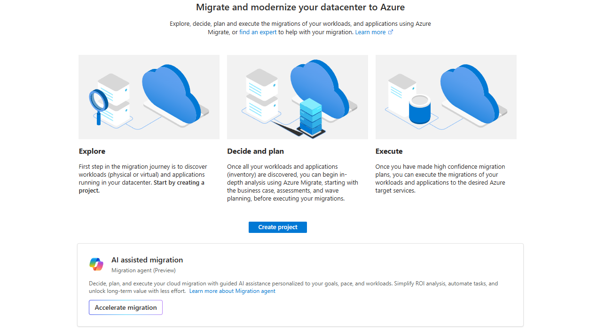
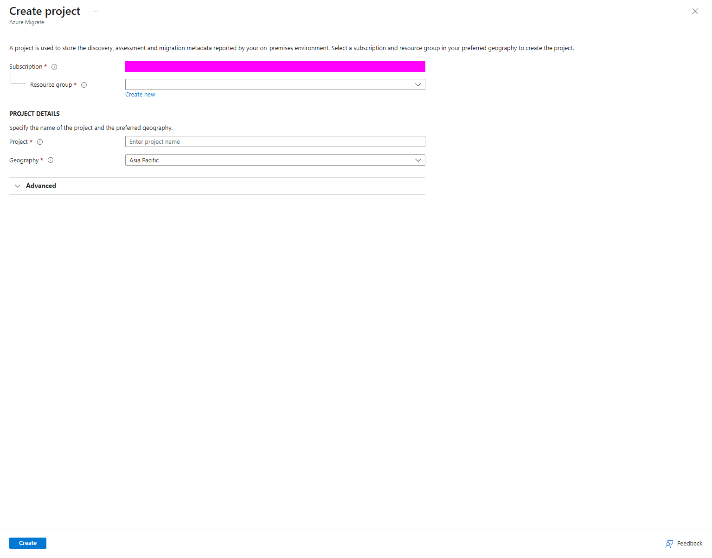
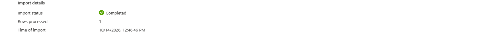
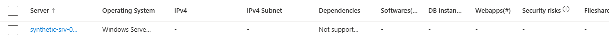
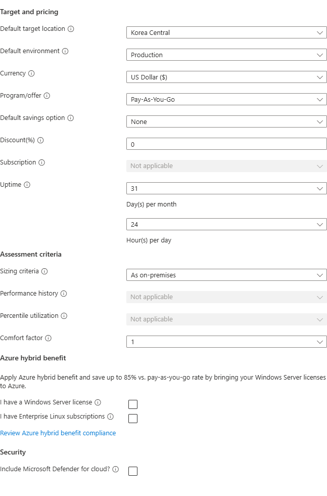
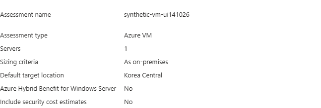
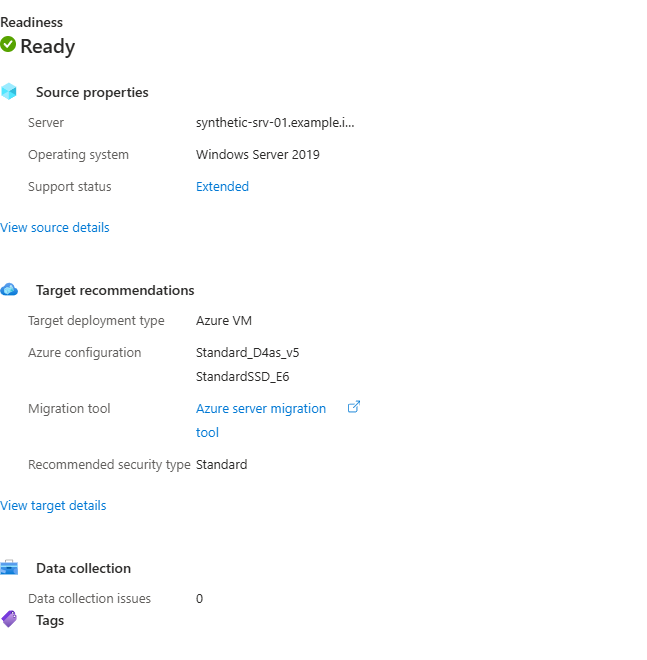
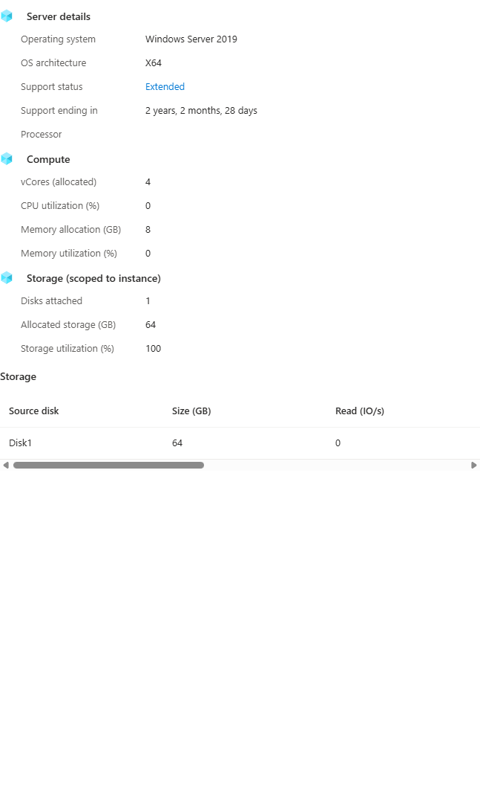
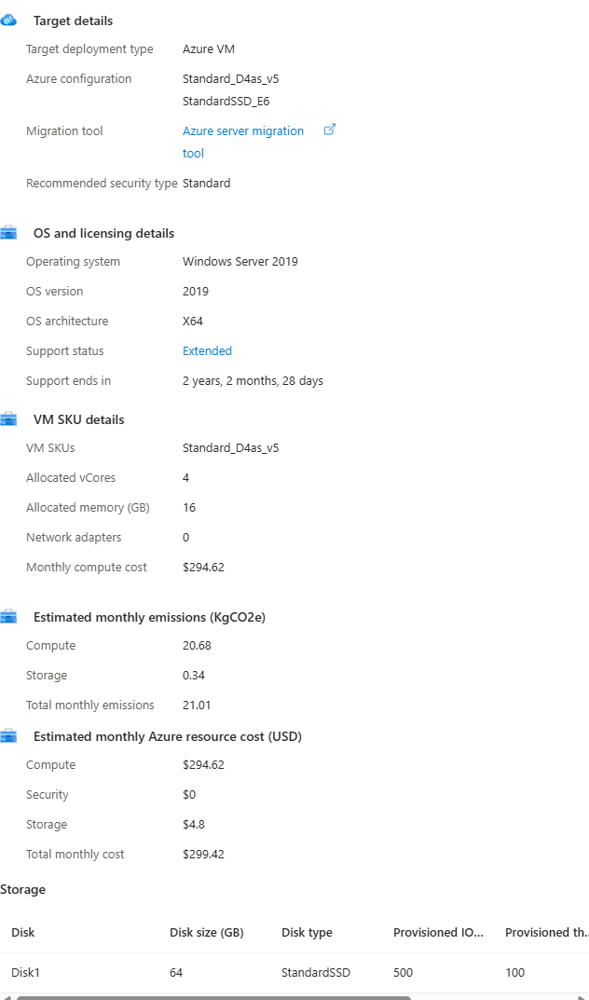

# Azure Migrate — separate assessment from actual server migration

English | [한국어](./README-ko.md)

Start with Azure Migrate discovery, assessment, replication, test migration and cutover. Preserving an OS, disks and local services is different from redeploying the app on a new VM.

## 1. Learning objectives and module boundaries

Choose A: concepts/synthetic case (30–45 minutes), B: separately approved official CSV assessment (45–60 minutes), or C: a supported instructor replication/test demo (60–90 minutes plus substantial setup). No other compute, Terraform or DB completion is required. CSV-imported inventory cannot by itself be migrated; B does not provide a real source or replication setup for C. Without source/appliance inputs, choose A or a clearly identified prepared demonstration.

**Resources for this step**

- [Planning](../planning/README.md)

## 2. Service introductions and selection

Open the Microsoft Learn introductions below before choosing a deployment or migration tool. Compare responsibilities, identity, network boundaries and lifecycle rather than treating AWS and Azure product names as one-to-one equivalents. A service resource, a running job and a verified application or dataset are separate outcomes.

### 2.1. Introduce Azure Migrate stages in the Portal

Search Services for Azure Migrate and open Get started. Explore gathers discovery/inventory evidence; Decide and plan covers business cases, assessment and waves; Execute requires a supported real source and separate replication, isolated test and cutover. Connect these stages to the synthetic case and retain unknowns. Optionally inspect Create project fields without submitting. Geography is management metadata, not the later target VM region or performance result. The screenshots are stage/field illustrations, not discovery or assessment evidence.

```text
CSV import → assessment of synthetic inventory
             └─ not actual server discovery, performance collection or replication

Actual source → discovery/assessment preparation → assessment evidence
Actual source + separate replication appliance/Mobility service → replication
  → test migration in an isolated network → actual app/data checks
  → approved cutover → final checks, rollback and operational handoff
```



*Portal illustration: observe the selected service and fields. Visible defaults are not approved deployment inputs; confirm the current interface and your own scope.*



*Portal illustration: observe the selected service and fields. Visible defaults are not approved deployment inputs; confirm the current interface and your own scope.*

**Resources for this step**

- [Synthetic assessment case](./lab/assessment-case.md)
- [Migrate services overview](https://learn.microsoft.com/en-us/azure/migrate/migrate-services-overview)
- [Tutorial discover import](https://learn.microsoft.com/en-us/azure/migrate/tutorial-discover-import)
- [Tutorial migrate aws virtual machines](https://learn.microsoft.com/en-us/azure/migrate/tutorial-migrate-aws-virtual-machines)
- [Overview](https://learn.microsoft.com/en-us/azure/virtual-machines/overview)
- [Virtual networks overview](https://learn.microsoft.com/en-us/azure/virtual-network/virtual-networks-overview)
- [Overview](https://learn.microsoft.com/en-us/azure/role-based-access-control/overview)
- [Prepare azure accounts](https://learn.microsoft.com/en-us/azure/migrate/prepare-azure-accounts)
- [Compute vm](../../onboarding/compute-vm/README.md)

## 3. Prerequisites, permissions and cost

A needs no Azure/AWS login. B/C use the Portal with approved subscription/project geography, dedicated group and current template/roles. Review Azure Migrate Owner, Decide and Plan Expert and Execute Expert at the appropriate scope, plus any required Entra registration rights; do not default to subscription Owner or change tenant app-registration policy. C needs an actual supported source, separate replication appliance/Mobility service, access/network and cost approval. The discovery appliance is not the physical/AWS replication appliance. Protect registration keys/source inventory/credentials. Assess appliance/replica/storage/test/final VM/network/egress cost, license and retention; exclude GPU/HA/large disks/OS upgrades from the basic demo. Use only an approved sandbox, synthetic data and the selected module's minimum inputs. Do not place credentials, account identifiers, real customer inventory or sensitive output in Git, prompts or shared screenshots. Confirm tenant, subscription, region, quota, cost and the resource owner; do not change the participant's default subscription or broaden access to make an error disappear.

## 4. Step-by-step lab

Choose only the mode that matches your objective and available inputs. Read the full step, its execution environment and expected observation before running its commands. Use approved synthetic sandbox inputs. Obtain approval for resource creation, role assignments, writes and destructive actions separately.

### 4.1. Read the synthetic preservation requirement

Use the assessment-case card: OS/services/local state must survive, while cores/memory/disk capacity are explicitly invented. Identify unknown dependencies, boot type, write rate and functionality. Explain what CSV/as-is assessment can estimate versus what replication/test must prove. The planning workloads.csv is a workshop scenario table, not a Migrate import schema; do not upload it directly.

**Resources for this step**

- [Synthetic assessment case](./lab/assessment-case.md)
- [Synthetic workload scenarios](../planning/lab/workloads.csv)

### 4.2. Optional B: create only a dedicated assessment project

Approve target, rights, geography and costs, then use a fresh rg-amw-migrate-<lab-id> and migrate-amw-<lab-id>, with owner and lab tags/records. Do not reuse a shared/operational project or register discovery/replication appliances in this assessment exercise. Project geography and assessment target region are separate. If current UI/support differs, stop and confirm the official experience rather than building a substitute wrapper.

For the current project workflow, open **All projects → Create project** and review the project form. After approval to create the dedicated project, use **Start discovery → Using import → Server inventory (CSV)**. Here “Start discovery” is the navigation label for the import route; uploading synthetic inventory is not actual source discovery.

### 4.3. Put one synthetic server into the current official CSV

Download the current import template/recognized OS fields, then map one unique synthetic name, 4 cores, memory candidate 8192 MB, Windows Server 2019/x64 and 64 GB disk only where the template supports them. Check units, encoding and required fields. Keep performance/history/boot/IP/IOPS unknown according to supported input rules; do not invent measured utilization. Review before Import and read status/warnings/errors. Same-name reimport can update an existing item, so never reuse shared names. Completed means accepted inventory, not discovered or tested OS/app compatibility.

Use **Download .CSV file** to obtain the official template, then **Browse → Import** for a reviewed file. The supplied [synthetic-inventory.csv](./lab/synthetic-inventory.csv) follows the current Portal template's **27 columns** and contains **one fictional server**, with no AWS inventory or actual performance measurements:

| Input | Synthetic value |
|---|---|
| Required server name | `synthetic-srv-01.example.invalid` |
| Required cores / memory in MB | `4` / `8192` |
| Required OS name | `Microsoft Windows Server 2019 (64-bit)` |
| OS version / architecture | `2019` / `x64` |
| Number of disks / disk 1 size in GB | `1` / `64` |
| IP, utilization, throughput, IOPS and boot evidence | Blank / unknown, not measured zero |

The starred template fields identify minimum required inputs; keep the full template column structure and compare it with the current downloaded version. In a separate dedicated lab, choose a unique synthetic name if needed; do not update another participant's same-name item. Unlike [planning workloads.csv](../planning/lab/workloads.csv), this asset is intended for **Azure Migrate CSV import**, not real server discovery, replication, test migration or AWS transfer.



*Completed / Rows processed 1 confirms acceptance of this one fictional inventory row only. It is not an assessment, readiness recommendation or migrated server.*

Inspect the imported item in the project inventory and distinguish supplied values from missing evidence.



*The cropped inventory shows one imported item, Windows Server 2019, unknown IP and Dependencies: Not supported. Column widths truncate the name/OS text; use the linked synthetic CSV for full input values rather than claiming they are fully visible here. “Not supported” describes dependency information in this imported-inventory view, not a general statement about Azure Migrate or actual application dependencies.*

**Resources for this step**

- [Synthetic assessment case](./lab/assessment-case.md)

### 4.4. Read readiness, sizing and cost assumptions

Allow the Portal's stated **15-minute wait after import** before proceeding to assessment. Inventory acceptance and an assessment result are separate stages; the import screenshot above supplies no assessment evidence.

1. Open the existing approved **Migrate project → Overview → Create assessment**.
2. In **Basics**, enter a unique synthetic assessment name, such as `synthetic-vm-<lab-id>`. Choose **Add workloads**, select only the checkbox for `synthetic-srv-01.example.invalid`, and confirm **Add selection**. Do not include another participant's inventory.
3. In **General**, review target region, environment, currency, pricing, savings/discounts, hours and licensing. For the illustrated calculation choose **Korea Central / Production / USD / Pay as you go / no savings / 0% discount / 31 days per month / 24 hours per day**. “Production” is an estimate setting, not permission to deploy a production workload.
4. Select **Sizing: As on-premises** for this hardware-only input. Select **Windows Azure Hybrid Benefit: No**, **Linux Azure Hybrid Benefit: No**, and **Include Defender cost: No** for the example estimate. Excluding Defender cost from this calculation does **not** disable an existing Defender configuration.



5. Inspect **Advanced** only as needed, keeping the selected target **Azure VM**; do not add other target workloads merely to fill the form.
6. In **Review**, require **1 server**, Azure VM, As on-premises, Korea Central, AHB No and the selected security-cost assumption. Review ownership and approve creation of the **assessment only**.



7. Open **Decide and plan → Assessments**, select your assessment, and read status, readiness, source properties and target recommendations. The example is a completed assessment of one fictional imported server; it creates no VM or replication.





**Interpret missing performance correctly.** The CSV supplies 4 cores, 8192 MB memory and one 64 GB disk, but no utilization/IOPS history. UI/API default zeros for CPU, memory or IOPS are **not measured idle usage**. As on-premises is the selected calculation setting, a calculation assumption; measured performance and algorithm behavior require separate review. Review the supplied hardware, persisted settings and recommendation explanations together; reconcile missing/default values or inconsistent sizing assumptions before using a result for a customer design. Do not invent measurements or relabel native fields.



| Example output | How to read it |
|---|---|
| Source Ready; Windows Server 2019 Extended support | Suitability and support lifecycle are separate. Mainstream support ended 2024-01-09; extended support ends 2029-01-09. Extended does not mean already end-of-support. |
| `Standard_D4as_v5`, 4 vCPU / 16 GB | A recommendation for the supplied synthetic input, not measured rightsizing, quota/availability, tested boot or deployed capacity |
| `StandardSSD_E6`, 64 GB | Suggested disk configuration, not an actual created disk |
| Compute USD 294.62 + storage USD 4.80 = USD 299.42/month | An estimate using retail/no AHB/no reservation and 31×24 hours, with Defender cost excluded—not an invoice, price quote, total production cost or new deployment charge |

Confirm lifecycle and support against [Windows Server 2019 lifecycle](https://learn.microsoft.com/en-us/lifecycle/products/windows-server-2019) and current service documentation when using the example.

**B completes with interpretation of the assessment, not migration.** Readiness/Ready/Suitable and a recommended Server Migration tool do not establish actual source boot, dependency, network, replication or app/data compatibility. [CSV-imported servers cannot be migrated directly from that inventory](https://learn.microsoft.com/en-us/azure/migrate/tutorial-discover-import?view=migrate); a real supported source and separate replication preparation are required. Do not press Replicate/Migrate or create an AWS source to extend this lab.

### 4.5. Read actual AWS/physical replication preparation

For the AWS/physical agent-based path distinguish actual supported source, optional discovery appliance, separate replication appliance and source Mobility service. Confirm OS/kernel/boot/disks/services/write changes, source changes/credentials and source↔appliance→Azure TLS/routes/ports. Use current official appliance size/OS/registration requirements with approval, not broad root/password/inbound rules copied into this workshop. The Terraform Amazon Linux assumption is not an observed source; check documented as-is limitations and consider supported-OS/app redeployment instead of inventing disk-conversion support.

### 4.6. C: instructor replication and isolated test demonstration

Only an independently approved supported demo can select real replication inventory, review target compute/storage/network and start replication. Observe initial/change replication health/lag/errors; progress alone is not consistency. Start test migration in an isolated VNet/subnet with approved temporary VM/disk costs. Verify the test cannot write production DB/queue/mail/payment dependencies; a test name is not isolation. Check native status plus actual target boot/service/data/app criteria. Record unknowns and use Clean up test migration for test resources. Without these inputs, discuss the flow rather than claiming a live result.

### 4.7. Read cutover, completion and rollback boundaries

Use go/no-go, backups, source write stop, final sync and responsible owner from the planning/cutover modules. Confirm who actually stops the physical/AWS source; verify the actual source stop independently of the selected migration option. Approve final migration and separately inspect target boot/app/data/network/identity. Complete migration/stop replication affects retained replication resources and reversibility, not generic rollback. Preserve source/backups until acceptance/retention approval. Target new writes require a data recovery plan; connection reversal alone is not rollback. Online is not zero-downtime assurance.

**Resources for this step**

- [Cutover](../cutover/README.md)
- [Planning](../planning/README.md)

**Optional completion:** for CSV assessment, record the recommended target, source-preservation requirements and real test-migration inputs in the [real-source preparation task](../planning/README.md#48-prepare-to-replace-the-synthetic-source-with-a-real-source). Do not replicate a server from CSV or create a target here. Only with a separately prepared real test target, use [target client completion](../cutover/README.md#45a-use-the-migrated-result-through-a-fresh-client) to observe the isolated endpoint, representative read and logs. Distinguish actual app/OS behavior from assessment recommendations; existing owners control source, replication and backup cleanup.

## 5. Verification and common failures

For A, explain imported versus discovered versus replicated/tested evidence. For B, inspect current template, unique inventory item, warnings/unknowns/as-is assumptions. For C, investigate appliance/Mobility/source/network/OS support, service health/lag and actual boot/app/data failures. Do not turn unsupported OS names or missing evidence into Ready. Check leftover disks/storage/appliance/test resources after cleanup.

## 6. Cleanup and ownership

Cleanup follows the chosen mode and actual resource ownership. Reading has no targets; assessment uses an exclusive project; replication requires separate test, final target, state/appliance and source retention decisions. Follow the mode-specific notes below, list effects and obtain approval rather than deleting another module's source VM.

### A: reading only

No Azure resources were created and no deletion is required. Keep only synthetic requirements and safe learning notes.

### B: dedicated import/assessment project

Inspect exact project/group/lab ID and all associated resources, confirm no other participants or replication/appliance/source targets depend on them, then approve deletion through the current Portal path. Verify management/storage remnants and cost. Use the current dedicated-project cleanup controls; preserve shared projects and inventory.

### C: instructor-owned replication demo

Test cleanup, Complete migration/stop replication, project deletion and actual target deletion are different actions. Inspect each native action's effect and preserve source/backup/rollback inputs. Account for VM/disk/NIC, replication storage/state, appliance and final target separately. Preserve external source/network and other tracks; After project removal, inspect the remaining resources and delayed billing.

## 7. Additional considerations for a real migration

Real migrations need dependency inventory, measured performance history, license/OS/app support, appliance security/scale, agent access, disk change rate/bandwidth/egress, test isolation, RPO/RTO, write freeze, DNS/connections, backups, handoff and regulatory review. A synthetic assessment is not production migration approval.

## 8. Sources and reuse

The workshop instructions and synthetic inputs were written for learning. Consult the official introductions and procedures linked here for the current support matrix, versions and regional availability. Documentation and illustrative screenshots are not a compatibility guarantee for a different source, target or topology. Keep third-party dependency licenses and notices intact.

**Resources for this step**

- [Tutorial discover import](https://learn.microsoft.com/en-us/azure/migrate/tutorial-discover-import)
- [Tutorial migrate aws virtual machines](https://learn.microsoft.com/en-us/azure/migrate/tutorial-migrate-aws-virtual-machines)
- [Tutorial migrate physical virtual machines](https://learn.microsoft.com/en-us/azure/migrate/tutorial-migrate-physical-virtual-machines)
- [Prepare azure accounts](https://learn.microsoft.com/en-us/azure/migrate/prepare-azure-accounts)
