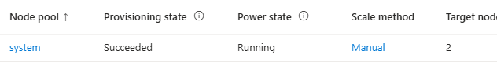

# AKS — 같은 앱을 Deployment·Pod·Service로 실행하기

[English](./README.md) | 한국어


## 1. 학습 목표·모듈 경계

| 선택 범위 | 입력 | 결과 | 건너뛸 트랙 |
|---|---|---|---|
| manifest 읽기 | 포함된 YAML과 공통 앱 계약 | Deployment·Service·probe의 연결 설명 | Azure 로그인·registry·클러스터 생성 전부 |
| 선택 Azure 실습 | 동일 앱 이미지·registry ID와 Azure 권한 | 앱 HTTP 계약·Pod 로그·선택 리소스 정리 | VM·Container Apps·Functions·Terraform·DB·Blob |

이미지가 없으면 [공통 이미지 준비](../../../shared/container-image/README-ko.md)의 **4.1~4.2만** 사용한다. Container Apps용 user-assigned pull identity는 필요 없다. 이미 승인된 이미지·registry가 있으면 준비를 생략한다. **다른 컴퓨트 트랙을 완료하지 않는다.**

EKS의 클러스터·데이터·트래픽을 실제 이전하는 실습은 아니다. 같은 앱을 새 AKS에 재배포하면서 공통 Kubernetes 모델과 Azure identity 차이를 비교한다.


## 2. 서비스 소개와 AWS 비교


| 서비스·기능 | Microsoft Learn 소개 | 이 모듈에서 볼 내용 |
|---|---|---|
| AKS | [AKS 개요](https://learn.microsoft.com/en-us/azure/aks/what-is-aks) | 관리형 Kubernetes와 node pool |
| Azure Container Registry | [ACR 소개](https://learn.microsoft.com/en-us/azure/container-registry/container-registry-intro) | 같은 digest 이미지 |
| Managed Identity | [Managed Identity 개요](https://learn.microsoft.com/en-us/entra/identity/managed-identities-azure-resources/overview) | control plane·kubelet·앱 identity의 구분 |
| Microsoft Entra Workload ID | [AKS Workload ID 개요](https://learn.microsoft.com/en-us/azure/aks/workload-identity-overview) | 앱 federation과 kubelet pull의 차이 |
| Azure RBAC | [Azure RBAC 개요](https://learn.microsoft.com/en-us/azure/role-based-access-control/overview) | Azure 리소스 권한과 Kubernetes API 인가 |
| Azure CNI Overlay | [CNI Overlay 개요](https://learn.microsoft.com/en-us/azure/aks/concepts-network-azure-cni-overlay) | node IP와 별도 Pod IP 범위 |
| Resource Manager | [Resource Manager 개요](https://learn.microsoft.com/en-us/azure/azure-resource-manager/management/overview) | 실습·managed node 그룹의 소유권 |

| AWS에서 읽던 것 | AKS에서 비교할 것 | 주의점 |
|---|---|---|
| EKS + managed node group | AKS + node pool | 관리 책임·업그레이드·네트워크 기본값이 동일하지 않음 |
| ECR 이미지 pull 권한 | AKS kubelet identity의 ACR 권한 | 앱 Pod의 데이터 접근 권한과 별도 |
| IRSA / EKS Pod Identity | Microsoft Entra Workload ID | 목적은 비슷하지만 federation·service account 연결이 다름 |
| Kubernetes Deployment·Service | 같은 Kubernetes API resource | 클라우드별 ingress·스토리지·identity 설정까지 동일하다는 뜻은 아님 |


### 교육용 클러스터 선택


AKS Automatic은 일반적인 production-ready 기본 후보다. 이 실습은 **node 수·SKU·manifest를 직접 읽고 고정하는 학습**을 위해 AKS Standard(`sku base`)와 Free tier를 선택한다. Free는 control plane SLA가 없다는 뜻이지 VM·디스크·네트워크가 무료라는 뜻이 아니다.

공식 system pool 조건은 **최소 2개 노드, 노드당 최소 4 vCPU·4 GB 메모리**다. `Standard_D4s_v5` 2개를 예제로 사용하며 1-node/B-series 예제로 비용을 낮춰 적지 않는다. 전용 user pool·3-zone HA·GPU·유료 관측성은 제외한다. 앱을 system pool에 함께 두는 것은 교육용 단순화이며 production 분리 설계가 아니다.


## 3. 사전 준비·권한·비용


- **명령 환경:** 로컬 PowerShell 7.4 이상 + Azure CLI + `kubectl` + `kubelogin`, 저장소 루트. WSL Bash 명령으로 복사하지 않는다.
- `kubectl`은 선택한 Kubernetes 버전과 지원되는 version skew를 맞춘다. [AKS client 설치](https://learn.microsoft.com/en-us/cli/azure/aks#az-aks-install-cli)를 참고해 `az aks install-cli`의 버전·설치 위치를 확인하고 준비한다. 기존 도구·kubeconfig를 임의로 덮어쓰지 않는다.
- 강사는 `Microsoft.ContainerService`·`Microsoft.Network`·`Microsoft.Compute`·`Microsoft.ManagedIdentity` 등록, 리전의 supported Kubernetes patch, VM SKU 가용성·quota를 확인한다. 기본 VM 8 vCPU 외에 upgrade surge 여유도 고려한다.
- 새 실습 그룹·AKS 생성/조회/삭제, cluster user credential 조회 권한이 필요하다.
- 승인된 관리자는 새 cluster scope의 `Azure Kubernetes Service RBAC Cluster Admin`을 참가자에게 부여한다. namespace 생성·node 조회까지 배우기 위한 **실습 전용 클러스터 범위의 단순화**다. 구독 전체 Owner를 참가자 기본 권한으로 주지 않는다.
- kubelet에 registry scope `AcrPull`도 별도 부여한다. role assignment 권한은 일반 리소스 Contributor와 다르다. 이 모듈은 RBAC mode ACR만 다룬다. ABAC registry에 `AcrPull`을 그대로 적용하지 않는다.
- Entra 인증과 Azure RBAC를 사용하고 local account는 끈다. kubeconfig는 이 실습의 Git 제외 폴더에만 저장한다.
- 비용: **D4s_v5 노드 2개·managed OS disk·AKS outbound load balancer/public IP**. 앱 Service는 ClusterIP라 외부 앱용 LoadBalancer를 추가하지 않는다. [가격 계산기](https://azure.microsoft.com/en-us/pricing/calculator/)에서 승인한다.
- 최소 구성도 부담되면 manifest 읽기만 하거나 강사 데모로 진행한다. 임의로 구독·리전·쿼터를 변경하거나 미지원 1-node 구성으로 줄이지 않는다.
- 이 모듈의 새 그룹과 AKS가 만든 node 그룹만 소유한다. **기존 registry·이미지·다른 컴퓨트는 정리하지 않는다.**


## 4. 단계별 실습 — 필요한 범위만 선택


### 4.1 클라우드 없이 manifest 읽기


[app.yaml](./lab/app.yaml)을 열고 다음을 찾는다.

```text
Deployment: 1 replica → Pod: image + HTTP 8080 + /health probes
Service: ClusterIP 8080 → app=workshop label을 가진 Pod의 http port
kubectl port-forward → 로컬 127.0.0.1:8080
```

- Deployment의 selector·Pod label·Service selector가 일치하는가?
- readiness probe는 요청을 받을 준비, liveness probe는 재시작 판단이라는 차이를 설명할 수 있는가?
- 요청 CPU 100m·메모리 128Mi와 제한 250m·256Mi를 구분할 수 있는가?
- 동일한 [공통 앱](../../../sample-app/README-ko.md)의 메모리 데이터 때문에 1 replica·`Recreate`를 쓴다. 재배포 중 끊김이 있고 데이터가 초기화되므로 HA·무중단 설계라고 설명하지 않는다.
- 토큰을 mount하지 않는 이유는 이 앱이 Kubernetes API를 호출하지 않기 때문이다. Workload ID를 활성화해도 이 Pod에 Azure 데이터 권한을 자동 부여하지 않는다.

분석만 선택했다면 여기서 완료한다. `<namespace>`·`<container-image>`가 있는 template을 그대로 배포하지 않는다.


### 4.2 선택 Azure 실습의 대상·입력 확인


```powershell
$ErrorActionPreference = "Stop"
$PSNativeCommandUseErrorActionPreference = $true
az version
kubectl version --client
kubelogin --version
az login
$SubscriptionId = "<sandbox-subscription-id>"
$Location = "<approved-region>"
$KubernetesVersion = "<approved-supported-patch-version>"
$ApiServerCidr = "<approved-public-admin-ip>/32"
$NodeSshPublicKeyFile = "<approved-RSA-public-key-file>"
$RegistryServer = "<approved-registry-login-server>"
$RegistryId = "<approved-registry-resource-id>"
$ContainerImage = "<approved-registry-login-server>/workshop/app@sha256:<digest>"
$ParsedId = [guid]::Empty
$ParsedAddress = [System.Net.IPAddress]::None
if (-not [guid]::TryParse($SubscriptionId, [ref]$ParsedId) -or
    [string]::IsNullOrWhiteSpace($Location) -or $Location -like "<*" -or
    $KubernetesVersion -notmatch "^\d+\.\d+\.\d+$" -or
    $ApiServerCidr -notmatch "^\d{1,3}(\.\d{1,3}){3}/32$" -or
    -not [System.Net.IPAddress]::TryParse(($ApiServerCidr -split "/")[0], [ref]$ParsedAddress) -or
    -not (Test-Path -LiteralPath $NodeSshPublicKeyFile -PathType Leaf) -or
    [string]::IsNullOrWhiteSpace($RegistryServer) -or $RegistryServer -like "<*" -or
    [string]::IsNullOrWhiteSpace($RegistryId) -or $RegistryId -like "<*" -or
    $ContainerImage -notmatch "^[a-z0-9.-]+/[a-z0-9._/-]+@sha256:[a-f0-9]{64}$") {
    throw "Set the approved cluster inputs, public admin IP, public SSH key and image."
}
if (-not $RegistryId.StartsWith("/subscriptions/$SubscriptionId/", [System.StringComparison]::OrdinalIgnoreCase) -or
    -not $ContainerImage.StartsWith("$RegistryServer/", [System.StringComparison]::OrdinalIgnoreCase)) {
    throw "This lab expects the registry in the approved subscription and the selected image."
}
$NodeSshPublicKey = (Get-Content -Raw -LiteralPath $NodeSshPublicKeyFile).Trim()
if ($NodeSshPublicKey -notlike "ssh-rsa *") { throw "Provide an approved RSA public key, not a private key." }
az account show --subscription $SubscriptionId --query "{name:name,id:id,tenantId:tenantId,state:state}" --output table
az aks get-versions --location $Location --subscription $SubscriptionId --output table
$LabId = [guid]::NewGuid().ToString("N").Substring(0, 8)
$ResourceGroupName = "rg-amw-aks-$LabId"
$NodeGroupName = "rg-amw-aksnodes-$LabId"
$ClusterName = "aks-amw-$LabId"
$Namespace = "amw-$LabId"
$LabDirectory = Join-Path (Join-Path $PWD "lab-output") "aks-$LabId"
$KubeConfigPath = Join-Path $LabDirectory "kubeconfig"
$ManifestPath = Join-Path $LabDirectory "app.yaml"
[pscustomobject]@{ Subscription = $SubscriptionId; Region = $Location; Group = $ResourceGroupName; Nodes = $NodeGroupName; Cluster = $ClusterName; AdminCidr = $ApiServerCidr; Image = $ContainerImage } | Format-List
```

승인된 테넌트·`Enabled` 상태, Kubernetes patch, 관리 단말의 public egress IP, quota·비용을 확인한다. SSH는 이 실습의 접속 방법이 아니며 클러스터 생성에 필요한 공개키만 입력한다. 개인키를 복사·생성하지 않는다. API는 이 `/32`에서 접근한다. VPN/출구 IP가 바뀌면 승인된 설정을 다시 확인하며 `0.0.0.0/0`으로 넓히지 않는다.


### 4.3 승인 후 새 클러스터 생성


```powershell
foreach ($Name in @($ResourceGroupName, $NodeGroupName)) {
    $Exists = az group exists --name $Name --subscription $SubscriptionId --output tsv
    if ($Exists -ne "false") { throw "Use fresh lab and node groups." }
}
New-Item -ItemType Directory -Path $LabDirectory -ErrorAction Stop | Out-Null
az group create --name $ResourceGroupName --location $Location --subscription $SubscriptionId --tags Workshop=azure-migration-aks LabId=$LabId --output table
az aks create --name $ClusterName --resource-group $ResourceGroupName --node-resource-group $NodeGroupName --location $Location --sku base --tier free --kubernetes-version $KubernetesVersion --node-count 2 --node-vm-size Standard_D4s_v5 --node-osdisk-type Managed --node-osdisk-size 32 --os-sku AzureLinux3 --max-pods 30 --network-plugin azure --network-plugin-mode overlay --network-dataplane cilium --pod-cidr 10.244.0.0/16 --service-cidr 10.50.0.0/16 --dns-service-ip 10.50.0.10 --outbound-type loadBalancer --api-server-authorized-ip-ranges $ApiServerCidr --enable-managed-identity --enable-aad --enable-azure-rbac --disable-local-accounts --enable-oidc-issuer --enable-workload-identity --ssh-key-value $NodeSshPublicKeyFile --subscription $SubscriptionId --output table
$Cluster = az aks show --name $ClusterName --resource-group $ResourceGroupName --subscription $SubscriptionId --output json | ConvertFrom-Json
if ($Cluster.provisioningState -ne "Succeeded" -or $Cluster.nodeResourceGroup -ne $NodeGroupName -or
    @($Cluster.agentPoolProfiles).Count -ne 1 -or $Cluster.agentPoolProfiles[0].count -ne 2 -or
    $Cluster.agentPoolProfiles[0].vmSize -ne "Standard_D4s_v5") {
    throw "The cluster does not match the approved lab configuration."
}
$ClusterId = $Cluster.id
$KubeletObjectId = $Cluster.identityProfile.kubeletidentity.objectId
$ParticipantObjectId = az ad signed-in-user show --query id --output tsv
if (-not $ClusterId -or -not $KubeletObjectId -or -not $ParticipantObjectId) { throw "Cluster or identity IDs are missing." }
[pscustomobject]@{ ClusterScope = $ClusterId; RegistryScope = $RegistryId; Kubelet = $KubeletObjectId; Participant = $ParticipantObjectId } | Format-List
```

**관찰:** 새 AKS와 node 그룹, system pool 2개 노드다. 앱 Pod는 아직 없다. 주소 범위는 서로 겹치지 않는 교육용 예제이며 기존 VNet·온프레미스에 연결하지 않는다. 실제 환경은 IP 충돌·라우팅 요구를 먼저 검토한다.

**권한 구분:** cluster control plane identity, 이미지를 받는 kubelet identity, 앱 Workload ID는 별도다. Entra Workload ID를 켰지만 이 합성 앱은 Azure SDK를 사용하지 않아 Pod federation·데이터 역할을 추가하지 않는다.


### 4.4 승인된 관리자의 두 역할 할당


관리자가 **새 클러스터·해당 registry·참가자**를 확인하고 각 명령을 별도로 실행한다. 다른 터미널이면 위의 확인한 ID·구독을 설정한다. 생성 직후 각 역할 ID를 안전한 실습 기록에 보관하고 참가자에게 전달한다. 두 번째 할당이 실패해도 첫 번째 ID를 잃지 않도록 하며 Git·공유 캡처에 넣지 않는다.

```powershell
$ErrorActionPreference = "Stop"
$PSNativeCommandUseErrorActionPreference = $true
$AcrPullAssignmentId = az role assignment create --assignee-object-id $KubeletObjectId --assignee-principal-type ServicePrincipal --role AcrPull --scope $RegistryId --subscription $SubscriptionId --query id --output tsv
if ([string]::IsNullOrWhiteSpace($AcrPullAssignmentId)) { throw "The kubelet role assignment ID was not returned." }
$AcrPullAssignmentId
```

첫 번째 ID를 보관한 뒤 참가자 인가를 준비한다.

```powershell
$ClusterAccessAssignmentId = az role assignment create --assignee-object-id $ParticipantObjectId --assignee-principal-type User --role "Azure Kubernetes Service RBAC Cluster Admin" --scope $ClusterId --subscription $SubscriptionId --query id --output tsv
if ([string]::IsNullOrWhiteSpace($ClusterAccessAssignmentId)) { throw "The cluster role assignment ID was not returned." }
$ClusterAccessAssignmentId
```

참가자 터미널에서 같은 ID가 설정됐는지 확인한 뒤 보관한다. 이미 다른 역할을 보유했다는 이유로 기존 역할을 삭제하지 않는다. 이 단계에서 새로 만든 두 역할만 추적한다.

```powershell
if ([string]::IsNullOrWhiteSpace($AcrPullAssignmentId) -or
    -not $AcrPullAssignmentId.StartsWith("$RegistryId/providers/Microsoft.Authorization/roleAssignments/", [System.StringComparison]::OrdinalIgnoreCase) -or
    [string]::IsNullOrWhiteSpace($ClusterAccessAssignmentId) -or
    -not $ClusterAccessAssignmentId.StartsWith("$ClusterId/providers/Microsoft.Authorization/roleAssignments/", [System.StringComparison]::OrdinalIgnoreCase)) {
    throw "Record only the role assignments created for this lab."
}
Set-Content -LiteralPath (Join-Path $LabDirectory "acr-grant-id.txt") -Value $AcrPullAssignmentId -Encoding utf8NoBOM
Set-Content -LiteralPath (Join-Path $LabDirectory "cluster-grant-id.txt") -Value $ClusterAccessAssignmentId -Encoding utf8NoBOM
```

**관찰:** registry scope는 kubelet pull, cluster scope는 참가자의 Kubernetes API 접근이다. 새 할당 전파에는 수분이 걸릴 수 있다. 준비됐다는 추측으로 403을 성공 처리하지 않는다.


### 4.5 이 실습의 kubeconfig·namespace·manifest만 사용


```powershell
if (Test-Path -LiteralPath $KubeConfigPath) { throw "Do not overwrite an existing kubeconfig." }
az aks get-credentials --name $ClusterName --resource-group $ResourceGroupName --file $KubeConfigPath --context $ClusterName --subscription $SubscriptionId
kubelogin convert-kubeconfig --login azurecli --kubeconfig $KubeConfigPath
$Context = kubectl --kubeconfig $KubeConfigPath config current-context
if ($Context -ne $ClusterName) { throw "Unexpected Kubernetes context." }
kubectl --kubeconfig $KubeConfigPath --context $ClusterName get nodes
kubectl --kubeconfig $KubeConfigPath --context $ClusterName create namespace $Namespace
kubectl --kubeconfig $KubeConfigPath --context $ClusterName label namespace $Namespace workshop=azure-migration-aks lab-id=$LabId
$Template = Get-Content -Raw -LiteralPath .\modules\onboarding\compute-aks\lab\app.yaml
$Rendered = $Template.Replace("<namespace>", $Namespace).Replace("<container-image>", $ContainerImage)
if ($Rendered.Contains("<namespace>") -or $Rendered.Contains("<container-image>")) { throw "Manifest placeholders remain." }
Set-Content -LiteralPath $ManifestPath -Value $Rendered -Encoding utf8NoBOM
kubectl --kubeconfig $KubeConfigPath --context $ClusterName apply --namespace $Namespace --filename $ManifestPath
kubectl --kubeconfig $KubeConfigPath --context $ClusterName rollout status deployment/workshop --namespace $Namespace --timeout=180s
kubectl --kubeconfig $KubeConfigPath --context $ClusterName get deployment,pods,services --namespace $Namespace
```

**관찰:** node 2개가 Ready, 앱 replica 1개가 ready, Service는 ClusterIP다. Pod IP·Service IP·node IP를 구분한다. 기본 kubeconfig를 수정하거나 현재 기본 context로 `apply`하지 않는다.


### 4.6 Port-forward와 같은 HTTP 계약 확인


**두 번째 로컬 PowerShell 터미널**에 이 실습의 경로·이름만 설정하고 유지한다. kubeconfig 내용·토큰은 출력하지 않는다.

```powershell
$ErrorActionPreference = "Stop"
$PSNativeCommandUseErrorActionPreference = $true
$KubeConfigPath = "<path-to-this-lab-kubeconfig>"
$ClusterName = "<this-lab-cluster-name>"
$Namespace = "<this-lab-namespace>"
kubectl --kubeconfig $KubeConfigPath --context $ClusterName port-forward --namespace $Namespace service/workshop 8080:8080 --address 127.0.0.1
```

**관찰:** `Forwarding from 127.0.0.1:8080`다. 포트가 이미 사용 중이면 이 실습의 기존 서버만 종료하거나 port-forward의 로컬 포트를 바꾸고 HTTP 요청도 같은 값으로 맞춘다. 앱용 public LoadBalancer·Ingress는 만들지 않는다.

첫 번째 터미널에서 확인한다.

```powershell
$BaseUrl = "http://127.0.0.1:8080"
$Health = Invoke-RestMethod "$BaseUrl/health"
$Before = @(Invoke-RestMethod "$BaseUrl/items")
if ($Health.status -ne "ok" -or $Before.Count -ne 2) { throw "Expected a healthy fresh app with two seed items." }
$Created = Invoke-RestMethod "$BaseUrl/items" -Method Post -ContentType "application/json" -Body '{"name":"aks-workshop-item"}' -StatusCodeVariable PostStatus
$After = @(Invoke-RestMethod "$BaseUrl/items")
if ($PostStatus -ne 201 -or $After.Count -ne 3 -or
    -not ($After | Where-Object { $_.id -eq $Created.id -and $_.name -eq "aks-workshop-item" })) {
    throw "Write/read verification failed."
}
$Invalid = Invoke-WebRequest "$BaseUrl/items" -Method Post -ContentType "application/json" -Body '{"name":""}' -SkipHttpErrorCheck
if ($Invalid.StatusCode -ne 422 -or @(Invoke-RestMethod "$BaseUrl/items").Count -ne 3) {
    throw "Invalid input changed the data or did not return 422."
}
kubectl --kubeconfig $KubeConfigPath --context $ClusterName logs deployment/workshop --namespace $Namespace --tail=20
```

**성공 기준:** 헬스 ok, 2→3개, POST 201·read-back, 잘못된 입력 422·데이터 불변, Pod 로그의 요청 상태다. Running 상태와 함께 HTTP 응답·로그를 확인한다.


### 4.7 선택 private API/검사 client 경로

Portal **AKS Overview → Node pools**에서 system pool의 관리 상태·scale mode·target node 수를 읽는다. 예시는 **Succeeded / Running / Manual / target2**다.



*target 수는 원하는 capacity다. Ready nodes의 `-`는 이 화면에 Kubernetes readiness 값이 없다는 뜻이다. Nodes/Workloads 조회에는 browser/client의 private API route/DNS와 해당 Kubernetes 인가가 필요하다. 제공 private client의 `kubectl get nodes`·Pod readiness/log·HTTP를 사용해 runtime을 확인하고 private endpoint 설정은 유지한다.*

기존 public API `/32` 경로와 하나를 선택한다. **public API CIDR을 private 경로에 그대로 적용하지 않는다.** 승인된 node subnet/명시 outbound/private DNS/control identity·도달 가능한 private client를 준비한다. Standard/base Free·최소2 system nodes·지원 patch·CNI주소를 확인하고 private API/Entra/AzureRBAC/localaccounts disabled를 actual resource에서 읽는다. 준비 세부 사항은 [강사 가이드](../../../guides/instructor-guide-ko.md)를 따른다.

승인된 관리자가 control plane의 필요한 VNet/DNS/NAT권한·kubelet의 registry AcrPull·private client의 새 cluster scope API권한을 각각 준비한다. client MI는 kubelogin msi, local user는 azurecli로 구분하고 실제 can-i/node조회·Pod/probe·같은HTTP계약을 확인한다. kubeconfig는 보호된 별도파일이며 기본config를 덮지 않는다.

private client의 도구·DNS·TCP443·MI 인가는 [강사 준비](../../../guides/instructor-guide-ko.md)를 따른다. 같은 namespace/manifest·localhost HTTP를 확인하고 source DB를 변경하지 않는다.


## 5. 검증·대표 실패


| 실패 | 확인·해결 |
|---|---|
| quota/SKU/버전 오류 | 리전 가용성·최소 system pool 조건·승인 비용 확인. 1-node/B-series로 자동 변경하지 않음 |
| Kubernetes API timeout | 승인된 admin public IP·VPN/egress·API 허용 범위 확인. 공개 범위를 자동 확대하지 않음 |
| 401/403·kubelogin 오류 | 해당 tenant 로그인·cluster scope 역할·전파·client 버전 확인. `--admin`으로 우회하지 않음 |
| ImagePullBackOff | kubelet identity·registry RBAC mode·AcrPull·digest·전파 확인. 앱 identity 권한과 혼동하지 않음 |
| Pending | 리소스 request·node Ready·scheduling 이벤트 확인 |
| CrashLoopBackOff·probe 실패 | 앱 로그·8080 listen·probe 경로·메모리 limit 확인 |
| 데이터 초기화 | Pod 재시작·Recreate 업데이트는 새 메모리 저장소를 만든다는 한계 확인 |

진단은 이 kubeconfig·context·namespace에 한정한다.

```powershell
kubectl --kubeconfig $KubeConfigPath --context $ClusterName describe pods --namespace $Namespace --selector app=workshop
kubectl --kubeconfig $KubeConfigPath --context $ClusterName get events --namespace $Namespace --sort-by=.lastTimestamp
```


## 6. 정리 — 자신이 만든 것만


manifest 읽기만 했다면 Azure 삭제 대상이 없다. 중간 실패라면 **실제로 생성된 단계만** 정리하고 변수·기록을 복구한다. 기존 클러스터·registry를 자동 탐색해서 삭제하지 않는다.


### 6.1 Namespace와 이 실습의 role assignment


port-forward 터미널을 `Ctrl+C`로 종료한다. 참가자 터미널에서 namespace의 태그와 이름을 확인한 뒤 삭제한다.

```powershell
$Ns = kubectl --kubeconfig $KubeConfigPath --context $ClusterName get namespace $Namespace --output json | ConvertFrom-Json
if ($Namespace -ne "amw-$LabId" -or $Ns.metadata.labels.workshop -ne "azure-migration-aks" -or $Ns.metadata.labels.'lab-id' -ne $LabId) {
    throw "The namespace is not this lab."
}
[pscustomobject]@{ Cluster = $ClusterName; Namespace = $Namespace; Labels = $Ns.metadata.labels } | Format-List
kubectl --kubeconfig $KubeConfigPath --context $ClusterName get deployment,pods,services --namespace $Namespace
```

대상과 영향을 확인하고 승인한 경우에만 삭제한다.

```powershell
kubectl --kubeconfig $KubeConfigPath --context $ClusterName delete namespace $Namespace --wait=true
```

삭제 확인·승인은 이 명령을 실행하기 전에 한다. 이후 승인된 관리자는 4.4에서 보관한 **정확한 두 assignment ID**만 확인·삭제한다. registry의 기존 역할이나 구독의 역할을 일괄 삭제하지 않는다.

```powershell
$AcrPullAssignmentId = (Get-Content -Raw -LiteralPath (Join-Path $LabDirectory "acr-grant-id.txt")).Trim()
$ClusterAccessAssignmentId = (Get-Content -Raw -LiteralPath (Join-Path $LabDirectory "cluster-grant-id.txt")).Trim()
if (-not $AcrPullAssignmentId.StartsWith("$RegistryId/providers/Microsoft.Authorization/roleAssignments/", [System.StringComparison]::OrdinalIgnoreCase) -or
    -not $ClusterAccessAssignmentId.StartsWith("$ClusterId/providers/Microsoft.Authorization/roleAssignments/", [System.StringComparison]::OrdinalIgnoreCase)) {
    throw "Unexpected role assignment scopes."
}
az role assignment list --scope $RegistryId --subscription $SubscriptionId --query "[?id=='$AcrPullAssignmentId'].{id:id,principal:principalId,scope:scope}" --output table
az role assignment list --scope $ClusterId --subscription $SubscriptionId --query "[?id=='$ClusterAccessAssignmentId'].{id:id,principal:principalId,scope:scope}" --output table
```

첫 할당이 이 cluster의 kubelet, 두 번째가 이 실습의 참가자인지 대조하고 삭제 승인을 받는다. 이 역할 정리는 registry 자체 삭제가 아니라 **이 소비자가 추가한 grant만 회수**하는 것이다. 확인한 경우에만 다음을 실행한다.

```powershell
az role assignment delete --ids $AcrPullAssignmentId --subscription $SubscriptionId
az role assignment delete --ids $ClusterAccessAssignmentId --subscription $SubscriptionId
```


### 6.2 Cluster 그룹과 managed node 그룹 확인


```powershell
$Group = az group show --name $ResourceGroupName --subscription $SubscriptionId --output json | ConvertFrom-Json
$CurrentCluster = az aks show --name $ClusterName --resource-group $ResourceGroupName --subscription $SubscriptionId --output json | ConvertFrom-Json
az resource list --resource-group $ResourceGroupName --subscription $SubscriptionId --query "[].{name:name,type:type}" --output table
az resource list --resource-group $NodeGroupName --subscription $SubscriptionId --query "[].{name:name,type:type}" --output table
if ($ResourceGroupName -ne "rg-amw-aks-$LabId" -or $Group.tags.Workshop -ne "azure-migration-aks" -or
    $Group.tags.LabId -ne $LabId -or $CurrentCluster.nodeResourceGroup -ne "rg-amw-aksnodes-$LabId") {
    throw "The cluster groups do not match this lab."
}
az group delete --name $ResourceGroupName --subscription $SubscriptionId
foreach ($Name in @($ResourceGroupName, $NodeGroupName)) {
    $ExistsAfter = az group exists --name $Name --subscription $SubscriptionId --output tsv
    if ($ExistsAfter -ne "false") { throw "A lab or node group remains; investigate before claiming cleanup." }
}
```

AKS 삭제가 managed node 그룹의 정리도 수행하는지 확인한다. 남은 그룹을 바로 강제 삭제하지 말고 실패 원인·과금 리소스를 강사와 확인한다. 로컬 kubeconfig·렌더링 파일·두 역할 ID 파일은 정리 확인 후 해당 **4개 파일만** 제거하고 빈 실습 폴더를 지운다. 다음 세션에서 값이 필요하면 먼저 안전한 실습 기록으로 보관한다.

```powershell
Remove-Item -LiteralPath $KubeConfigPath
Remove-Item -LiteralPath $ManifestPath
Remove-Item -LiteralPath (Join-Path $LabDirectory "acr-grant-id.txt")
Remove-Item -LiteralPath (Join-Path $LabDirectory "cluster-grant-id.txt")
Remove-Item -LiteralPath $LabDirectory
```

다른 파일이 있으면 빈 폴더 삭제가 실패하므로 내용을 확인하고 전체 `lab-output`을 재귀 삭제하지 않는다. 공유 이미지 그룹은 마지막 소비자가 끝난 후 [공통 준비의 정리](../../../shared/container-image/README-ko.md#6-정리--마지막-소비자가-끝난-다음)를 따르며 기존 승인 입력은 삭제하지 않는다.


## 7. 실제 이전에서 추가로 확인할 사항


- EKS add-on·Ingress·스토리지/PVC·CRD·policy·DNS·클러스터 버전 호환성.
- IRSA/Pod Identity→Workload ID, kubelet pull과 앱 데이터 권한 분리.
- IP 계획·egress·API 접근, private 경계와 최소 namespace 권한.
- 별도 user pool·HA·PDB·배포 전략·영속 데이터·백업·컷오버·롤백.
- 관측성·패치·업그레이드·비용. 이 작은 재배포는 실제 EKS 이전 검증이 아니다.


## 8. 출처·버전·확인 범위
