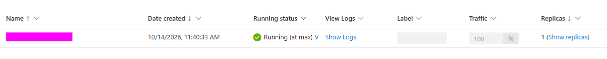
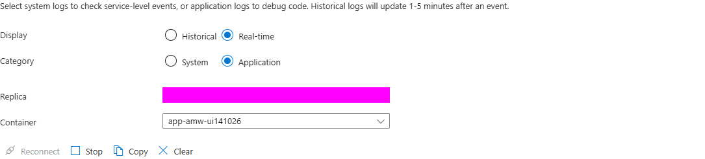

# Container Apps — 서버 대신 앱 실행을 선언하기

[English](./README.md) | 한국어


## 1. 학습 목표·모듈 경계


- 대상: EC2 + Docker 또는 ECS 개념을 아는 엔지니어, 예상 60~75분. 이미지가 없으면 별도 공통 준비 30~40분을 추가한다.
- 선택할 때: HTTP 컨테이너의 재배포·Managed Identity pull·HTTPS·로그·정리를 배우고 싶을 때.
- 입력: 같은 앱의 digest 이미지, registry server, `AcrPull`이 있는 user-assigned identity, 해당 Azure 권한.
- 결과: `/health`·`/items` 계약과 앱 그룹의 정리 확인.
- 건너뛸 자료: VM·AKS·Functions·Storage·DB·Terraform·공통 앱의 로컬 Docker 실습.
- 제외: EC2 OS·디스크 복제, EKS/Kubernetes 운영 모델, 실제 데이터 이전.

이미 승인된 입력이 있으면 준비를 반복하지 않는다. 없다면 [공통 이미지 준비](../../../shared/container-image/README-ko.md)의 4.1~4.3만 수행한다. **다른 컴퓨트 트랙이나 CLI 앱 배포 완료는 필요 없다.** Terraform은 이 문서를 선행 모듈로 쓰지 않고 공통 준비의 입력만 사용한다.


## 2. 서비스 소개와 AWS 비교


| 서비스·기능 | Microsoft Learn 소개 | 선택 이유 |
|---|---|---|
| Container Apps | [Container Apps 개요](https://learn.microsoft.com/en-us/azure/container-apps/overview) | VM 운영 없이 HTTP 컨테이너 실행 |
| Container Registry | [ACR 소개](https://learn.microsoft.com/en-us/azure/container-registry/container-registry-intro) | 준비된 동일 이미지 |
| Managed Identity | [Managed Identity 개요](https://learn.microsoft.com/en-us/entra/identity/managed-identities-azure-resources/overview) | registry 암호 없는 pull |
| Azure RBAC | [Azure RBAC 개요](https://learn.microsoft.com/en-us/azure/role-based-access-control/overview) | registry scope 권한 |
| Resource Manager | [Resource Manager 개요](https://learn.microsoft.com/en-us/azure/azure-resource-manager/management/overview) | 앱 전용 그룹과 lifecycle |

Container Apps는 EC2를 복제하는 서버 이전이 아니라 **앱 실행 방식을 바꾸는 재배포**다. ECS/Fargate와 운영 책임을 비교하되 네트워크·스케일·revision을 1:1 동일하다고 설명하지 않는다.


## 3. 사전 준비·권한·비용


- 명령은 **로컬 PowerShell 7.4 이상 + Azure CLI**, 저장소 루트에서 실행한다.
- 선택한 명령의 CLI help와 지원을 확인한다. 이 Azure CLI 2.90.0의 core `containerapp` 명령으로 실행했고 extension 추가는 필요하지 않았다. 선택 기능의 명령이 실제로 없을 때만 승인된 extension을 준비하고 버전을 기록한다.
- 승인된 구독·리전의 `Microsoft.App` 등록·Consumption quota를 강사가 확인한다.
- 새 앱 그룹·environment·앱의 생성/조회/삭제 권한과 **기존 입력 identity의 assign 권한**이 필요하다. 새 앱 그룹의 Contributor만으로 다른 그룹의 identity 연결까지 가능하다고 가정하지 않는다.
- 이미지·identity는 [공통 준비](../../../shared/container-image/README-ko.md) 또는 승인된 기존 입력이다. 이 모듈은 registry·identity를 생성하거나 역할을 새로 부여하지 않는다.
- 비용 대상은 **Container Apps의 1 replica**다. 입력 registry 비용은 공통 준비/원 소유자가 별도로 확인한다. [가격 계산기](https://azure.microsoft.com/en-us/pricing/calculator/)에서 비용 승인을 받는다.
- 로그는 stream만 사용하고 별도 Log Analytics workspace는 만들지 않는다.
- 인증 없는 공개 HTTPS 교육용 API다. 합성 데이터만 넣고 공개 endpoint가 금지된 환경에서는 별도 승인 환경을 준비한다.


## 4. 단계별 실습 — PowerShell


### 4.1 대상·입력 확인


```powershell
$ErrorActionPreference = "Stop"
$PSNativeCommandUseErrorActionPreference = $true
az version
az extension show --name containerapp --query "{name:name,version:version}" --output table
az login
$SubscriptionId = "<sandbox-subscription-id>"
$Location = "<approved-region>"
$RegistryServer = "<approved-registry-login-server>"
$ContainerImage = "<approved-registry-login-server>/workshop/app@sha256:<digest>"
$PullIdentityId = "<approved-user-assigned-identity-resource-id>"
$ParsedId = [guid]::Empty
if (-not [guid]::TryParse($SubscriptionId, [ref]$ParsedId) -or
    [string]::IsNullOrWhiteSpace($Location) -or $Location -like "<*" -or
    [string]::IsNullOrWhiteSpace($RegistryServer) -or $RegistryServer -like "<*" -or
    $ContainerImage -notmatch "^[a-z0-9.-]+/[a-z0-9._/-]+@sha256:[a-f0-9]{64}$" -or
    [string]::IsNullOrWhiteSpace($PullIdentityId) -or $PullIdentityId -like "<*") {
    throw "Set the approved subscription, region, image, registry and pull identity."
}
if (-not $ContainerImage.StartsWith("$RegistryServer/", [System.StringComparison]::OrdinalIgnoreCase)) {
    throw "The image does not belong to the selected registry."
}
az account show --subscription $SubscriptionId --query "{name:name,id:id,tenantId:tenantId,state:state}" --output table
$LabId = [guid]::NewGuid().ToString("N").Substring(0, 8)
$ResourceGroupName = "rg-amw-aca-$LabId"
$EnvironmentName = "env-amw-$LabId"
$AppName = "app-amw-$LabId"
[pscustomobject]@{ Subscription = $SubscriptionId; Region = $Location; Group = $ResourceGroupName; Image = $ContainerImage } | Format-List
```

공통 준비와 같은 터미널이면 placeholder 대신 확인한 입력 값을 사용한다. 새 터미널에는 해당 값을 명시적으로 설정한다. 구독·테넌트·`Enabled` 상태, 리전·비용·입력의 pull/assign 권한을 확인한 뒤 진행한다.


### 4.2 이 모듈의 새 앱 그룹만 생성


```powershell
$Exists = az group exists --name $ResourceGroupName --subscription $SubscriptionId --output tsv
if ($Exists -ne "false") { throw "Do not reuse an existing app group." }
az group create --name $ResourceGroupName --location $Location --subscription $SubscriptionId --tags Workshop=azure-migration-container-apps LabId=$LabId --output table
```

**관찰:** 새 앱 그룹이다. 입력 registry·identity는 다른 그룹에 그대로 있으며 새로 만들거나 이 그룹으로 옮기지 않는다.


### 4.3 Environment와 앱 생성


```powershell
az containerapp env create --name $EnvironmentName --resource-group $ResourceGroupName --location $Location --logs-destination none --enable-workload-profiles true --subscription $SubscriptionId --output table
az containerapp create --name $AppName --resource-group $ResourceGroupName --environment $EnvironmentName --image $ContainerImage --user-assigned $PullIdentityId --registry-identity $PullIdentityId --registry-server $RegistryServer --ingress external --target-port 8080 --transport auto --cpu 0.25 --memory 0.5Gi --min-replicas 1 --max-replicas 1 --revisions-mode single --subscription $SubscriptionId --output table
$Fqdn = az containerapp show --name $AppName --resource-group $ResourceGroupName --subscription $SubscriptionId --query properties.configuration.ingress.fqdn --output tsv
if ([string]::IsNullOrWhiteSpace($Fqdn)) { throw "No ingress hostname was returned." }
$BaseUrl = "https://$Fqdn"
$BaseUrl
```

**관찰:** HTTPS 주소가 표시된다. `target-port 8080`은 컨테이너의 listen 포트이며 클라이언트는 HTTPS 443으로 접근한다.

메모리 데이터 차이를 줄이기 위해 1 replica·single revision으로 제한한다. scale-to-zero·HA·무중단·데이터 영속성을 검증하는 설정은 아니다.

CLI create가 polling 중 connection reset으로 실패하면 같은 이름을 곧바로 재생성하지 않는다. `env show`/`containerapp show`에서 실제 state·오류를 확인하고 실패한 명령의 exit code와 resource 상태를 별도로 기록한다.


### 4.4 헬스·쓰기·읽기·로그 검증

```powershell
$Health = Invoke-RestMethod "$BaseUrl/health"
if ($Health.status -ne "ok") { throw "Health response differs from the app contract." }
$Before = @(Invoke-RestMethod "$BaseUrl/items")
$Created = Invoke-RestMethod "$BaseUrl/items" -Method Post -ContentType "application/json" -Body '{"name":"azure-workshop-item"}'
$After = @(Invoke-RestMethod "$BaseUrl/items")
if ($After.Count -ne $Before.Count + 1 -or -not ($After | Where-Object { $_.id -eq $Created.id -and $_.name -eq $Created.name })) {
    throw "The created item could not be read back."
}
[pscustomobject]@{ Health = $Health.status; Before = $Before.Count; After = $After.Count; CreatedId = $Created.id } | Format-List
az containerapp logs show --name $AppName --resource-group $ResourceGroupName --type console --tail 20 --subscription $SubscriptionId
```

**성공 기준:** 헬스 `ok`, 항목 수 1 증가, 같은 생성 항목을 읽을 수 있고 로그에서 요청을 확인한다. 재시작·revision 변경으로 데이터가 초기화될 수 있다.

Portal에서 이 앱의 **Revisions and replicas**를 열고 active revision·traffic 배분·replica 수를 읽는다. 예시 single-replica revision은 **Running at max**·**traffic 100%**·**replica 1**이다. “at max”는 설정한 replica 한도이며 CPU 포화·HA·앱 정상 동작을 증명하지 않는다.



선택 revision의 log stream에서 **Real-time**·**Application**을 고르고 selector가 승인된 revision/replica/container인지 확인한다. 실제 log와 HTTP 요청을 대조한다. health/읽기·생성·잘못된 입력·없는 route는 각각 200·201·422·404로 관찰할 수 있다. payload·식별정보가 있는 log는 공유하지 않는다.



*이미지는 controls만 보여주며 잘린 body는 제외했으므로 HTTP status는 실제 stream에서 읽는다. 승인된 실제 stream에서 해당 line을 읽는다. **Stop**은 stream 보기를 닫는 것이지 앱 정지나 과금 종료가 아니다.*


## 5. 대표 실패


| 실패 | 확인·해결 |
|---|---|
| identity assign 권한 부족 | 입력 identity scope의 연결 권한을 관리자와 확인 |
| image pull 실패 | digest·ACR RBAC mode·ARM 인증·identity AcrPull과 역할 전파 확인 |
| 502/503·헬스 실패 | revision·console/system 로그, 앱 시작 오류·target port 확인 |
| 내용 검증 실패 | 프로세스 재시작·replica와 실제 응답 확인. 실패를 성공으로 바꾸지 않음 |


## 6. 정리 — 앱 그룹만 소유


먼저 포함 리소스가 이 실습의 environment·앱뿐인지 확인한다. **입력 registry·identity와 다른 모듈의 리소스는 삭제하지 않는다.**

```powershell
az account show --subscription $SubscriptionId --query "{name:name,id:id}" --output table
$Group = az group show --name $ResourceGroupName --subscription $SubscriptionId --output json | ConvertFrom-Json
az resource list --resource-group $ResourceGroupName --subscription $SubscriptionId --query "[].{name:name,type:type,id:id}" --output table
if ($ResourceGroupName -ne "rg-amw-aca-$LabId" -or $Group.tags.Workshop -ne "azure-migration-container-apps" -or $Group.tags.LabId -ne $LabId) {
    throw "The group does not match this app lab."
}
az group delete --name $ResourceGroupName --subscription $SubscriptionId
$ExistsAfter = az group exists --name $ResourceGroupName --subscription $SubscriptionId --output tsv
if ($ExistsAfter -ne "false") { throw "App group deletion is not verified." }
```

CLI 확인 요청에 대상을 대조해 응답하고 `--yes`는 사용하지 않는다. 모든 소비 모듈이 끝난 후에만 [공통 이미지 준비 정리](../../../shared/container-image/README-ko.md#6-정리--마지막-소비자가-끝난-다음)를 수행한다. 기존 승인 입력이면 그 리소스는 정리 대상이 아니다.


## 7. 실제 이전 고려사항


- OS·이미지 플랫폼·런타임, 외부 DB·스토리지와 revision 간 데이터 일관성.
- 인증·네트워크·최소 권한, scale-to-zero·콜드 스타트·요청 제한.
- 영구 로그·백업·운영 전환. EC2 인스턴스를 복제한 실습은 아니다.


## 8. 출처


- 직접 작성한 명령이며 기존 이미지 준비는 공통 instruction으로 추출했다.
