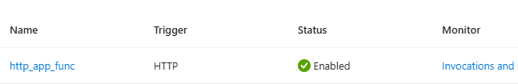

# Functions — HTTP trigger에 같은 앱을 연결하는 선택 확장

[English](./README.md) | 한국어

**샘플 설정:** 제공 Blob 예제는 private endpoint/DNS·public Disabled·Entra data 인증·Shared Key/익명 금지·bypass None·resource-instance 예외 없음으로 구성한다. 선택 lab의 승인 identity/network 입력과 관리자에게 적용 정책을 확인한다. 제공 설정/TLS 검사는 유지하며 대안은 별도 지원 시나리오·승인을 따른다. 인증과 network는 다른 통제다.


## 1. 학습 목표·모듈 경계

| 모드 | 입력 | 범위 |
|---|---|---|
| A: 개념/코드 읽기 | 같은 FastAPI source·HTTP ASGI adapter·공식 소개 | Azure/AWS 로그인·SDK 설치·host/resource 실행 없음 |
| B: local 학습 | Python 3.12·Functions Core Tools 4·Azurite·approved package source | 단일 local worker의 같은 HTTP 계약·auth/route 한계 |
| C: 선택 cloud 관찰 | 지원되는 Linux Python hosting·새 app/host storage·권한·source 배포·비용 승인 | function key/auth·host/scale·앱 상태 관찰. 데이터 영속성을 보장하지 않음 |

같은 [sample-app/app.py](../../../sample-app/app.py)를 준비 폴더로 복사해 사용한다. 새 business app이나 DB adapter는 만들지 않고 원본도 수정하지 않는다. **기존 Docker image를 그대로 Functions/Flex에 배포하는 트랙이 아니다.** 새 Function App entry/host·Python requirements와 source 배포가 필요하다.

실제 Lambda event·IAM·API Gateway·data를 이전하는 실습은 아니다. AWS resource도 만들지 않는다.


## 2. 서비스 소개와 trigger/binding


| 서비스/기능 | Microsoft Learn 소개 | 볼 내용 |
|---|---|---|
| Azure Functions | [Functions 개요](https://learn.microsoft.com/en-us/azure/azure-functions/functions-overview) | event-driven host와 앱 실행 |
| Triggers/bindings | [Trigger·binding 개념](https://learn.microsoft.com/en-us/azure/azure-functions/functions-triggers-bindings) | 시작 event와 입력/출력 연결 |
| HTTP trigger | [HTTP trigger](https://learn.microsoft.com/en-us/azure/azure-functions/functions-bindings-http-webhook-trigger) | request·route·auth·HTTP response |
| Python model | [Python developer guide](https://learn.microsoft.com/en-us/azure/azure-functions/functions-reference-python), [AsgiFunctionApp API](https://learn.microsoft.com/en-us/python/api/azure-functions/azure.functions.asgifunctionapp?view=azure-python) | v2 entry와 thin ASGI adapter |
| Flex Consumption | [Flex hosting 소개](https://learn.microsoft.com/en-us/azure/azure-functions/flex-consumption-plan) | Linux source hosting·scale·memory·비용 |
| Managed Identity/host storage | [Identity 개요](https://learn.microsoft.com/en-us/entra/identity/managed-identities-azure-resources/overview), [Host storage 설정](https://learn.microsoft.com/en-us/azure/azure-functions/functions-app-settings#azurewebjobsstorage) | host와 deployment storage의 권한 |

| AWS에서 읽던 것 | Functions에서 비교할 것 | 동일하게 가정하면 안 되는 부분 |
|---|---|---|
| Lambda handler·event/context | HTTP trigger/trigger별 parameter·Functions context | API Gateway/Lambda event JSON을 그대로 HTTP app이 받는 것이 아님 |
| API Gateway 연동 | HTTP trigger·route·response·auth | authorization·path·hosting/scale가 같지 않음 |
| S3/SQS/scheduled event | Blob/Event Grid·Queue/Service Bus·Timer trigger 후보 | 전달·재시도·중복·binding 설정을 source 요구에 맞춰 검토 |
| IAM role | Managed Identity/RBAC와 trigger 연결 | host storage·app data·HTTP caller 권한은 별도 |

선택한 adapter 범위는 **HTTP trigger → ASGI → 동일 앱 → HTTP response**뿐이다. Timer·Queue·Blob은 binding 사용 목적만 소개하고 resource·함수·SDK를 전부 추가하지 않는다. `trigger`는 실행 event, `input/output binding`은 지원되는 입출력 연결이며 모든 외부 service의 자동 연결 기능은 아니다.


## 3. 사전 준비·hosting/auth·비용


- A는 문서만 읽는다. B는 **local WSL/Linux Bash**의 Python 3.12·Core Tools 4·Azurite를 선택한다. 준비 폴더 생성 예만 **local PowerShell 7.4 이상**이며 셸을 섞지 않는다.
- WSL에서는 `command -v node`, `command -v func`, `command -v azurite`로 실제 실행 경로를 먼저 확인한다. Windows npm 설치 경로가 PATH에서 발견된 것을 Linux 도구 준비 완료로 취급하지 않는다. 승인된 Linux 설치와 `func --version`·`azurite --version`의 정상 종료를 확인한 뒤 host를 시작한다. launcher의 첫 실행이 추가 binary를 내려받을 수도 있으므로 실행 파일 존재만 확인해서는 안 된다.
- [Core Tools 공식 local 개발 안내](https://learn.microsoft.com/en-us/azure/azure-functions/functions-run-local#install-the-azure-functions-core-tools)의 **Linux 탭**을 따른다. 이 모듈은 GA Core Tools v4 기준이며 preview Functions CLI v5와 혼동하지 않는다. Ubuntu 배포판이 공식 APT 안내의 지원 목록에 없으면 다른 release 이름을 강제로 대입하지 않고 해당 OS의 지원되는 설치 방법을 별도로 확인한다.
- Python 3.12는 현재 공통 앱 범위를 유지하려는 선택이다. Functions/hosting/SDK의 현재 지원을 확인하고 더 최신 Python으로 조용히 바꾸지 않는다. source/SDK 호환성 확인 없이 supported runtime을 인증하지 않는다.
- requirements는 dependency 후보 범위이고 lock/실행 검증이 아니다. 조직의 승인된 단일 package source로 준비한다. uv는 해당 source 설정을 별도로 확인하며 pip 설정이 자동 적용된다고 가정하지 않는다.
- local sample의 `UseDevelopmentStorage=true`는 **Azurite용 공개 개발 설정**이며 실제 storage account key가 아니다. cloud/production storage 설정으로 publish하지 않는다.
- C는 Linux Flex Consumption의 **현재 source 배포 경로**를 후보로 두고 region·runtime·quota·memory·concurrency·always-ready·배포 방식과 비용을 승인한다. custom container 지원을 같은 경로로 가정하지 않는다.
- host storage/deployment storage·필요 data roles·Managed Identity는 current hosting 지침으로 준비한다. host가 storage를 쓴다는 것으로 이 앱의 `/items`가 Blob/DB에 영속 저장되는 것은 아니다.
- 비용은 execution/선택 hosting·host/deployment storage·관련 log/telemetry다. always-ready·큰 규모·premium/dedicated·추가 paid monitoring을 기본 자동 추가하지 않는다. [가격 계산기](https://azure.microsoft.com/en-us/pricing/calculator/)로 승인한다.
- app resource 생성/배포, identity/storage role assignment, HTTP function key 조회/회수는 별도 권한일 수 있다. broad subscription Owner를 기본값으로 부여하지 않는다.
- adapter는 `AuthLevel.FUNCTION`을 사용한다. function key는 secret이며 per-user Entra 인가나 app의 production 인증 체계를 대신하지 않는다.
- 공식 문헌상 local Core Tools에서는 auth enforcement가 Azure와 다를 수 있다. local 요청 성공을 cloud function key 검증 성공으로 쓰지 않는다.
- 앱은 memory state다. **host/worker 재시작·scale-out·다른 instance의 요청은 서로 같은 data를 공유하지 않는다.** worker 수 1의 local 설정이 cloud 단일 instance를 보장하지 않는다.


## 4. 단계별 instruction


### 4.1 코드/설정에서 달라지는 것 읽기


| 파일 | 역할 |
|---|---|
| [function_app.py](./lab/function_app.py) | `azure.functions` SDK로 동일 FastAPI object를 HTTP/ASGI entry에 연결 |
| [host.json](./lab/host.json) | host config version 2.0·빈 HTTP `routePrefix`로 기존 `/health`·`/items` 경로 유지 |
| [requirements.txt](./lab/requirements.txt) | Functions SDK·FastAPI·Pydantic 후보. Uvicorn Docker entry가 아님 |
| [local.settings.example.json](./lab/local.settings.example.json) | local emulator/worker 설정. secret 파일/실제 계정은 넣지 않음 |
| [.funcignore](./lab/.funcignore) | venv·tests·local settings/secret을 source publish에서 제외 |

Functions runtime 4, Python programming model v2, `host.json`의 version 2.0은 같은 version 번호가 아니다. 이 adapter는 Python v2 형태의 단일 entry이며 함수별 `function.json`을 복제하지 않는다.

원본 Dockerfile의 Uvicorn process/8080 대신 Functions host가 HTTP를 받고 ASGI app을 호출한다. Lambda event/trigger별 코드는 필요한 변환/설정을 별도로 검토해야 한다.


### 4.2 새 staging 폴더만 준비


**local PowerShell, repository root**에서 수행하는 준비 초안이다.  stage는 `lab-output`의 고유 폴더이며 기존 source·다른 폴더를 overwrite하지 않는다.

```powershell
$ErrorActionPreference = "Stop"
$LabId = [guid]::NewGuid().ToString("N").Substring(0, 8)
$StagePath = Join-Path (Join-Path $PWD "lab-output") "functions-$LabId"
$TemplatePath = Join-Path $PWD "modules\onboarding\compute-functions\lab"
if (Test-Path -LiteralPath $StagePath) { throw "Use a fresh Functions staging folder." }
New-Item -ItemType Directory -Path $StagePath -ErrorAction Stop | Out-Null
foreach ($Name in @("function_app.py", "host.json", "requirements.txt", ".funcignore")) {
    Copy-Item -LiteralPath (Join-Path $TemplatePath $Name) -Destination (Join-Path $StagePath $Name)
}
Copy-Item -LiteralPath .\sample-app\app.py -Destination (Join-Path $StagePath "app.py")
$StagePath
```

**관찰할 결과:** 같은 API source 1개와 adapter/host/runtime requirements/ignore의 source 프로젝트다. app 코드를 다시 작성하거나 image registry를 준비하지 않는다.

local B를 선택한 경우에만 example을 stage의 `local.settings.json`로 복사한다.

```powershell
Copy-Item -LiteralPath (Join-Path $TemplatePath "local.settings.example.json") -Destination (Join-Path $StagePath "local.settings.json")
```

실제 local settings는 Git·publish에서 제외하고 emulator 전용이다. `--publish-local-settings` 등으로 cloud에 보내지 않는다. 실제 cloud host storage/identity는 C에서 따로 준비한다.


### 4.3 B — local host와 같은 계약


staging 폴더를 WSL에서 열고 승인된 도구/source를 준비한다. 이 단계는 **staging 안의 WSL Bash**이며 VM Bash/원본 app 폴더가 아니다.

```bash
uv venv --python 3.12 .venv
uv pip install --python .venv --requirements requirements.txt
source .venv/bin/activate
func start --port 7071
```

실제 Azurite는 승인된 local 설치/설정에서 별도로 시작한다. Core Tools·Azurite version·접속·storage 상태가 준비되기 전에 host 성공으로 처리하지 않는다. 강사가 unsupported tool/network를 검증 없이 설치시키지 않는다.

다른 local WSL Bash 터미널에서 선택 HTTP 계약을 관찰한다.

```bash
curl --fail-with-body http://127.0.0.1:7071/health
curl --fail-with-body http://127.0.0.1:7071/items
curl --fail-with-body --request POST http://127.0.0.1:7071/items \
  --header 'Content-Type: application/json' \
  --data '{"name":"functions-workshop-item"}'
curl --fail-with-body http://127.0.0.1:7071/items
```

**local 기대 기준:** fresh 단일 worker의 health ok·초기 2개·POST 201·생성 항목 read-back/3개다. 빈 이름 등 기존 API의 422/data 불변도 별도로 확인한다. `func start`가 함수 목록을 표시했다는 것만으로 계약을 accept하지 않는다.

local auth가 생략된 경우의 성공은 C의 key/security evidence가 아니다. host 재시작 후 data 초기화를 설명하고 영속성/DB migration으로 표시하지 않는다.

검증용 stage에서만 다음을 실행한다. pytest는 개발 검증 도구이며 cloud runtime requirements에 추가하지 않는다. 아래 경로는 4.2의 repository 내 `lab-output/functions-<id>` stage 기준이다.


host 테스트는 **새 단일 worker의 개인 local host**만 대상으로 실행한다. 같은 host에서 재실행하면 이전 write가 남으므로 host를 재시작해 초기 상태를 만든다. 테스트 후에는 자신이 시작한 host·emulator만 종료한다.


### 4.4 C — Portal hosting·storage·source 배포


지원/role/network·비용과 실제 배포를 승인한 승인 후만 수행한다.

1. 고유 `rg-amw-functions-<lab-id>`와 새 Python Function App을 Portal에서 준비한다.
2. supported Linux Flex/Python 3.12·region/quota·memory·scale 설정을 확인한다. 현재 지원이 없으면 승인된 대안을 따로 설계하고 미지원 구성으로 계속하지 않는다.
3. hosting이 요구하는 host/deployment storage·container·identity/role·network를 검토한다. emulator 설정·실제 account key를 source 파일에 넣지 않는다.
4. identity 기반 설정/role이 해당 host/배포 경험을 만족하는지 current 공식 문헌으로 확인한다. app data role과 혼동하지 않는다.
5. default 생성될 telemetry/workspace와 always-ready/scale·추가 비용을 대조한다. 필요 없는 paid 구성을 켜지 않으며 Portal 기본값을 비용 0으로 가정하지 않는다.
6. `.funcignore`·same app source·현재 remote build/dependency·approved package source를 확인한다.
7. 해당 staged source에 대한 Core Tools/Portal의 **현재 지원 deploy 경로**를 선택한다. 이전 Docker image의 ACR pull을 이 경로에 추가하지 않는다.

Core Tools를 선택하면 아래는 **staging WSL Bash** 예다. 현재 runtime/tool/hosting 지원·target와 배포 영향 승인 뒤에만 수행한다.

```bash
: "${FUNCTION_APP_NAME:?승인된 이번 실습 Function App 이름을 설정하세요}"
func azure functionapp publish "$FUNCTION_APP_NAME"
```

`FUNCTION_APP_NAME`은 승인된 이 실습 앱의 실제 이름으로 먼저 설정한다. 값이 없으면 위 명령은 배포 전에 중단한다.

**관찰할 결과:** 실제 배포/host 상태·함수 route·build/runtime log다. 지원 flag·build/source/container 방식은 현재 도구 경험으로 확인한다. 배포 응답에 이어 route·auth·HTTP 동작을 각각 확인한다.


#### 선택 prebuilt zip·MI private storage

선택 리전의 현재 Python3.12/Flex/memory/maximumInstanceCount 지원을 확인하고 승인된 값으로 준비한다. source/host/deployment storage·UAI·private Blob/Queue/Table endpoint/DNS·VNet/outbound가 입력이다. 지원되는 identity 설정과 Blob/Queue data 역할을 분리해 준비하고 connection string/key를 source에 넣지 않는다. 기존 Blob DNS는 consumer 입력으로 보존하며 새 endpoint/zone/grant만 정리 책임을 기록한다.

Host/deployment Storage는 public Disabled/Deny/bypass None·Shared Key/anonymous 금지와 private DNS/endpoint·UAI를 유지한다. 승인된 Functions HTTPS 공개 endpoint와 storage private 격리는 별도이며 function key와 storage MI를 같은 인증으로 설명하지 않는다.

이 선택 배포는 **로컬 PowerShell의 Azure CLI**이며 Core Tools publish와 다른 확인 경로다. 승인된 app과 prebuilt zip을 입력으로 사용한다.

```powershell
if (-not $env:FUNCTION_APP_NAME -or -not $env:FUNCTION_APP_RESOURCE_GROUP -or -not $env:FUNCTION_PREBUILT_ZIP -or -not $env:FUNCTION_APP_SUBSCRIPTION_ID) {
    throw "승인된 subscription/app/group/prebuilt zip 입력이 필요합니다."
}
if (-not (Test-Path -LiteralPath $env:FUNCTION_PREBUILT_ZIP -PathType Leaf)) { throw "배포 zip이 없습니다." }
az functionapp deployment source config-zip --name $env:FUNCTION_APP_NAME --resource-group $env:FUNCTION_APP_RESOURCE_GROUP --src $env:FUNCTION_PREBUILT_ZIP --subscription $env:FUNCTION_APP_SUBSCRIPTION_ID --build-remote false --timeout 600
if ($LASTEXITCODE -ne 0) { throw "Functions prebuilt zip 배포 실패" }
```


### 4.5 Cloud HTTP/auth·scale 한계 관찰


- 승인된 app endpoint가 맞는지 실제 resource/host를 확인한다.
- key 없는 요청이 설정에 맞게 거부되는지, 승인된 **function-level key**로 같은 HTTP route가 동작하는지 확인한다.
- key는 지원 client의 `x-functions-key` header 등 승인된 보관 방식으로 전달한다. URL query·terminal history·로그·Git·Copilot·공유 화면에 key를 노출하지 않고 master/host-wide key를 편의 기본값으로 쓰지 않는다.
- cloud의 `/health` 200과 선택된 route·POST 201/422 등의 실제 응답·host/console log를 대조한다.
- memory 앱의 POST가 어느 instance에서 처리됐는지, 뒤 GET이 같은 상태를 보장하는지는 따로 설명한다. **다른 instance일 수 있는 cloud 요청에 2→3개를 전역 보장하는 기준을 적용하지 않는다.**
- cloud scale 제한·concurrency/instance 설정이 무엇을 보장하는지 지원 문헌과 실제 host 관찰로 확인한다. local worker 1이나 잘 된 단일 요청을 HA/scale·data 일관성 증거로 쓰지 않는다.


영속/공유 data·app/identity 기반 사용자 auth는 실제 운영 고려사항이며 기본 API에 DB/Blob을 자동 추가하지 않는다.


Functions adapter/host/cloud pytest는 [강사 검증 도구](../../../guides/instructor-guide-ko.md#functions-http-검증-도구)를 따른다. 참가자의 기본 local host/HTTP 학습이나 다른 앱 수강의 필수 준비가 아니다.

## 5. 대표 실패

읽기 inventory 확인은 승인 **Function App Overview → Functions** tab에서 한다. 예시는 **`http_app_func` / HTTP / Enabled**다.



*Enabled는 등록된 function 상태다. invocation은 위 HTTP/auth 단계에서 key 없는 요청·잘못된 key 거부·승인 health/쓰기/read-back·invalid/missing route 응답으로 확인한다. key/connection string은 private하게 보관하고 inventory row를 data test로 대신하지 않는다.*


| 실패 | 확인·대응 |
|---|---|
| import/SDK/remote build 실패 | staged `app.py`·requirements·Python/SDK·approved source·actual build 지원 확인 |
| `/api/health` 또는 route 404 | host `routePrefix`·HTTP/ASGI entry·배포 root를 확인 |
| local host storage 실패 | Azurite와 local-only 설정·endpoint/port 확인. 실제 account key로 자동 대체하지 않음 |
| cloud storage/권한 오류 | host/deployment identity·data role·network/config를 확인. Contributor 하나를 모든 data 권한으로 보지 않음 |
| 401/403 | actual cloud auth level·key/client 접근·추가 access 제한 확인. anonymous로 임의 변경하지 않음 |
| POST 뒤 data 초기화/불일치 | restart·worker/instance·scale·memory 모델을 읽음. code 성공 fallback으로 숨기지 않음 |
| 원본 image가 배포 안 됨 | 이 선택 경로는 source/host/adapter 배포. 같은 image를 무조건 실행한다고 설명하지 않음 |


## 6. 정리 — 자기 Functions source/app·host resource만


A는 Azure 삭제 대상이 없다. B는 `Ctrl+C`로 이 host/Azurite 실행을 종료하고 이 stage의 venv/source/settings만 확인해 제거한다. 원본 `sample-app`·입력 template·다른 venv·전체 `lab-output`을 재귀 삭제하지 않는다. 예상하지 않은 파일이 있으면 강사와 대상/비밀을 확인한다.

C는 정확한 app/group/lab 식별·host/deployment storage·선택 telemetry·identity/grant·비용을 목록으로 보여 주고 승인 후 **자기 resource만** 정리한다. 기존 공유 storage/다른 group·teacher identity를 지우지 않는다. function key의 회수/보존과 credential·log 미노출도 확인한다.

Function App 삭제·hosting/always-ready 중지·storage/container/telemetry 삭제는 다른 영향이다. app 하나를 지웠다고 모든 storage 비용이 정리됐다고 하지 않는다.


## 7. 실제 Lambda/운영 전환 고려사항


- event/payload·API Gateway path/auth·response·batch·재시도/중복·idempotency·DLQ.
- trigger/input/output binding의 지원·connection/identity·오류/scale 특성.
- timeout·cold start·concurrency·memory·ephemeral state·외부 DB/storage·observability/cost.
- 실제 code/설정·cutover/rollback·보안/규제. 이 HTTP adapter는 모든 Lambda trigger 변환이나 실제 AWS migration 결과가 아니다.


## 8. 출처


- adapter/설정·instruction은 직접 작성했고 business logic는 기존 common source를 재사용한다. 외부 app·고객 설정/secret·actual host 결과를 복사하지 않았다.
- 다른 hosting/trigger/scale-out은 해당 지원·권한·network·비용과 별도 기준으로 검토한다.
