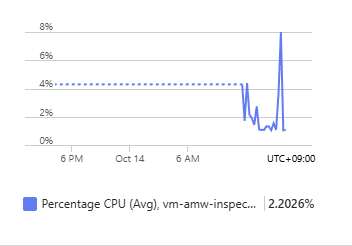

# VM + Docker — 서버를 관리하면서 같은 컨테이너 실행하기

[English](./README.md) | 한국어


## 1. 학습 목표·모듈 경계


- 대상: EC2·Linux·Docker 경험이 있는 엔지니어.
- 예상: 개념 읽기 20~30분, 선택 실습 90~120분 + VM·패키지 준비·역할 전파 대기. 준비·대기 시간은 강사와 별도로 계획한다.
- 목표: VM의 OS·네트워크·identity·Docker 프로세스를 직접 관리하면서 같은 HTTP 앱을 실행한다.
- 결과: VM의 Managed Identity로 같은 이미지 pull, localhost 앱 접근, 로그·재시작·정리 방법.
- **Docker는 VM에서 앱을 실행하는 방법이지 별도 Azure 컴퓨트 서비스가 아니다.**

| 선택 범위 | 최소 입력 | 건너뛸 자료 |
|---|---|---|
| 개념·코드 읽기 | 포함된 앱·Dockerfile·AWS Terraform 소스 | Azure 로그인·VM 생성·이미지 준비 전부 |
| 선택 Azure 실습 | 동일 앱 이미지·registry ID, 승인된 VM 설정·Azure 권한·SSH 키 쌍 | AKS·Container Apps·Functions·Terraform 배포·DB·Blob |
| 선택 private VM 실습 | 승인된 private VM/NAT·VM MI AcrPull·guest Run Command 권한·동일 digest | public IP·SSH 접속/tunnel·다른 컴퓨트/DB 실습 |

이미지가 없으면 [공통 이미지 준비](../../../shared/container-image/README-ko.md)의 **4.1~4.2만** 선택한다. VM은 자기 system-assigned identity를 사용하므로 Container Apps용 pull identity는 만들지 않는다. 이미 승인된 이미지·registry가 있으면 공통 준비를 건너뛴다.

이 실습은 **새 Azure VM에 앱을 재배포**한다. 기존 EC2의 OS·디스크·데이터를 복제하거나 Azure Migrate로 실제 서버를 이전한 결과가 아니다.


## 2. 서비스 소개와 AWS 비교


| 서비스·기능 | Microsoft Learn 소개 | 이 실습에서 볼 내용 |
|---|---|---|
| Azure Virtual Machines | [VM 개요](https://learn.microsoft.com/en-us/azure/virtual-machines/overview) | OS·프로세스·패치의 관리 책임 |
| Virtual Network | [VNet 개요](https://learn.microsoft.com/en-us/azure/virtual-network/virtual-networks-overview) | VM의 최소 네트워크 |
| Network Security Group | [NSG 개요](https://learn.microsoft.com/en-us/azure/virtual-network/network-security-groups-overview) | 승인된 출구 IP의 SSH만 허용 |
| Public IP | [Public IP 개요](https://learn.microsoft.com/en-us/azure/virtual-network/ip-services/public-ip-addresses) | SSH 접근과 명시적 outbound 경로 |
| Managed Identity | [Managed Identity 개요](https://learn.microsoft.com/en-us/entra/identity/managed-identities-azure-resources/overview) | VM identity의 registry 접근 |
| Azure Container Registry | [ACR 소개](https://learn.microsoft.com/en-us/azure/container-registry/container-registry-intro) | 동일한 digest 이미지 |
| Azure RBAC | [Azure RBAC 개요](https://learn.microsoft.com/en-us/azure/role-based-access-control/overview) | VM 관리와 이미지 pull 권한의 구분 |

| AWS에서 읽던 개념 | Azure에서 비교할 개념 | 같다고 가정하면 안 되는 부분 |
|---|---|---|
| EC2 + Docker | Azure VM + Docker | VM 크기·이미지·디스크·OS 지원이 다름 |
| VPC·subnet·SG | VNet·subnet·NSG | subnet의 AZ/리전 범위와 규칙·기본 동작이 다름 |
| Instance profile의 ECR 접근 | VM Managed Identity의 ACR 접근 | 인증·토큰·역할 scope가 다름 |
| user data | VM 준비·guest OS 명령 | 부팅 스크립트 자동 변환이 아니라 명령의 목적을 이해하는 것이 목표 |

선택 이유는 **OS와 Docker를 직접 제어하는 운영 모델 비교**다. 서버 운영을 줄이는 것이 우선이면 Container Apps, Kubernetes 모델을 유지하려면 AKS를 선택하고 이 모듈은 건너뛴다.


## 3. 사전 준비·비용·안전 경계


- 로컬 제어 명령: **PowerShell 7.4 이상 + Azure CLI + OpenSSH client**, 저장소 루트.
- VM 내부 명령: **Ubuntu 24.04 LTS x64의 Bash**, SSH 접속 후 실행. 로컬 WSL 터미널과 VM 터미널을 혼동하지 않는다.
- 강사는 `Microsoft.Compute`·`Microsoft.Network`·`Microsoft.ManagedIdentity` 등록, 승인된 리전·x64 VM SKU·quota·Ubuntu Gen2 이미지 URN을 준비한다.
- VM size는 `<approved-small-x64-vm-size>` 입력이다. 낮은 부하의 교육용 후보는 x64 Bsv2/Basv2, 일정 CPU 성능이 필요하면 Dsv5/Dasv5를 비교한다. **SKU·리전·가격·quota는 선택 환경의 지원·가용성·비용을 확인해야 하며 확정 추천이 아니다.**
- [B-family 소개](https://learn.microsoft.com/en-us/azure/virtual-machines/sizes/general-purpose/b-family)의 CPU credit·throttling을 이해한다. 현재 공통 이미지는 `linux/amd64`이므로 Arm Bpsv2 등의 VM을 임의 선택하지 않는다.
- 단일 VM만 준비한다. GPU·VMSS·HA·Load Balancer·Bastion·NAT Gateway·추가 data disk는 기본 실습에서 제외한다.
- 비용 대상은 **VM·Standard SSD OS disk·Standard public IP**다. 공유 registry·빌드 비용은 원 소유자의 별도 대상이다. [가격 계산기](https://azure.microsoft.com/en-us/pricing/calculator/)로 승인한다. VM deallocate만으로 디스크·IP·registry 요금이 없어지지 않는다.
- 새 실습 그룹·네트워크·VM의 생성/조회/삭제 권한이 필요하다. registry scope 역할의 생성·조회·삭제는 승인된 관리자가 수행한다.
- 승인된 SSH 공개키/개인키 쌍을 로컬에 준비한다. 개인키는 저장소·프롬프트·build context에 넣지 않고 이 모듈이 삭제하지 않는다.
- SSH 22는 **승인된 관리 단말의 public egress IPv4 `/32`만** 허용한다. 앱 8080은 VM localhost에만 bind하고 SSH tunnel로 접근한다. 인터넷에 8080을 열지 않는다.
- 처음 SSH 접속할 때 강사가 승인된 경로에서 확인한 host key fingerprint와 대조한다. `StrictHostKeyChecking=no`로 우회하지 않는다.
- 새 VM·그룹만 대상으로 한다. 다른 컴퓨트의 완료나 기존 운영 VM의 수정은 필요하지 않다.


## 4. 단계별 instruction


### 4.1 클라우드 없이 실행 요구 읽기


[공통 앱](../../../sample-app/README-ko.md), [Dockerfile](../../../sample-app/Dockerfile), [AWS 소스](../../migration/terraform/lab/aws/main.tf)를 읽는다.

```text
EC2 예제: Linux 준비 → Docker → image → HTTP 8080
Azure 실습: 새 Ubuntu VM → Docker → 같은 digest image → VM localhost 8080
클라이언트: 승인된 SSH → tunnel → VM localhost의 HTTP API
```

VM을 관리하는 사람, VM의 identity, 컨테이너 안의 non-root 앱 사용자는 서로 다른 권한 주체다. 컨테이너가 non-root라고 해서 Docker daemon 관리 권한도 낮은 권한인 것은 아니다.

분석만 선택했다면 여기서 완료한다. VM 생성·registry 접근은 필요 없다.


### 4.2 로컬 PowerShell — 대상·입력 준비


```powershell
$ErrorActionPreference = "Stop"
$PSNativeCommandUseErrorActionPreference = $true
$SubscriptionId = "<sandbox-subscription-id>"
$Location = "<approved-region>"
$VmSize = "<approved-small-x64-vm-size>"
$VmImageUrn = "<approved-ubuntu-24.04-x64-gen2-image-urn>"
$AdminCidr = "<approved-public-admin-ip>/32"
$SshPublicKeyFile = "<approved-public-key-file>"
$SshPrivateKeyFile = "<approved-private-key-file>"
$RegistryServer = "<approved-registry-login-server>"
$RegistryId = "<approved-registry-resource-id>"
$ContainerImage = "<approved-registry-login-server>/workshop/app@sha256:<digest>"
$ParsedId = [guid]::Empty
$ParsedAddress = [System.Net.IPAddress]::None
if (-not [guid]::TryParse($SubscriptionId, [ref]$ParsedId) -or
    [string]::IsNullOrWhiteSpace($Location) -or $Location -like "<*" -or
    [string]::IsNullOrWhiteSpace($VmSize) -or $VmSize -like "<*" -or
    [string]::IsNullOrWhiteSpace($VmImageUrn) -or $VmImageUrn -like "<*" -or
    $AdminCidr -notmatch "^\d{1,3}(\.\d{1,3}){3}/32$" -or
    -not [System.Net.IPAddress]::TryParse(($AdminCidr -split "/")[0], [ref]$ParsedAddress) -or
    -not (Test-Path -LiteralPath $SshPublicKeyFile -PathType Leaf) -or
    -not (Test-Path -LiteralPath $SshPrivateKeyFile -PathType Leaf) -or
    [string]::IsNullOrWhiteSpace($RegistryServer) -or $RegistryServer -like "<*" -or
    [string]::IsNullOrWhiteSpace($RegistryId) -or $RegistryId -like "<*" -or
    $ContainerImage -notmatch "^[a-z0-9.-]+/[a-z0-9._/-]+@sha256:[a-f0-9]{64}$") {
    throw "Set the approved VM, SSH and image inputs."
}
if (-not $RegistryId.StartsWith("/subscriptions/$SubscriptionId/", [System.StringComparison]::OrdinalIgnoreCase) -or
    -not $ContainerImage.StartsWith("$RegistryServer/", [System.StringComparison]::OrdinalIgnoreCase)) {
    throw "Use the selected registry and approved subscription."
}
$RegistryName = ($RegistryId -split "/")[-1]
$LabId = [guid]::NewGuid().ToString("N").Substring(0, 8)
$ResourceGroupName = "rg-amw-vm-$LabId"
$VmName = "vm-amw-$LabId"
$VnetName = "vnet-amw-$LabId"
$SubnetName = "snet-app"
$NsgName = "nsg-amw-$LabId"
$PublicIpName = "pip-amw-$LabId"
$NicName = "nic-amw-$LabId"
$AdminUser = "workshopadmin"
$LabDirectory = Join-Path (Join-Path $PWD "lab-output") "vm-$LabId"
$GrantFile = Join-Path $LabDirectory "registry-grant-id.txt"
az login
az account show --subscription $SubscriptionId --query "{name:name,id:id,tenantId:tenantId,state:state}" --output table
[pscustomobject]@{ Subscription = $SubscriptionId; Region = $Location; Group = $ResourceGroupName; VM = $VmName; Size = $VmSize; ImageUrn = $VmImageUrn; SshSource = $AdminCidr; AppImage = $ContainerImage } | Format-List
```

승인된 구독·테넌트·`Enabled` 상태, SSH 키 쌍, 이미지 architecture·Gen2/Trusted Launch 지원, VM size·quota·비용을 확인한다. 이 값은 통합 검증 때 실제 환경에 맞춰 확정한다. 이미지 URN의 재현 버전도 그때 기록한다.


### 4.3 로컬 PowerShell — 최소 네트워크와 VM 생성


아래 명령은 승인된 후 단계별로 수행한다. VNet 주소는 기존 환경에 연결하지 않는 교육용 예제다.

```powershell
$Exists = az group exists --name $ResourceGroupName --subscription $SubscriptionId --output tsv
if ($Exists -ne "false") { throw "Do not reuse an existing VM group." }
New-Item -ItemType Directory -Path $LabDirectory -ErrorAction Stop | Out-Null
az group create --name $ResourceGroupName --location $Location --subscription $SubscriptionId --tags Workshop=azure-migration-vm LabId=$LabId --output table
az network vnet create --name $VnetName --resource-group $ResourceGroupName --location $Location --address-prefixes 10.60.0.0/16 --subnet-name $SubnetName --subnet-prefixes 10.60.1.0/24 --subscription $SubscriptionId --output table
az network nsg create --name $NsgName --resource-group $ResourceGroupName --location $Location --subscription $SubscriptionId --output table
az network nsg rule create --name allow-admin-ssh --nsg-name $NsgName --resource-group $ResourceGroupName --priority 100 --direction Inbound --access Allow --protocol Tcp --source-address-prefixes $AdminCidr --source-port-ranges "*" --destination-address-prefixes "*" --destination-port-ranges 22 --subscription $SubscriptionId --output table
az network public-ip create --name $PublicIpName --resource-group $ResourceGroupName --location $Location --sku Standard --allocation-method Static --subscription $SubscriptionId --output table
az network nic create --name $NicName --resource-group $ResourceGroupName --location $Location --vnet-name $VnetName --subnet $SubnetName --network-security-group $NsgName --public-ip-address $PublicIpName --subscription $SubscriptionId --output table
```

**관찰할 결과:** 새 그룹의 VNet·subnet·NSG·NIC·public IP다. 8080 허용 규칙은 없으며 SSH source는 승인된 `/32`다. 연결 검증은 이후 SSH 단계에서 별도로 수행한다.

생성 대상·비용을 다시 확인하고 VM을 만든다.

```powershell
az vm create --name $VmName --resource-group $ResourceGroupName --location $Location --nics $NicName --image $VmImageUrn --size $VmSize --admin-username $AdminUser --authentication-type ssh --ssh-key-values $SshPublicKeyFile --assign-identity "[system]" --storage-sku StandardSSD_LRS --os-disk-size-gb 32 --security-type TrustedLaunch --enable-vtpm true --enable-secure-boot true --subscription $SubscriptionId --output table
$Vm = az vm show --name $VmName --resource-group $ResourceGroupName --subscription $SubscriptionId --output json | ConvertFrom-Json
$VmPrincipalId = $Vm.identity.principalId
$VmIp = az network public-ip show --name $PublicIpName --resource-group $ResourceGroupName --subscription $SubscriptionId --query ipAddress --output tsv
if ($Vm.provisioningState -ne "Succeeded" -or -not $VmPrincipalId -or [string]::IsNullOrWhiteSpace($VmIp)) {
    throw "VM provisioning, managed identity or public IP is incomplete."
}
[pscustomobject]@{ VM = $VmName; Address = $VmIp; Principal = $VmPrincipalId; RegistryScope = $RegistryId } | Format-List
```

**관찰할 결과:** VM 생성은 성공했지만 아직 Docker나 앱은 없다. public IP는 SSH와 명시적 outbound 경로용이다. VM 안의 앱에 public HTTP 포트를 열었다는 뜻이 아니다.


### 4.4 승인된 관리자 — VM identity에 pull 권한


관리자는 **새 VM principal·선택 registry·구독**을 대조하고 실행한다. 다른 터미널이면 확인한 변수를 설정한다.

```powershell
$ErrorActionPreference = "Stop"
$PSNativeCommandUseErrorActionPreference = $true
$RegistryGrantId = az role assignment create --assignee-object-id $VmPrincipalId --assignee-principal-type ServicePrincipal --role AcrPull --scope $RegistryId --subscription $SubscriptionId --query id --output tsv
if ([string]::IsNullOrWhiteSpace($RegistryGrantId)) { throw "The VM pull role assignment ID was not returned." }
$RegistryGrantId
```

관리자는 생성 직후 정확한 ID를 안전하게 보관·전달한다. 참가자 터미널에서 해당 ID를 설정하고 기록한다.

```powershell
if ([string]::IsNullOrWhiteSpace($RegistryGrantId) -or
    -not $RegistryGrantId.StartsWith("$RegistryId/providers/Microsoft.Authorization/roleAssignments/", [System.StringComparison]::OrdinalIgnoreCase)) {
    throw "Record only the registry grant created for this VM."
}
Set-Content -LiteralPath $GrantFile -Value $RegistryGrantId -Encoding utf8NoBOM
```

**관찰할 결과:** VM 리소스 관리 권한과 registry 데이터 pull 권한이 별도다. 역할 전파가 완료되기 전에는 인증·pull이 실패할 수 있다. Owner나 registry admin 암호를 기본 해결책으로 사용하지 않는다.


### 4.5 로컬 PowerShell → VM Bash — 도구 준비


SSH host key를 승인된 fingerprint와 대조하고 VM에 접속한다.

```powershell
ssh -i $SshPrivateKeyFile "$AdminUser@$VmIp"
```

다음은 **접속한 Ubuntu VM의 Bash**에서 실행한다. 로컬 WSL에 Docker를 설치하는 명령이 아니다.

```bash
set -euo pipefail
sudo apt-get update
sudo apt-get install --yes docker.io curl ca-certificates python3
sudo systemctl enable --now docker
sudo docker version
```

Azure CLI는 [Linux 설치 안내](https://learn.microsoft.com/en-us/cli/azure/install-azure-cli-linux)의 Ubuntu용 절차와 조직의 승인된 패키지 소스를 따른다. 공식 설치 script를 선택하면 먼저 파일로 받는다.

```bash
curl --fail --silent --show-error --location \
  https://aka.ms/InstallAzureCLIDeb --output install-azure-cli.sh
```

VM에서 파일과 공식 안내를 확인하고 승인한 경우에만 설치한다. script에 자격증명이나 내부 feed를 넣지 않는다.

```bash
sudo bash install-azure-cli.sh
az version
rm -- install-azure-cli.sh
```

**이유:** OS·패키지·daemon을 직접 준비하는 것이 VM 트랙의 관리 책임이다. Docker group은 root에 준하는 권한이므로 사용자를 자동 추가하지 않고 교육용 명령에서는 명시적으로 `sudo docker`를 사용한다.


### 4.6 VM Bash — Managed Identity로 이미지 pull


확인한 값만 VM 터미널에 설정한다. **access token을 출력·파일 기록·프롬프트 입력하지 않고 `set -x`도 사용하지 않는다.** 다음 subshell은 pull 종료/실패 시 해당 registry의 Docker 로그인 정보를 제거한다.

```bash
(
  set -euo pipefail
  SUBSCRIPTION_ID="<sandbox-subscription-id>"
  REGISTRY_NAME="<approved-registry-name>"
  REGISTRY_SERVER="<approved-registry-login-server>"
  CONTAINER_IMAGE="<approved-registry-login-server>/workshop/app@sha256:<digest>"
  if [[ "$SUBSCRIPTION_ID" == "<"* || "$REGISTRY_NAME" == "<"* ||
        "$REGISTRY_SERVER" == "<"* || "$CONTAINER_IMAGE" == "<"* ]]; then
    printf 'Replace the approved image and registry inputs.\n' >&2
    exit 1
  fi
  az login --identity --output none
  trap 'unset AUTH_JSON ACR_TOKEN; sudo docker logout "$REGISTRY_SERVER"' EXIT
  AUTH_JSON="$(az acr login --name "$REGISTRY_NAME" --subscription "$SUBSCRIPTION_ID" \
    --expose-token --output json)"
  TOKEN_SERVER="$(printf '%s' "$AUTH_JSON" | python3 -c 'import json,sys; print(json.load(sys.stdin)["loginServer"])')"
  if [[ "$TOKEN_SERVER" != "$REGISTRY_SERVER" ||
        "$CONTAINER_IMAGE" != "$REGISTRY_SERVER/"* ]]; then
    printf 'The token response and selected image do not match the approved registry.\n' >&2
    exit 1
  fi
  ACR_TOKEN="$(printf '%s' "$AUTH_JSON" | python3 -c 'import json,sys; print(json.load(sys.stdin)["accessToken"])')"
  unset AUTH_JSON
  if [[ -z "$ACR_TOKEN" ]]; then
    printf 'No registry access token was returned.\n' >&2
    exit 1
  fi
  printf '%s' "$ACR_TOKEN" | sudo docker login "$REGISTRY_SERVER" \
    --username 00000000-0000-0000-0000-000000000000 --password-stdin
  unset ACR_TOKEN
  sudo docker pull "$CONTAINER_IMAGE"
)
```

**관찰할 결과:** token 응답의 registry와 입력 image가 일치한 뒤 같은 digest를 pull하고 로그인 정보를 제거한다. Python은 로컬 JSON 필드만 읽으며 응답/token은 파일이나 콘솔에 출력하지 않는다. 로컬 참가자 로그인이 아니라 VM identity를 사용한다. private Run Command와 SSH/CLI 흐름은 별도 선택 경로이며 실행 identity·출력·로그인 정보 정리를 각각 확인한다.


### 4.7 VM Bash — localhost에만 앱 실행


위 subshell의 변수는 밖으로 나오지 않는다. 같은 확인한 image 값을 이 단계에 명시한다.

```bash
set -euo pipefail
CONTAINER_IMAGE="<approved-registry-login-server>/workshop/app@sha256:<digest>"
if [[ "$CONTAINER_IMAGE" == "<"* || -z "$CONTAINER_IMAGE" ]]; then
  printf 'Set the approved digest image.\n' >&2
  exit 1
fi
sudo docker info >/dev/null
EXISTING="$(sudo docker ps --all --filter 'name=^/workshop$' --format '{{.Names}}')"
if [[ -n "$EXISTING" ]]; then
  printf 'The workshop container already exists. Inspect it before changing anything.\n' >&2
  exit 1
fi
sudo docker run --detach --name workshop --restart unless-stopped \
  --publish 127.0.0.1:8080:8080 --cpus 0.25 --memory 256m \
  --read-only --cap-drop ALL --security-opt no-new-privileges \
  "$CONTAINER_IMAGE"
sudo docker ps --filter 'name=^/workshop$'
sudo docker inspect --format '{{.Config.User}} {{.State.Health.Status}}' workshop
sudo docker logs --tail 20 workshop
```

**관찰할 결과:** 이미지의 non-root 사용자 `10001:10001`, 이후 health `healthy`, 앱 로그다. `Running`만으로 HTTP 검증을 완료하지 않는다. 컨테이너 상태는 다음 단계의 실제 앱 응답과 함께 읽는다.


### 4.8 로컬 PowerShell — SSH tunnel과 앱 계약


VM Bash 세션은 유지하거나 `exit`로 종료한다. **별도의 로컬 PowerShell 터미널**에 확인한 접속 값만 설정하고 tunnel을 유지한다.

```powershell
$ErrorActionPreference = "Stop"
$PSNativeCommandUseErrorActionPreference = $true
$SshPrivateKeyFile = "<approved-private-key-file>"
$AdminUser = "workshopadmin"
$VmIp = "<this-lab-vm-public-ip>"
ssh -i $SshPrivateKeyFile -N -L "127.0.0.1:8080:127.0.0.1:8080" -o ExitOnForwardFailure=yes -o ServerAliveInterval=30 "$AdminUser@$VmIp"
```

원래 로컬 PowerShell 터미널에서 동일 앱 계약을 확인한다. 포트가 충돌하면 이 실습의 기존 로컬 서버만 종료하거나 tunnel과 요청의 로컬 포트를 함께 바꾼다.

```powershell
$BaseUrl = "http://127.0.0.1:8080"
$Health = Invoke-RestMethod "$BaseUrl/health"
$Before = @(Invoke-RestMethod "$BaseUrl/items")
if ($Health.status -ne "ok" -or $Before.Count -ne 2) { throw "Expected a healthy fresh app with two seed items." }
$Created = Invoke-RestMethod "$BaseUrl/items" -Method Post -ContentType "application/json" -Body '{"name":"vm-workshop-item"}' -StatusCodeVariable PostStatus
$After = @(Invoke-RestMethod "$BaseUrl/items")
if ($PostStatus -ne 201 -or $After.Count -ne 3 -or
    -not ($After | Where-Object { $_.id -eq $Created.id -and $_.name -eq "vm-workshop-item" })) {
    throw "VM write/read verification failed."
}
$Invalid = Invoke-WebRequest "$BaseUrl/items" -Method Post -ContentType "application/json" -Body '{"name":""}' -SkipHttpErrorCheck
if ($Invalid.StatusCode -ne 422 -or @(Invoke-RestMethod "$BaseUrl/items").Count -ne 3) {
    throw "Invalid input changed the data or did not return 422."
}
```

**검증 때의 성공 기준:** 헬스 ok, 2→3개, POST 201·read-back, 잘못된 입력 422·데이터 불변. VM Bash에서 `sudo docker restart workshop`을 선택적으로 실행하면 메모리 데이터는 2개로 초기화된다. 이 재시작은 무중단이나 데이터 보존 테스트가 아니다.


### 4.9 선택 private Run Command 경로


기존 public SSH 경로와 **하나를 선택**한다. 이미 승인된 private network/client 입력이 있으면 public IP/SSH를 새로 열지 않는다. 이 새 VM은 기존 sandbox VNet의 전용 subnet·기존 NAT outbound·inbound deny와 자기 MI를 사용했고, registry scope AcrPull만 부여했다. 기존 PostgreSQL 검사/source VM을 Docker host로 바꾼 것이 아니다.

관리자는 [공식 VM Run Command](https://learn.microsoft.com/en-us/azure/virtual-machines/linux/run-command)를 통해 같은 VM Bash 단계와 localhost HTTP 검증을 수행할 수 있다. 기본 실행 셸이 `/bin/sh`일 수 있으므로 Bash 전용 `pipefail`을 그대로 실행하지 않는다. 승인된 스크립트에는 Bash 환경을 명시하고 실제 guest stdout/오류·exit/pass 기준을 읽는다. ARM의 `Enable succeeded`만으로 guest 성공을 판단하지 않는다.


승인된 기존 private client VM은 owner가 허용하면 Docker 실습 host로 재사용할 수 있다. 이미지·identity·network를 그대로 사용하며 다른 consumer를 바꾸거나 두 번째 VM을 만들지 않는다. 제공 VM은 consumer 정리에서 보존한다.

Portal의 **VM Overview → Monitoring → Platform metrics**에서 CPU metric·aggregation·기간을 읽는다. 예시 chart는 **Last 24 hours의 Average CPU 약2.2026%**다. VM host CPU와 앱 동작을 구분하고 위 localhost HTTP·Docker 검사로 앱을 확인한다. 이 조회를 위해 Performance Diagnostics·VM Insights·Log Analytics를 새로 설치/생성할 필요는 없다.



*Running과 CPU chart는 host 관찰이다. container health/log/HTTP는 따로 읽으며 이 값은 선택 기간의 예시이지 성능 보장값이 아니다.*

## 5. 대표 실패와 확인할 항목


| 실패 | 확인·해결 |
|---|---|
| image/size/Trusted Launch 오류 | 승인된 Gen2 x64 이미지·SKU·리전·quota·지원 조건을 확인. 임의 리전/size 변경 금지 |
| SSH timeout | public IP·NSG association·승인된 실제 egress `/32` 확인. SSH를 전체 인터넷에 열지 않음 |
| SSH 인증·host key 오류 | 승인된 키 쌍·사용자·fingerprint를 확인. 개인키를 공유하거나 host key 검사를 끄지 않음 |
| 패키지 설치 실패 | Ubuntu·승인된 공급망·outbound·proxy 확인. TLS/서명 검증을 끄지 않음 |
| image pull 실패 | VM identity·registry RBAC mode·AcrPull·전파·image digest 확인. admin 암호로 우회하지 않음 |
| Docker 권한/daemon 오류 | `sudo` 사용·service 상태 확인. 모든 사용자에게 Docker/root 권한을 주지 않음 |
| 앱/health 실패 | 로그·이미지 architecture·CPU/메모리 제한·listen 포트 확인 |
| 데이터 초기화 | Docker/VM 재시작과 메모리 저장 한계를 연결해 설명 |

실습에서는 기대 출력과 실제 출력·오류를 대조한다.


## 6. 정리 — VM 자산과 자신이 만든 grant만


분석만 했으면 Azure 삭제 대상이 없다. 중간 실패라면 생성된 단계만 정리한다. SSH tunnel은 `Ctrl+C`로 종료한다.


### 6.1 VM Bash — 앱 종료


```bash
sudo docker inspect --format '{{.Name}} {{.Config.Image}}' workshop
```

이 VM의 실습 컨테이너인지 확인하고 삭제를 승인한 뒤 실행한다.

```bash
sudo docker stop workshop
sudo docker rm workshop
exit
```

Docker 전체 prune·다른 컨테이너 삭제는 하지 않는다. VM disk는 아래 그룹 삭제로 정리하며 이미지 cache를 일괄 지우지 않는다.


### 6.2 관리자 — 이 VM에 추가한 registry grant 회수


로컬 실습 기록의 정확한 ID·principal·scope를 대조한다. 사용자 지정 기존 역할은 삭제하지 않는다.

```powershell
$RegistryGrantId = (Get-Content -Raw -LiteralPath $GrantFile).Trim()
if (-not $RegistryGrantId.StartsWith("$RegistryId/providers/Microsoft.Authorization/roleAssignments/", [System.StringComparison]::OrdinalIgnoreCase)) {
    throw "Unexpected registry grant scope."
}
az role assignment list --scope $RegistryId --subscription $SubscriptionId --query "[?id=='$RegistryGrantId'].{id:id,principal:principalId,scope:scope}" --output table
```

해당 VM principal의 이 grant임을 확인하고 승인한 경우에만 회수한다.

```powershell
az role assignment delete --ids $RegistryGrantId --subscription $SubscriptionId
```


### 6.3 로컬 PowerShell — VM 전용 그룹 삭제


```powershell
az account show --subscription $SubscriptionId --query "{name:name,id:id}" --output table
$Group = az group show --name $ResourceGroupName --subscription $SubscriptionId --output json | ConvertFrom-Json
az resource list --resource-group $ResourceGroupName --subscription $SubscriptionId --query "[].{name:name,type:type,id:id}" --output table
if ($ResourceGroupName -ne "rg-amw-vm-$LabId" -or $Group.tags.Workshop -ne "azure-migration-vm" -or $Group.tags.LabId -ne $LabId) {
    throw "The group is not this VM lab."
}
```

목록이 실습 VM·OS disk·NIC·네트워크·public IP뿐인지 확인하고 승인한 뒤 삭제한다. VM만 지우고 disk/IP가 남는 상황과 그룹 전체 정리를 구분한다.

```powershell
az group delete --name $ResourceGroupName --subscription $SubscriptionId
$ExistsAfter = az group exists --name $ResourceGroupName --subscription $SubscriptionId --output tsv
if ($ExistsAfter -ne "false") { throw "VM group cleanup is not verified." }
Remove-Item -LiteralPath $GrantFile
Remove-Item -LiteralPath $LabDirectory
```

로컬에서는 이 grant 기록과 빈 실습 폴더만 지운다. SSH 입력 키·전체 `lab-output`·다른 모듈 파일은 삭제하지 않는다. 공유 registry는 **마지막 소비자가 끝난 뒤** [공통 준비의 정리](../../../shared/container-image/README-ko.md#6-정리--마지막-소비자가-끝난-다음)를 따르며 외부 기존 입력이면 삭제하지 않는다.


## 7. 실제 이전에서 추가로 고려할 사항


- 기존 OS·서비스·디스크를 유지할지, 새 VM에서 앱만 재배포할지 구분.
- OS 지원·패치·hardening·백업·복구·원격 접근과 image 공급망.
- VM 크기·burstable CPU·디스크 성능·확장·HA·영구 로그.
- 외부 DB·스토리지·비밀, 네트워크 경계, 쓰기 일관성·컷오버·롤백.
- 이 실습은 실제 EC2 서버/데이터 이전이나 production 운영 설계의 완성이 아니다.


## 8. 출처
