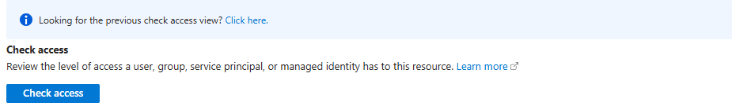
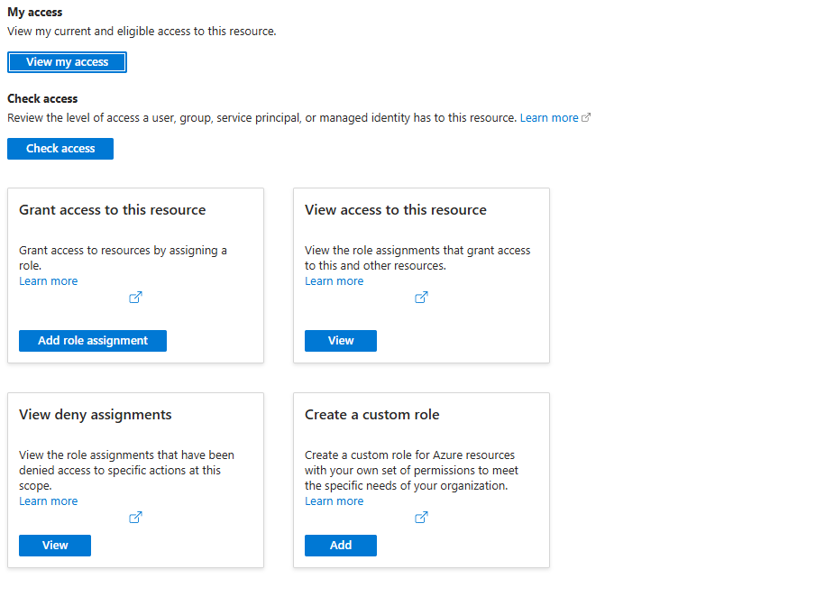

# Identity — who can access what?

English | [한국어](./README-ko.md)

Learn how Microsoft Entra ID authentication and Azure RBAC authorization differ. This read-only module needs no application, compute deployment or data migration.

## 1. Learning objectives and module boundaries

For engineers familiar with AWS IAM; allow about 50 minutes as a planning estimate. Inputs are an approved Azure user identity and subscription where role definitions can be read. The outcome is an explanation of principal, role and scope, role definitions versus assignments, and management versus data permissions. Do not create identities or role assignments here.

### When to choose this module

Choose this module for identity, RBAC scope and data-permission concepts. Skip the shared app, compute, Terraform and database labs. If you already understand these concepts, proceed directly to the minimum identity inputs of your chosen module.

## 2. Service introductions and selection

Open the Microsoft Learn introductions below before choosing a deployment or migration tool. Compare responsibilities, identity, network boundaries and lifecycle rather than treating AWS and Azure product names as one-to-one equivalents. A service resource, a running job and a verified application or dataset are separate outcomes.

**Resources for this step**

- [What is entra](https://learn.microsoft.com/en-us/entra/fundamentals/what-is-entra)
- [Overview](https://learn.microsoft.com/en-us/azure/role-based-access-control/overview)
- [Overview](https://learn.microsoft.com/en-us/azure/azure-resource-manager/management/overview)
- [Overview](https://learn.microsoft.com/en-us/entra/identity/managed-identities-azure-resources/overview)
- [Storage blobs introduction](https://learn.microsoft.com/en-us/azure/storage/blobs/storage-blobs-introduction)

## 3. Prerequisites, permissions and cost

Use local PowerShell 7.4 or later and a supported Azure CLI. Permission to read the approved scope is sufficient; subscription Owner is not a prerequisite. No paid resource, region or compute quota is required. Follow tenant MFA and Conditional Access policies. Use only an approved sandbox, synthetic data and the selected module's minimum inputs. Do not place credentials, account identifiers, real customer inventory or sensitive output in Git, prompts or shared screenshots. Confirm tenant, subscription, region, quota, cost and the resource owner; do not change the participant's default subscription or broaden access to make an error disappear.

**Resources for this step**

- [..](../../../Readme.md)

## 4. Step-by-step lab

Choose only the mode that matches your objective and available inputs. Read the full step, its execution environment and expected observation before running its commands. Use approved synthetic sandbox inputs. Obtain approval for resource creation, role assignments, writes and destructive actions separately.

### 4.1. Sign in and confirm the subscription boundary

Run in local PowerShell. Replace the subscription placeholder with the approved sandbox ID and confirm the directory and Enabled state. Sign-in authenticates a user; it does not grant resource or Blob data access. Stop if the subscription or tenant differs from the agreed scope.

```powershell
$ErrorActionPreference = "Stop"
$PSNativeCommandUseErrorActionPreference = $true
az login
$SubscriptionId = "<sandbox-subscription-id>"
$ParsedSubscriptionId = [guid]::Empty
if (-not [guid]::TryParse($SubscriptionId, [ref]$ParsedSubscriptionId)) {
    throw "Replace SubscriptionId with the approved sandbox subscription ID."
}
az account show --subscription $SubscriptionId --query "{name:name,id:id,tenantId:tenantId,state:state}" --output table
```

### 4.2. Read management permissions in role definitions

Compare Reader and Contributor Actions, NotActions and DataActions. Reader can read management metadata; Contributor can manage many resources but excludes some actions. These outputs describe role definitions, not roles assigned to you. Do not infer data permissions from a resource-management role name.

```powershell
az role definition list --name "Reader" --subscription $SubscriptionId --query "[0].{role:roleName,permissions:permissions}" --output json
az role definition list --name "Contributor" --subscription $SubscriptionId --query "[0].{role:roleName,permissions:permissions}" --output json
```

### 4.3. Compare Blob data roles

Read Storage Blob Data Reader and Contributor, especially DataActions for read, write and delete. Data roles can also contain management Actions. Creating a storage account is a management operation; reading a Blob is a data operation. Use Entra login authorization in the data module rather than an account-key workaround. If Shared Key is allowed elsewhere, key-list permissions require a separate security review.

```powershell
az role definition list --name "Storage Blob Data Reader" --subscription $SubscriptionId --query "[0].{role:roleName,permissions:permissions}" --output json
az role definition list --name "Storage Blob Data Contributor" --subscription $SubscriptionId --query "[0].{role:roleName,permissions:permissions}" --output json
```

### 4.4. Read the scope of your access in the Portal

In a browser, open Subscriptions → the approved subscription → Access control (IAM) → View my access. Inspect direct, group and inherited access without adding or deleting roles. In a newer Check access view, use the link to the previous view if necessary. If subscription-wide viewing is unavailable, ask an administrator to show the approved resource-group scope. Ordinary RBAC allow assignments combine: a lower-scope Reader does not negate an inherited Contributor. Directory roles are distinct from Azure resource roles.



*Portal illustration: observe the selected service and fields. Visible defaults are not approved deployment inputs; confirm the current interface and your own scope.*



*Portal illustration: observe the selected service and fields. Visible defaults are not approved deployment inputs; confirm the current interface and your own scope.*

### 4.5. Understand where Managed Identity is attached

This is a concept exercise, not an identity deployment. System-assigned identities share the attached resource's lifecycle; user-assigned identities are independent resources that supported services can reuse. Attaching an identity and granting it data permissions are separate operations. Local az login uses the participant's identity, not the future application's Managed Identity.

```text
Local participant → az login → participant Entra identity → permitted data operation
Azure app → Managed Identity → app identity RBAC → permitted data operation
```

## 5. Verification and common failures

Explain authentication versus authorization, definition versus assignment, inherited scope and management versus data access. A null role definition is not success: check its name, cloud and readable scope. If sign-in or Graph user lookup fails, work with the administrator instead of bypassing MFA or granting Owner.

## 6. Cleanup and ownership

This module creates no Azure resources or assignments. Do not delete resources owned by other modules. On a shared PC, run az logout when finished; this clears local login state, not Azure roles or resources.

## 7. Additional considerations for a real migration

Review tenant boundaries, human and application identities, guest/group membership, service Managed Identity support, minimum data scopes and role propagation. Plan secret rotation, audit evidence and an operational handoff; this module does not complete a regulatory or security design.

## 8. Sources and reuse

The workshop instructions and synthetic inputs were written for learning. Consult the official introductions and procedures linked here for the current support matrix, versions and regional availability. Documentation and illustrative screenshots are not a compatibility guarantee for a different source, target or topology. Keep third-party dependency licenses and notices intact.
