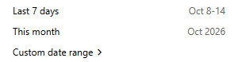
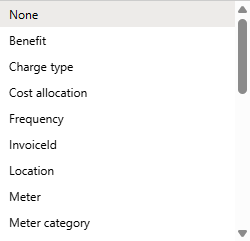
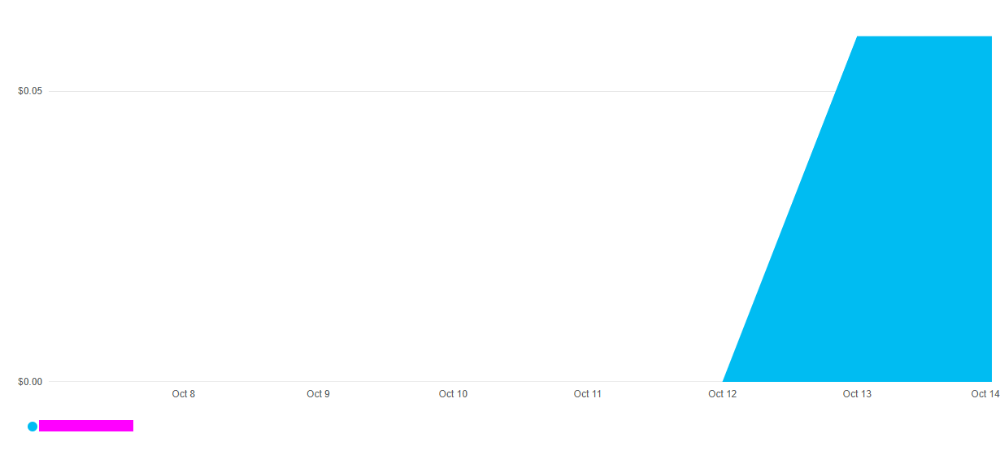
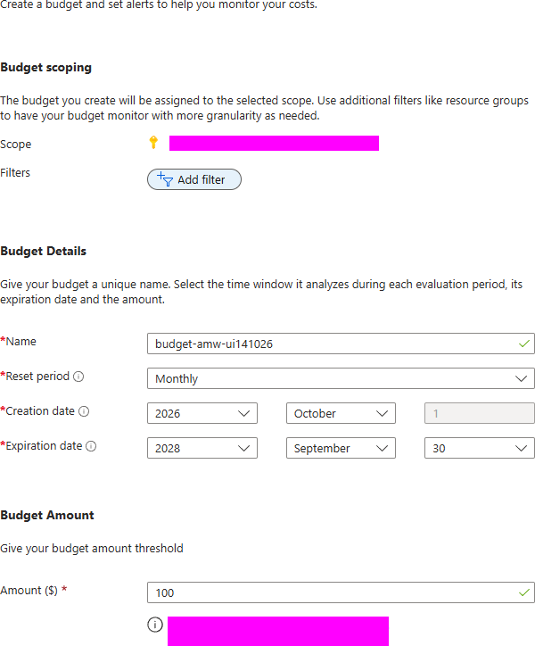
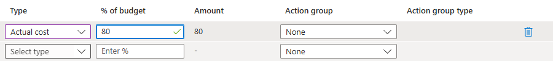

# Observability and cost — interpret evidence in the Portal

English | [한국어](./README-ko.md)

Separate management success, application behavior, logs/metrics and reported cost. Use a resource you already selected or synthetic observation cards; do not deploy another compute track just to observe it.

## 1. Learning objectives and module boundaries

For CloudWatch/CloudTrail/Cost Explorer users. Allow concept/cards 20 minutes, optional Portal observation 30–40 minutes and an optional budget 15 minutes, plus preparation. Inputs are only the cards, an approved small resource/read scope, or a separately approved budget scope/amount/recipient. Outputs are interpreted evidence, not a new logging or shutdown platform.

## 2. Service introductions and selection

Open the Microsoft Learn introductions below before choosing a deployment or migration tool. Compare responsibilities, identity, network boundaries and lifecycle rather than treating AWS and Azure product names as one-to-one equivalents. A service resource, a running job and a verified application or dataset are separate outcomes.

**Resources for this step**

- [Overview](https://learn.microsoft.com/en-us/azure/azure-monitor/overview)
- [Activity log](https://learn.microsoft.com/en-us/azure/azure-monitor/platform/activity-log)
- [Overview cost management](https://learn.microsoft.com/en-us/azure/cost-management-billing/costs/overview-cost-management)
- [Tutorial acm create budgets](https://learn.microsoft.com/en-us/azure/cost-management-billing/costs/tutorial-acm-create-budgets)
- [Log analytics overview](https://learn.microsoft.com/en-us/azure/azure-monitor/logs/log-analytics-overview)
- [App insights overview](https://learn.microsoft.com/en-us/azure/azure-monitor/app/app-insights-overview)

## 3. Prerequisites, permissions and cost

Use a browser and the approved directory/subscription/resource/time range. Resource Reader may not grant log-stream, guest OS, Kubernetes or billing access; obtain only the required scopes. Existing resource costs continue. Do not automatically enable Application Insights SDK, Log Analytics, Container Insights, Prometheus or Grafana. A budget is an alert, not a spending cap or guaranteed shutdown. Protect log payloads, callers, account data and screenshots. Use only an approved sandbox, synthetic data and the selected module's minimum inputs. Do not place credentials, account identifiers, real customer inventory or sensitive output in Git, prompts or shared screenshots. Confirm tenant, subscription, region, quota, cost and the resource owner; do not change the participant's default subscription or broaden access to make an error disappear.

## 4. Step-by-step lab

Choose only the mode that matches your objective and available inputs. Read the full step, its execution environment and expected observation before running its commands. Use approved synthetic sandbox inputs. Obtain approval for resource creation, role assignments, writes and destructive actions separately.

### 4.1. Read synthetic observation cards without deploying

Card A: provisioning Succeeded and app health/write/read-back succeed, but Cost analysis has No data. App evidence is useful; cost is not settled or free. Card B: Activity Log creation succeeded, but system logs show image-pull failure and app access fails. Management success is not runtime success. Card C: VM deallocated, disks/public IP/registry remain. Compute stop is not complete cleanup. Label each evidence type; these cards are not actual Azure output.

### 4.2. Align target and observation time in the Portal

Check directory/subscription, open the chosen resource Overview and read name/group/region/current state. Match the actual exercise period and distinguish UTC/local time. Record resource owner and observation unit (VM, Pod, revision, replica). Running/Succeeded alone is not app or migration acceptance.

### 4.3. Read management events in Activity Log

Filter only the approved resource/group, period and relevant operation. Inspect creation/change/deletion status and error details, masking caller identifiers in shared evidence. Activity Log records control-plane actions, not every HTTP request or all Entra sign-ins. Missing /items events there do not prove that no requests occurred.

### 4.4. Distinguish metrics from app and platform logs

In Monitoring → Metrics select namespace/metric/period/aggregation and interpret units. Average, maximum and sum differ; host CPU is not guest memory or HTTP latency. For Container Apps choose console/system log stream and the correct revision/replica/container. For VM/AKS distinguish host metrics from explicitly accessed Docker/Pod logs. Streaming is not durable history. Storage metrics do not replace content verification. No data can mean scope/time/permission/collection gaps, not automatic health.

**Resources for this step**

- [Log streaming](https://learn.microsoft.com/en-us/azure/container-apps/log-streaming)

### 4.5. Read the actual scope of Cost analysis

Select approved scope, dates, currency, actual cost/forecast and grouping/filters. Include owned managed AKS node groups and shared input groups when assessing the whole selected combination; filtering only the app group can omit costs. Empty or delayed results are unresolved billing evidence. The calculator is an estimate and a forecast is not a final invoice. Deletion does not erase accrued usage or other retained resource charges.

1. Open the date selector and compare the available presets with the observation period. For a short retrospective exercise, **Last 7 days** can be appropriate; it does not mean lifetime cost.
2. Open **Group by** and choose **Resource group** when comparing ownership boundaries. The illustrated dropdown shows only part of the available dimensions.
3. Apply a resource-group filter containing **only the approved workshop group**. Check the selected scope, period, currency and filter before interpreting the chart; do not include unrelated groups.
4. Read reported actual cost separately from forecast. A single cost point or insufficient history may leave forecast unavailable; do not replace missing forecast with zero.

*The chart's $0.06 is historical accrued cost for one previous workshop Container Apps group over Last 7 days, visible after that group was deleted. It is not a final invoice, a current total for all workshop resources or evidence of ongoing resource existence. The legend is masked.*

### 4.6. Optional: create only a budget alert

Approve exact scope, amount, currency, period, recipient and rights. Create a uniquely named budget-amw-observe-<lab-id>, inspect actual/forecast thresholds such as actual cost 80%, and confirm inputs before submission. Do not change an operational budget or connect automatic shutdown/action groups. Do not generate paid usage to trigger an alert. Configuration visibility and observed alert delivery are separate outcomes.

For a form-only walkthrough, inspect **Create budget** and alert conditions without submitting. The example name `budget-amw-ui141026`, **100 USD** and **Monthly** reset illustrate inputs, not a prescribed budget. The visible **two-year end-date default is not recommended** for a short workshop: choose an explicitly approved end date and cleanup owner rather than retaining that default.

On the alert page, distinguish **Actual cost** from Forecast. With a 100 USD example budget, **80% equals 80 USD**; it is an alert threshold, not a spending limit. **Action group: None** means this example connects no action group or automatic stop. An approved recipient and final review are necessary before a separately approved creation; a form preview alone does not demonstrate alert delivery.

*These images show a form preview, not a created budget. No email recipient was entered or final Create submitted, and existing budgets were not changed. The example does not establish a saved configuration or delivered alert.*

## 5. Verification and common failures

Explain scope/time/owner, distinguish Activity Log from app logs and billing, and interpret the selected app/data response alongside its logs. Check collection and permissions before treating absent data as success. Confirm managed/shared cost scopes and reporting delay; a budget is not an enforced cap.

## 6. Cleanup and ownership

Reading/cards create nothing. Do not delete the observed VM/cluster/app/registry from this module: its original owner follows its cleanup procedure. If you created a budget, inspect and approve removal of only that exact scope/name/configuration. Preserve preexisting budgets/workspaces/action groups. Record post-cleanup billing observation time and reporting delay.

## 7. Additional considerations for a real migration

Compare pre/post-migration latency, error rates and data integrity; identify monitoring gaps. Read native migration status/logs separately from target application evidence. Plan persistent collection/retention/sampling/alerts, privacy and cost, recovery/HA and operational handoff.

## 8. Sources and reuse

The workshop instructions and synthetic inputs were written for learning. Consult the official introductions and procedures linked here for the current support matrix, versions and regional availability. Documentation and illustrative screenshots are not a compatibility guarantee for a different source, target or topology. Keep third-party dependency licenses and notices intact.
